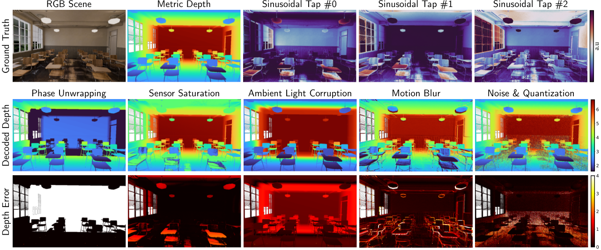
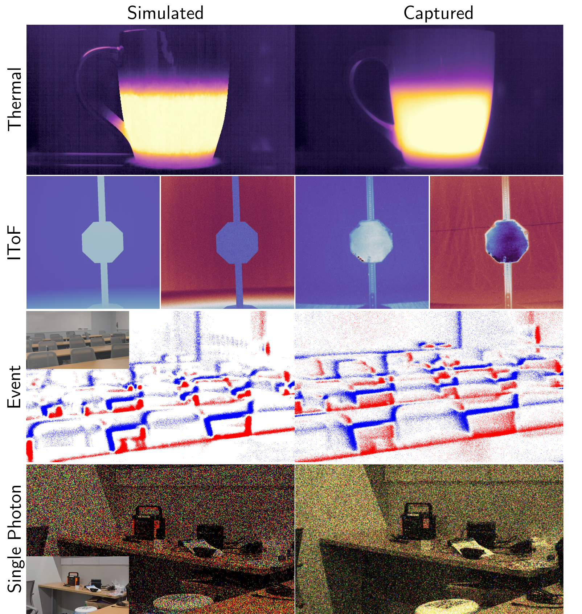

가상 교실에서 카메라를 움직이면 책상과 뒤쪽 벽까지의 거리를 장면의 좌표로 계산할 수 있어요. 실제 깊이 센서는 돌아온 빛으로 거리를 추정하기 때문에 같은 교실에서도 벽을 책상보다 가깝게 읽거나, 움직이는 책상 가장자리를 두 겹으로 그릴 수 있어요.

## 장면의 거리에서 센서의 기록까지

<abbr title="가상 장면의 빛과 움직임을 실제 장치가 기록할 법한 신호로 바꾸는 로봇 센서 시뮬레이터">VisionSIM</abbr>은 가상 세계를 계산하는 단계와 센서가 기록을 만드는 단계를 나눠요. 앞 단계에서 카메라 위치와 물체의 깊이, 표면에 빛이 닿고 반사되는 모습을 계산해요. 뒤 단계에서는 그 자료를 센서에 맞게 읽어요. 깊이 지도에는 픽셀마다 장면 속 실제 거리가 들어가고, 센서 기록에는 그 거리를 알아내는 데 쓰이는 빛의 세기나 도착 시각이 들어가요. 마지막으로 거리 계산기가 기록을 해석하면 비로소 측정 깊이가 나와요.

같은 표지판을 바라보는 장면을 한 번 준비하면 센서의 노출 시간이나 빛을 내보내는 주기를 바꿔 가며 기록을 다시 만들 수 있어요. 매 설정마다 표지판 위치를 새로 고르지 않으니, 깊이 지도가 달라졌을 때 설정을 바꾼 영향부터 살펴볼 수 있어요. 반대로 같은 센서 설정을 고정하고 표지판을 뒤로 옮기면 거리의 영향을 볼 수 있어요. 이때 장면을 다시 계산한 횟수와 센서 기록을 생성한 횟수는 서로 다른 비용이에요. 한 번 만든 장면을 재사용해도 후보마다 기록을 합성하고 거리를 복원하는 계산은 남아요.

센서별로 빛을 읽는 속도도 달라요. <abbr title="픽셀의 밝기가 일정량 이상 바뀔 때 그 위치와 시각을 기록하는 카메라">이벤트 카메라</abbr>를 모사하려면 프레임 사이에서 빛이 바뀐 순간을 알아야 해요. 원문은 장면을 일정 속도로 그린 뒤, 두 프레임 사이의 모습을 채우는 <abbr title="앞뒤 그림을 이용해 그 사이 시각의 모습을 추정하는 방법">영상 보간</abbr>으로 센서가 읽을 장면의 시간 간격을 좁혔어요. 빠르게 지나는 물체가 앞뒤 프레임 모두에서 가려져 있으면 중간에 드러난 모습을 추정할 근거도 부족해요. 출력 간격은 촘촘해져도 근거가 되는 관측은 처음 그린 프레임에 달려 있어요.

## 같은 교실에서도 깊이 지도가 다르게 깨져요

<abbr title="밝기가 주기적으로 바뀌는 빛을 쏘고 되돌아온 빛의 주기가 얼마나 밀렸는지로 거리를 계산하는 방식">iToF</abbr> 센서는 밝기가 일정한 주기로 오르내리는 빛을 내보내요. 멀리 있는 물체에서 돌아온 빛은 가까운 물체에서 돌아온 빛보다 늦어요. 센서는 돌아온 밝기 변화와 기준 밝기 변화의 어긋남인 <abbr title="반복되는 움직임이나 파형에서 주기의 어느 지점에 있는지 나타내는 값">위상</abbr>을 재서 이 차이를 거리로 바꿔요. 위상이 다른 기준을 몇 개 준비해 하나씩 돌아온 신호와 비교하고, 그 결과를 모아 어긋남을 계산해요. 원문의 교실 그림 맨 위에서 오른쪽 세 칸이 이렇게 얻은 중간 측정값이에요.

돌아오는 시간이 한 주기보다 길어지면 한 바퀴를 더 돌았는지 한 번의 주기 비교로는 알 수 없어요. 예를 들어 한 바퀴 반 늦은 빛과 반 바퀴 늦은 빛의 위상은 같아요. <abbr title="신호가 몇 주기나 지났는지 모를 때 멀리 있는 물체의 측정값이 가까운 구간으로 돌아오는 현상">위상 감김</abbr>이 생기면 멀리 있는 벽 전체가 가까운 면으로 보일 수 있어요. 논문에서 한 주파수로 거리를 구분할 수 있는 범위는 빛의 속도를 주파수의 두 배로 나눈 값이에요. 왕복 시간을 재기 때문에 2로 나누고, 밝기 변화를 빠르게 반복할수록 한 주기가 짧아서 구분할 수 있는 거리 범위도 줄어요.

빛이 너무 많이 들어와 픽셀이 담을 수 있는 양을 넘으면 <abbr title="장치가 표현할 수 있는 가장 큰 값에서 신호가 잘려 서로 다른 밝기가 같은 값으로 기록되는 현상">포화</abbr>가 일어나요. 기준을 바꿔도 밝은 곳의 기록이 같은 값에서 잘리면 거리 계산에 필요한 차이가 줄어요. 주변광이 강할 때는 배경이 밝아지고 물체에서 돌아온 주기 신호를 구별하기 어려워져요. 멀거나 빛을 덜 반사하는 물체에서 돌아오는 신호가 약하면 그 영향이 더 커요. 빛을 숫자로 바꿀 때 표현할 수 있는 값의 단계가 적으면, 실제 거리가 조금씩 변하는 면도 띠처럼 나뉠 수 있어요.

기준을 바꾸며 순서대로 기록하는 장치에서는 그사이에 카메라나 물체가 움직일 수 있어요. 첫 기록에서 의자가 있던 픽셀에 마지막 기록에서는 벽이 들어오면, 한 지점에서 정상적으로 얻은 기록처럼 묶어서 거리를 구하기 어려워요. 한 번의 기록을 모으는 동안에도 경계가 움직이면 신호가 섞여요. 그림 2에서 움직임이 만든 오차가 책상과 의자 윤곽을 따라 나타나는 이유예요. 전체 거리 지도에 작은 무작위 오차를 얹는 방식으로는 위치와 방향이 일정하게 나타나는 이 패턴을 다루기 어려워요.

<figure class="fig"><figcaption>위쪽에는 정답 깊이와 기준별 중간 기록이 있어요. 아래 오류 지도는 위상 감김으로 벽 전체가 틀리는 경우와 움직임으로 물체 윤곽이 틀리는 경우를 보여 줘요. <a href="https://arxiv.org/html/2611.08368v1#S4.F2">Jungerman 연구진, VisionSIM 그림 2</a> · <a href="https://creativecommons.org/licenses/by/4.0/">CC BY 4.0</a> · 원본 PNG</figcaption></figure>

## 돌아온 빛이 강할 때 기록에서 사라지는 것

<abbr title="빛을 짧게 쏘고 돌아온 빛이 도착한 시각을 재는 거리 측정 방식">dToF</abbr>는 돌아오는 빛의 도착 시각을 짧은 시간 칸에 나눠 세요. VisionSIM은 한 픽셀에 들어올 빛을 계산할 때 그 픽셀이 바라보는 주변 면의 거리와 반사량을 반영해요. 여기에 실제 장치에서 짧게 쏜 빛이 시간에 걸쳐 얼마나 퍼져 기록되는지와 주변광을 더하고, 각 시간 칸에 들어올 빛의 개수를 표본으로 뽑아요. 그러면 같은 거리에 같은 물체를 두고 반복해서 재도 매번 조금씩 다른 도착 빈도표가 나와요.

광자를 하나 감지하면 잠시 다음 광자를 받지 못하는 <abbr title="빛 한 알을 감지한 뒤 센서가 다음 빛을 기록할 수 있을 때까지 걸리는 시간">불감 시간</abbr>도 넣어요. 되돌아오는 빛이 강할 때 앞쪽 칸에서 먼저 감지가 일어나면 그 뒤 도착한 빛이 기록에서 빠지기 쉬워요. 이처럼 앞쪽 칸으로 기록이 몰리는 <abbr title="먼저 들어온 빛을 기록하느라 나중에 도착한 빛을 놓쳐 이른 시간대에 측정값이 몰리는 현상">파일업</abbr> 때문에 거리 계산기는 표면을 실제보다 가깝게 읽을 수 있어요. 표지판처럼 센서 쪽으로 강하게 빛을 돌려보내는 물체는 광학계 안에서도 빛이 퍼져, 거리 지도에 표지판 주변의 희미한 흔적을 남길 수 있어요. 앞쪽으로 치우친 시간별 기록과 주변으로 번진 흔적에는 서로 다른 원인이 들어 있어요.

연구진은 상용 단일 광자 거리 센서 한 모델의 실물 기록을 수집해서, 아주 짧은 빛에 장치가 어떻게 반응하는지를 모형에 맞췄어요. 실험실에 배치한 반사 표지판 장면에서는 이 시간 응답과 불감 시간, 광학계에서 빛이 번지는 현상을 반영했을 때 시뮬레이션과 실측의 <abbr title="오차를 제곱해 평균을 낸 뒤 제곱근을 취해 큰 오차에 가중치를 주는 지표">RMSE</abbr>가 약 1.53미터 줄었어요. 이 수치는 논문의 해당 장면에서 두 기록의 깊이 차이가 줄어든 양이에요. 표지판이 강하게 반사하는 장면의 재현에는 쓸 수 있는 근거이고, 센서 종류나 장면을 바꿔도 같은 개선 폭이 나오는지는 각 조건에서 다시 확인해야 해요.

## 네 가지 실물 비교에서 확인한 범위

그림 5의 위 두 줄은 실물 장면을 가상으로 만들어 센서 기록을 계산한 비교예요. 뜨거운 차를 따른 머그잔의 경우 연구진은 따르고 나서 4초 동안 온도가 오르는 모습을 비교했어요. 평균 절대 오차를 실물에서 온도가 변한 폭으로 나눈 값이 7.6%였어요. 예를 들어 실물 온도가 변한 폭을 10도로 놓으면 같은 비율의 오차는 0.76도예요. 정지 표지판을 찍은 두 번째 비교에서 논문은 위상의 평균 오차를 0.13라디안으로 보고했어요. 단위는 한 바퀴를 약 6.28로 세는 각도 단위라서, 해당 값은 위상 한 주기의 약 2.1%에 해당해요.

아래 두 줄의 출발점은 일반 카메라로 찍은 실물 영상이에요. 강의실 영상을 이벤트 카메라 기록으로 바꿨을 때 밝아지는 이벤트의 개수는 실측과 1.5%, 어두워지는 이벤트의 개수는 5.8% 차이가 났어요. 같은 개수라도 어느 픽셀에서 어느 시각에 생겼는지가 다르면 이동 중인 물체의 추적 결과가 달라질 수 있어요. 광자 한 알을 감지하는 카메라의 경우 연구진이 비교한 광자 감지 통계는 시뮬레이션 0.221, 실측 0.229였어요. 이 경우 앞단 카메라의 색 보정과 밝기 응답을 알기 어려워, 원본 영상의 값으로부터 실제 들어온 빛의 양을 되짚는 데 오차가 생겨요.

<figure class="fig"><figcaption>왼쪽은 모의 기록, 오른쪽은 실측이에요. 위 두 줄은 가상 장면에서 시작했고 아래 두 줄은 일반 카메라로 촬영한 영상에서 시작했어요. <a href="https://arxiv.org/html/2611.08368v1#S6.F5">Jungerman 연구진, VisionSIM 그림 5</a> · <a href="https://creativecommons.org/licenses/by/4.0/">CC BY 4.0</a> · 원본 PNG</figcaption></figure>

새 센서 조합을 고르는 사례에서는 같은 고속 궤적에서 일반 카메라와 이벤트 카메라 조합, 수동 단일 광자 카메라와 <abbr title="기기가 얼마나 빠르게 회전하고 가속하는지 재는 장치">관성 센서</abbr> 조합을 비교했어요. 각 조합의 기록을 기존 복원 방법으로 이미지처럼 바꾼 뒤, 추가 훈련 없이 기존 물체 검출기에 넣었어요. 논문의 사례에서 첫 조합은 물체 검출에 실패했고, 두 번째 조합은 검출기가 90%의 신뢰도 점수를 냈어요. 이는 예시 장면의 검출 점수예요. 센서 조합의 검출 성공 비율을 알고 싶다면 물체와 궤적을 바꿔 반복해야 하고, 두 종류의 복원기가 각각 어떤 오류를 남겼는지도 살펴야 해요.

## 보간과 센서 보정에서 남는 오차

연구진이 공개한 실내 자료는 서로 다른 공간 100개에서 각각 24초 동안 움직이는 카메라를 기준으로 해요. 좌우 카메라로 초당 100장씩 장면을 계산해서 정답 정보가 붙은 영상은 총 48만 장이에요. 카메라 한 쌍이 같은 시각에 본 왼쪽과 오른쪽 영상이 각각 집계되므로, 한쪽 카메라의 시각 수로 읽으면 두 배를 잘못 세게 돼요. 단일 광자 카메라와 이벤트 카메라의 기록은 이 기준 영상을 각각 160배와 40배 촘촘하게 보간한 입력에서 만들었어요. 센서별 측정 주기는 맞출 수 있어도 빠른 가림이나 작은 반사 변화까지 정밀하게 샘플링됐는지는 앞단 장면을 살펴야 해요.

표지판의 실측에서 iToF는 빛이 다른 경로로 반사돼 섞여 들어오는 현상과 실제 기기의 비정현파 응답을 모두 맞추지 못했어요. dToF에서도 이웃 감지 소자에 신호가 새는 현상은 모형에 빠져 있어요. 열화상에서 머그잔의 온도가 시간에 따라 얼마나 빨리 달라지는지는 실내 공기와 열을 주고받는 조건과 표면에서 열을 내보내는 정도에 따라 달라져요. 연구진은 비교에서 실내 공기 온도를 측정하지 않았어요. 어떤 설정을 한 장면에 맞췄더라도 그 설정을 다른 날의 실내 온도나 다른 재질에 그대로 쓰기 전에 빠진 조건이 무엇인지 확인할 필요가 있어요.

장면을 미리 계산해 두는 구조는 저장해 둔 정보의 범위 안에서만 쓸 수 있어요. 깊이와 표면 반사량만 들어 있는 장면에 안개를 추가한다고 가정해요. 거리 센서에는 물체 표면에서 돌아온 빛 외에 안개 입자에 흩어진 빛도 들어올 수 있어요. 이 성분을 넣으려면 빛이 공간을 지나며 어떻게 약해지고 흩어졌는지 앞단에서 계산해야 해요. 논문은 이처럼 공간 전체에서 일어나는 현상을 현재 구조의 제약으로 꼽아요. 실내에서 센서 설정을 비교해 얻은 결론을 안개가 있는 야외 시험에 옮길 때는 장면 입력이 그 현상을 담는지부터 확인해야 해요.

논문의 센서 비교는 경로를 미리 정해 둔 <abbr title="관측 결과가 로봇의 다음 동작에 영향을 주지 않는 시험 방식">개방 루프</abbr>였어요. 이 방식에서는 측정이 틀려도 카메라가 원래 궤적을 따라가요. 실제 주행에서는 벽을 가깝게 읽은 로봇이 속도를 줄이거나 방향을 바꾸고, 그 동작이 다음 센서 기록을 바꿔요. 이후 관측이 오류를 해소할 수도 있고 새로운 가림을 만들 수도 있어요. 그림 5는 기록이 실물처럼 달라지는지 확인하는 자료이고, 센서 기록을 이용해 정지하거나 회피하는 성능은 동작을 되먹이는 별도의 시험으로 측정해야 해요.

## 로봇 시뮬레이션에서 시험 순서를 정하는 법

1. 로봇이 쓰는 센서 출력을 확인해요. 거리 지도에 빈 픽셀이 생기는지 보는 작업과 빛이 도착한 시간별 빈도표로 거리를 다시 계산하는 작업은 필요한 입력이 달라요. 거리 지도만 쓰는 프로그램도 거리와 함께 유효 여부나 측정 시각을 받아야 하는지 확인해요. 거리 오차를 줄이는 것과 오래된 프레임을 버리는 것은 서로 다른 문제라 실험 기록에도 따로 남겨요.
2. 같은 궤적에서 변수 하나씩 바꿔요. 먼저 정지한 장면에서 밝기와 거리를 바꿔 위상 감김이나 포화가 생기는 구간을 찾아요. 그 뒤 조명과 센서 설정은 고정하고 움직임을 넣어서 어느 방향의 윤곽에 오류가 쌓이는지 봐요. 전체 화면의 평균 오차에 더해 관심 물체의 가까운 모서리, 먼 배경, 유효한 거리를 얻지 못한 픽셀을 확인하면 차이가 어디서 생겼는지 따라갈 수 있어요.
3. 장치 설정을 맞춘 기록과 평가 기록을 나눠요. 한 반사 표지판으로 광학계의 번짐을 맞췄다면 다른 거리와 각도의 표지판을 남겨 놓고 비교해요. 원문처럼 중간 기록을 얻을 수 있다면, 깊이 값에 앞서 시간별 기록에서 얼마나 일찍 감지가 몰렸는지 확인해요. 설령 최종 거리 차이가 작아도 그 값이 원시 기록의 차이를 우연히 상쇄한 결과일 수 있어요.
4. 검출 이후의 로봇 동작을 따로 확인해요. 고정 궤적에서 센서 오류를 찾았다면, 다음에는 그 기록을 받은 제어기가 어떤 속도를 내고 다음 장면을 어떻게 관측하는지 봐요. 예를 들어 멀리 있는 벽이 가까운 물체로 보이는 구간에서 감속이 일어난다면, 감속 이후 새 프레임이 들어왔을 때 원래 경로를 회복하는지까지 기록해요. 같은 센서 오차라도 로봇이 물체에 접근하는 속도와 기록이 갱신되는 시각에 따라 동작 결과가 달라져요.

가상 교실의 벽은 모델 안에서 멀리 있어도 센서 기록에서는 가까워질 수 있어요. 검증 자료에 벽의 정답 거리, 센서가 남긴 중간 기록, 그 기록에서 얻은 거리 지도를 함께 저장하면 로봇이 본 벽이 어느 단계에서 가까워졌는지 찾을 수 있어요. 그 차이가 일어나는 거리와 속도 범위를 알면 실물로 어떤 장면을 우선 시험할지도 정할 수 있어요.

<!-- src-block -->

출처 — https://arxiv.org/abs/2611.08368
