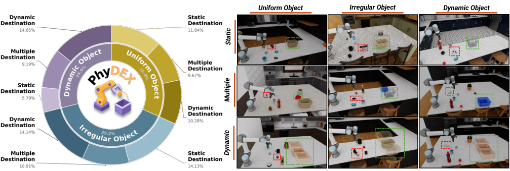
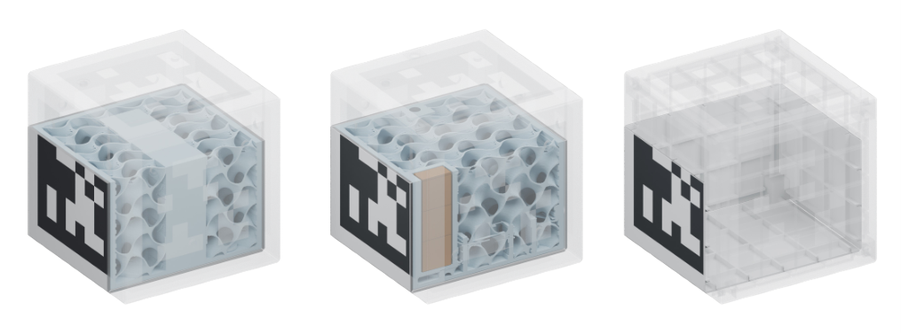

가상 주방에서 로봇 팔이 물체를 집어 손이 닿지 않는 바구니에 넣어요. 손이 물체 근처에도 가지 못한 시도와, 잘 집었지만 바구니를 빗나간 시도는 최종 점수표에서 똑같이 0점이에요. 이 점수만 가지고 로봇이 물체의 무게를 얼마나 잘 짐작했는지 알 수 있을까요?

## 바구니에 들어가기까지 무엇을 시험하나

<abbr title="가상 로봇이 물체를 집어 바구니에 넣는 과제로 물리적 성질에 맞춰 행동하는 능력을 비교하는 시험 환경">PhyDEX</abbr>는 물체를 손에서 놓은 뒤까지 평가해요. 로봇이 물체를 목적지까지 쥔 채 옮기면 마지막 순간에도 손의 위치를 고칠 수 있어요. 손이 닿지 않는 곳에 바구니를 두면 물체를 놓는 순간 로봇이 개입할 기회가 끝나요. 같은 모양의 물체를 같은 자세로 쥐었더라도 무게가 한쪽으로 쏠려 있거나 손가락 사이에서 미끄러지면 다른 곳에 떨어질 수 있어요.

시험 대상은 <abbr title="카메라 영상과 말로 주어진 지시를 받아 로봇의 다음 움직임을 고르는 모델">시각·언어·행동 모델</abbr>이에요. 지시에서 옮길 물체를 고르고, 화면에서 그 물체를 찾고, 손을 가져가 잡은 다음 바구니에 넣어야 해요. 연구진은 이 전 과정을 하나의 과제로 유지했어요. 물체를 이미 쥔 상태에서 시작하면 놓는 동작을 따로 보기 쉽지만, 어느 부분을 어떤 자세로 쥐었는지에 따라 뒤의 움직임이 달라지는 문제는 시험에서 빠지거든요. 대신 결과를 읽을 때는 어느 단계에서 시도가 끝났는지 다시 나눠요.

물체와 목적지는 서로 다른 축이에요. 물체는 질량이 고르게 분포한 것, 한쪽으로 치우친 것, 움직이는 동안 질량이나 무게중심이 달라지는 것으로 나뉘어요. 목적지는 고정된 곳 하나, 고정된 여러 곳 중 지정된 곳, 움직이는 곳 하나로 구분해요. 두 축을 교차하면 아홉 과제가 나와요. '움직이는 물체'라는 말로 두 축을 합쳐 버리면, 물체 내부의 무게 분포가 달라진 경우와 바구니 위치가 달라진 경우를 결과표에서 구분할 수 없어요.

<figure class="fig"><figcaption>오른쪽 장면을 행과 열로 따라가면 물체 조건을 유지한 채 목적지만 바꾼 비교를 찾을 수 있어요. 왼쪽 고리의 비율은 수집된 시도의 구성이에요. <a href="https://arxiv.org/html/2611.26565v1">Hao Vo 연구진, PhyDEX 그림 2</a> · <a href="https://creativecommons.org/licenses/by/4.0/">CC BY 4.0</a> · 원본 그대로</figcaption></figure>

## 겉모습을 유지하고 물리 조건을 바꾸는 법

연구진은 로봇 시뮬레이터 <abbr title="가상 장면 속 로봇과 물체의 움직임을 계산하고 카메라 영상을 생성하는 소프트웨어">Isaac Sim</abbr>에서 주방 장면 100개를 사용했어요. 같은 컵을 화면의 다른 곳에 놓으면 로봇은 시각적으로 대상을 다시 찾아야 해요. 컵의 겉모습과 위치를 유지한 채 무게중심만 바꾸면 찾는 문제는 그대로지만 들어 올릴 때 손목에 걸리는 부담이 달라져요. 시뮬레이터에서는 화면에 드러나는 변화와 손에 쥐어야 알 수 있는 변화를 별도로 지정할 수 있어요. 그래서 어떤 단서를 보고 행동했는지 물을 수 있어요.

논문의 물체 설정에서 질량은 기준값의 0.5배에서 2배, <abbr title="두 표면이 맞닿을 때 서로 미끄러지는 데 얼마나 저항하는지 나타내는 값">마찰계수</abbr>는 기준값의 0.8배에서 1.2배 사이로 바뀌어요. 무게중심은 각 축을 따라 기준 위치에서 최대 15밀리미터씩 옮겨요. 이 값들은 생성기가 물체에 넣은 설정이에요. 카메라에 보이는 색이나 무늬와 독립적으로 뽑기 때문에 같은 색의 컵은 늘 가볍다는 식으로 문제를 풀기 어려워요. 나중에 이 설정값을 모델에 알려 주는 대조 실험도 할 수 있어요.

겉으로 보이는 조건도 바꿔요. 양옆 카메라와 손목 카메라의 위치는 최대 5센티미터, 방향은 최대 5도씩 바꾸고 조명의 색과 세기도 달리해요. 주변에 다른 물체가 놓이므로 손을 뻗을 자리가 언제나 같지도 않아요. 잡을 후보 자세 중 서로 비슷한 자세만 남기면 장면을 많이 만들어도 집는 방향은 몇 가지로 굳어요. 연구진은 위치나 방향에 차이가 있는 후보를 남긴 뒤 장면과 부딪히는 자세를 걸러요. 이렇게 바뀐 잡기 자세는 물체를 손에 든 시점의 출발 상태까지 바꿔요.

자료에 등장하는 모형 107개에는 도착지로 쓰는 물체 20개도 들어가요. 나머지는 균일한 물체 46개, 무게가 치우친 물체 37개, 움직이는 중에 질량 조건이 바뀌는 물체 4개예요. 마지막 유형은 모형 수가 적지만 저장된 시도의 29.0%를 차지해요. 같은 모형이라도 놓인 자리나 잡힌 자세, 함께 놓인 목적지를 바꾸어 여러 기록을 만들 수 있기 때문이에요. 이 유형의 동작 예시를 자주 봤다는 것과 서로 다른 구조의 물체를 많이 경험했다는 것은 구분해서 읽어야 해요.

## 성공한 시연을 모으는 과정과 모델을 채점하는 과정

가상 장면을 준비한 뒤에는 움직임을 계산하는 프로그램이 시연을 만들어요. 주변 물체와 부딪히지 않고 접근해서 집어 올린 다음, 시뮬레이터에서 동작을 끝까지 실행해 결과를 확인해요. 계산에 쓴 가정과 실행 상태 사이에는 틈이 있어요. 예를 들어 손가락이 물체를 단단히 쥐고 있다고 놓고 계산했어도 실행 중에 물체가 미끄러질 수 있어요. 실패한 시도는 결과를 반영해 다시 계산하고, 실제 가상 장면에서 성공으로 판정된 시도만 시연 자료에 넣어요.

여기서 생성기와 학습 모델이 아는 정보가 달라요. 생성기는 장면 파일을 읽어 물체의 무게중심이나 질량을 알 수 있어요. 반면 그 시연을 보고 배운 모델은 시험 때 주어진 관측으로 다음 동작을 결정해야 해요. 시연에 올바른 동작이 담겼다는 사실만으로 어떤 관측 덕분에 그 동작을 골라야 하는지까지 가르쳐 주지는 않아요. 겉보기에 같은 두 장면에서 서로 다른 동작이 정답이라면, 둘을 가르는 단서가 모델의 입력에 있는지부터 봐야 해요.

완성된 자료는 35,357회, 143.2시간 분량이에요. 가상 세계의 물리는 1초에 120번 계산하고 자료는 1초에 10번 기록했어요. 기록 한 칸 사이에 물리 계산이 열두 번 진행되는 셈이에요. 카메라 영상 한 쌍에서 물체가 갑자기 손을 빠져나온 것처럼 보이더라도 그 사이의 접촉을 한 번만 계산했다는 뜻은 아니에요. 반대로 물리 계산 횟수가 많다고 모델이 매 순간에 해당하는 관측을 모두 받아 봤다고 할 수도 없어요. 빠른 사건을 평가할 때는 계산 시각과 기록 시각을 따로 적어야 하는 이유예요.

저장되는 항목에는 말로 된 지시, 여러 방향의 컬러 영상과 카메라 설정, 팔의 여섯 관절 각도, 손가락의 개폐 상태와 행동 기록이 있어요. 손목이 받는 힘과 비틀림은 2초 길이의 구간으로 남겨요. 연구진은 장면 설정과 동작을 다시 재생할 수 있는 자료도 보관했어요. 실패를 검토할 때 카메라에서 목표물을 잘못 찾았는지는 영상에서 살펴볼 수 있지만, 손이 물체를 들었을 때 하중이 어떻게 바뀌었는지는 힘 기록에서 읽는 편이 맞아요. 두 자료는 같은 시도를 서로 다른 쪽에서 설명해요.

학습용 자료에서 성공 시연이 차지하는 비율은 수집 규칙으로 정해져 있어요. 시험에서는 학습한 모델이 움직인 뒤 바뀐 장면을 다시 관측하면서 과제를 끝까지 수행해요. 시연과 비슷한 첫 동작을 내더라도 손이 조금 어긋나면 다음 화면부터 달라져요. 이때의 실패는 완성된 시연 파일을 되감아 보는 것만으로는 나타나지 않아요. 과제별로 모델을 따로 추가 학습하고 각 조건에서 50회씩 실행한 결과가 논문의 성공률이에요.

## 약 1.2%의 분모를 두 단계로 나누면

비교한 세 모델은 쓰임이 달라요. <abbr title="영상과 지시를 읽어 여러 로봇 작업의 움직임을 생성하도록 학습한 범용 모델">GR00T N1.7</abbr>은 여러 작업을 다루는 모델이고, <abbr title="빠르게 변하는 장면에 맞춰 다음 로봇 동작을 자주 갱신하도록 만든 모델">DynamicVLA</abbr>는 빠른 반응을 목표로 해요. <abbr title="영상에 손목의 힘과 비틀림 신호를 더해 로봇 행동을 고르는 모델">ForceVLA</abbr>는 영상에 더해 손목의 힘 신호를 받아요. 아래는 무작위 변화 폭을 전부 적용한 원문 표 1의 일부예요. 마지막 행은 아홉 과제 전체의 평균이에요.

| 물체와 목적지 조건 | GR00T N1.7 | DynamicVLA | ForceVLA |
| --- | ---: | ---: | ---: |
| 질량이 균일한 물체, 고정 목적지 하나 | 6% | 0% | 10% |
| 질량이 균일한 물체, 고정 목적지 여럿 | 2% | 0% | 10% |
| 무게가 치우친 물체, 고정 목적지 하나 | 0% | 0% | 0% |
| 움직이는 목적지, 세 물체 유형 각각 | 0% | 0% | 0% |
| 전체 평균 | 0.9% | 0.2% | 2.4% |

한 조건을 50회 시험했으니 그 칸의 2%는 한 번의 성공이에요. 여럿 중 하나를 골라야 하는 과제에서 단 한 번 목적지에 들어갔다면, 모델이 해당 조건을 안정적으로 처리한다는 근거로 쓰기는 어려워요. 움직이는 목적지에서 성공이 관찰되지 않았다는 결과에도 시행 횟수라는 범위가 붙어요. 다른 물체나 다른 모델로 시도해도 성공할 수 없다는 뜻으로 넓힐 수는 없어요.

연구진이 전체 시도를 따라가 보니 물체를 잡아 던지기 단계에 이른 비율이 평균 21.24%였어요. 그중 목적지에 넣은 비율은 약 5.6%예요. 시도 전체를 분모로 되돌리면 0.2124에 0.056을 곱해 약 1.2%가 나와요. 최종 성공률에는 물체를 쥘 기회조차 얻지 못했던 경우가 대거 섞여 있어요. 한편 집는 단계에 도달한 사례만 골라도 대부분은 바구니에 들어가지 않았어요. 잡기만 개선하면 뒤의 문제가 해결된다는 해석도 이 수치와 맞지 않아요.

분모를 나누면 고쳐 볼 곳이 달라져요. 손이 목표물 쪽으로 가지 않은 시도에서는 영상 속 대상 선택이나 팔의 접근부터 살펴볼 수 있어요. 물체에 닿았지만 들어 올리기 전에 떨어뜨린 경우라면 접촉 순간의 자세와 손가락 상태가 더 가까운 단서예요. 물체가 손을 떠난 뒤 목적지를 빗나간 시도에서야 앞서 쥔 위치와 물체 성질이 이후 움직임에 미친 영향을 따질 수 있어요. 이 분류는 실패가 드러난 시점을 알려 줘요. 원인까지 하나로 확정하려면 그 조건만 달리한 비교가 더 필요해요.

## 장면의 다양성과 숨은 물성을 따로 시험한 결과

낮은 점수에 장면 변화가 얼마나 기여했는지 보려고 연구진은 고정 목적지 하나만 남긴 비교를 했어요. 각 설정의 기준값 주위에서 값을 뽑는 폭을 전부 사용하거나, 절반으로 줄이거나, 무작위 변화를 끄는 방식이에요. 폭을 절반으로 줄인다는 말은 수집할 물체 수를 절반으로 줄인다는 뜻과 달라요. 같은 종류의 물체와 과제를 두고 한 설정에서 다음 설정까지 조건이 달라질 수 있는 범위를 좁혀요.

힘을 읽는 모델의 세 물체 유형 평균은 변화 폭 전체에서 3.3%, 절반에서 11.3%, 변화가 없을 때 35.3%였어요. 이 세 수치를 아홉 과제 평균 2.4%에 이어 붙이면 목적지 조건이 중간에 바뀌어요. 비교할 때는 원문 표 2 안에서 같은 행 묶음을 따라가야 해요. 변화가 없는 조건에서도 이 모델은 균일한 물체에서 44%, 무게가 치우친 물체에서 40%, 질량 조건이 움직이며 바뀌는 물체에서 22%를 기록했어요. 환경을 고정해도 물체 유형 사이의 차이가 남았어요.

이 실험에서는 카메라나 물체의 변화 범위를 묶어서 줄였어요. 점수가 오른 폭 전체를 마찰의 효과로 돌릴 수 없는 이유예요. 잡기 단계가 쉬워져서 던질 기회가 늘었을 수도 있고, 이미 잡은 뒤의 동작을 반복하기 쉬워졌을 수도 있어요. 둘을 가리려면 변화 폭마다 물체를 든 비율과 그중 바구니에 넣은 비율을 함께 모아야 해요. 표 2의 최종 점수는 어떤 범위에서 그런 추가 분석을 해 볼지 정하는 근거가 돼요.

원문 그림 4는 다른 질문을 다뤄요. 균일한 물체와 고정 목적지 하나를 둔 조건에서 물체의 실제 설정값을 읽어 모델이 받는 로봇 상태에 덧붙였어요. 범용 모델과 힘을 읽는 모델에서는 성공률이 올랐고, 빠른 반응을 목표로 한 모델에서는 변화가 없었어요. 가상 세계에서는 물체에 설정한 값을 정확히 꺼낼 수 있어서 가능한 비교예요. 이 결과로 확인한 것은 해당 정보를 입력으로 줄 때 활용할 여지가 있다는 점이에요. 센서 기록만 보고 같은 값을 정확히 추정하는 능력을 측정하려면 추정값과 설정값을 별도로 맞춰 봐야 해요.

## 실물에서는 겉이 같은 정육면체를 썼어요

<figure class="fig"><figcaption>왼쪽은 질량이 고르게 분포한 정육면체, 가운데는 한쪽 모서리 가까이에 금속을 넣은 정육면체, 오른쪽은 속을 비운 정육면체예요. 마지막 조건에서는 로봇 손가락에 마찰이 작은 테이프도 붙였어요. <a href="https://arxiv.org/html/2611.26565v1">Hao Vo 연구진, PhyDEX 그림 6</a> · <a href="https://creativecommons.org/licenses/by/4.0/">CC BY 4.0</a> · 원본 그대로</figcaption></figure>

실물에서는 세 물체의 생김새를 같게 만들어 내부 차이를 눈으로 알아맞히기 어렵게 했어요. 물체를 들기 전까지 영상에 같은 윤곽이 보이더라도 집은 뒤 손목에 걸리는 힘이나 비틀림은 달라질 수 있어요. 연구진은 로봇 바깥에 고정한 카메라와 손목 카메라, 손목에 달린 힘 센서를 사용했어요. 가상 장면에서 사용한 팔과 실물의 팔 기종도 달랐어요. 이 비교는 가상 장면과 닮은 과제를 물리 장치 위에 다시 구성한 실험이에요.

실물 학습 조건을 함께 읽어야 해요. 연구진은 물체 하나당 시연 300개를 모아 각 모델을 추가 학습하고, 물체마다 50회씩 평가했어요. 힘을 읽는 모델은 세 물체 평균 51.3%, 범용 모델은 10.7%를 기록했고, 빠른 반응을 목표로 한 모델은 성공한 시도가 없었어요. 이 실물 평균을 시뮬레이션 평균 옆에 두고 가상 학습 결과가 그대로 얼마나 이전됐는지 계산할 수는 없어요. 학습에 실물 시연을 썼고, 물체 종류와 목적지 구성도 달라졌거든요.

힘을 읽는 모델도 균일한 정육면체에서는 58%, 속을 비우고 마찰까지 낮춘 조건에서는 40%였어요. 이 둘 사이에는 무게와 접촉면이 함께 바뀌었어요. 결과 차이에서 가벼워진 효과만 뽑아내거나 테이프의 영향만 따로 계산할 수 없어요. 두 영향을 가르는 후속 비교라면 같은 물체에 손가락 표면만 바꾼 조건과, 손가락 표면을 유지하고 질량만 바꾼 조건이 필요해요. 겉모습을 통제하는 설계와 물리 변수를 하나씩 통제하는 설계는 서로 다른 질문에 답해요.

## 시뮬레이션 평가표에 남길 판단 순서

먼저 시험이 끝났다고 볼 사건을 정해요. 물체를 쥐었는지, 들어 올린 뒤에도 유지했는지, 손을 떠났는지, 지정한 목적지에 들어갔는지는 각기 다른 사건이에요. 최종 성공률 옆에 각 사건에 도달한 시도 수를 적어 두면 장면 수를 늘렸을 때 어디서 성능이 달라졌는지 볼 수 있어요. 앞 단계까지 통과한 표본 수가 적다면 뒤 단계의 비율을 읽을 때도 그 작은 분모를 함께 보게 돼요.

다음은 학습 때와 시험 때 각각 누가 무엇을 아는지 적는 일이에요. 시연 생성기가 읽은 물체 설정, 모델이 시험에서 받은 영상과 센서 신호, 평가자가 사후에 확인한 정답을 나눠요. 정답을 모델에 넣었을 때만 나아지면 그 실험은 물성 정보의 쓰임을 보여 줘요. 같은 장면에서 센서만 넣은 조건이 얼마나 가까워지는지까지 비교해야 실제 관측이 그 정보를 얼마나 대신할 수 있는지 판단할 수 있어요.

마지막으로 비교표의 한 행을 다른 환경으로 옮길 때는 목적지, 물체 유형, 변화 폭, 추가 학습 자료를 따라가요. 이 논문이 다룬 동작은 던지기 한 가지이고 물리적 변화는 주로 질량과 무게중심, 마찰에 집중돼 있어요. 천을 접거나 액체를 따르는 과제라면 통과해야 할 중간 사건부터 다시 정해야 해요. PhyDEX에서 다른 시험으로 옮겨 갈 만한 것은 1.2%라는 기준점보다, 그 숫자를 만든 시도 중 다음 단계까지 간 것이 몇 번인지 되묻는 평가 방식이에요.

<!-- src-block -->
출처 — https://arxiv.org/abs/2611.26565
