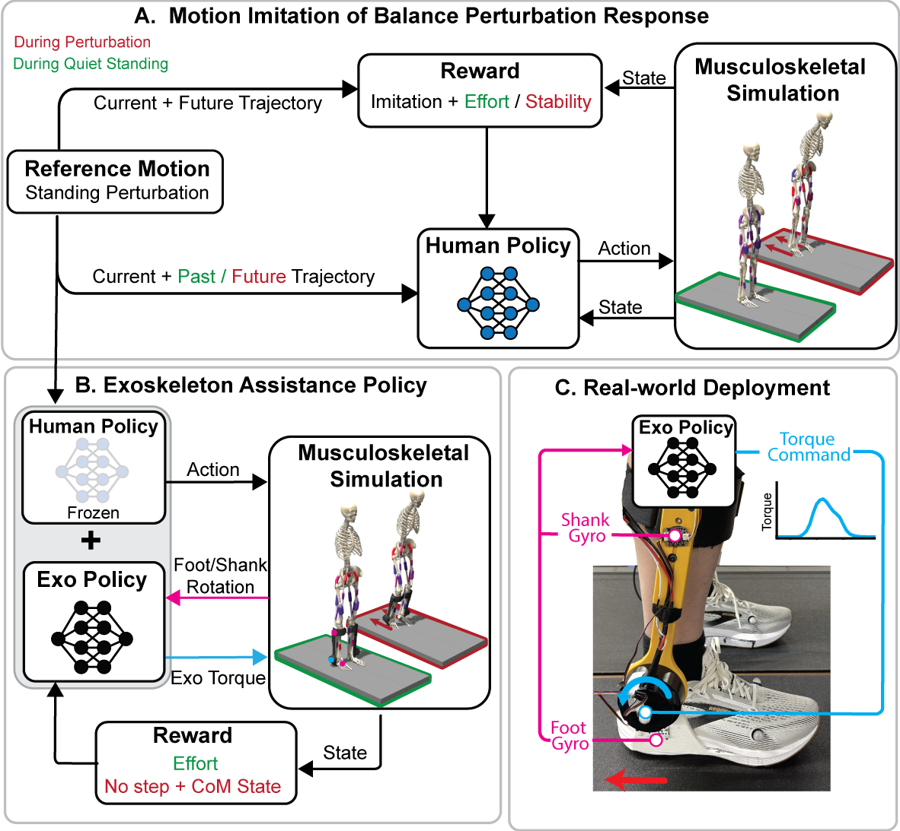
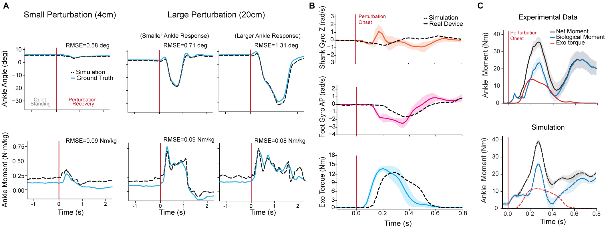

트레드밀 위에 선 사람의 발밑 벨트가 갑자기 뒤로 20센티미터쯤 끌려가면 몸은 앞으로 쏠려요. 발목에 찬 로봇 장치가 이 순간 힘을 보태 넘어지지 않게 도우려면 언제, 얼마나 세게 밀어야 할까요? 후보를 하나씩 사람에게 시험하려면 그때마다 사람을 넘어질 듯한 상황에 다시 세워야 해요.

## 넘어질 뻔한 순간을 반복하지 않고 보조를 고르는 문제

<abbr title="몸 바깥에 착용해 관절에 힘을 보태는 로봇 장치">외골격</abbr>으로 서 있는 사람의 균형을 돕는 연구는 대개 미리 정한 모양의 힘을 정해진 시점에 내보냈어요. 서 있을 때 발목에 짧은 힘을 한 번 주거나, 걷다가 <abbr title="균형을 흔들려고 일부러 몸이나 발밑에 주는 밀림이나 끌림">교란</abbr>을 받을 때 엉덩이 관절에 곡선 모양의 힘을 주는 식이에요. 선행 연구에서는 발목 보조가 몸이 스스로 버티는 힘을 내기 시작하기 전에 들어가야만 균형이 나아졌고, 힘을 키울수록 사람마다 결과가 갈렸어요. 보조의 시점과 크기를 함께 찾아야 하는데, 사람을 대상으로 조건을 바꿔 가며 찾으면 매번 균형을 무너뜨리는 자극을 줘야 해요. 피로가 쌓이고 같은 자극에 익숙해져 반응이 줄어드는 <abbr title="같은 자극을 되풀이해 겪으면서 몸의 반응이 점점 약해지는 현상">습관화</abbr>가 생기면, 뒤 시험이 앞 시험과 같은 조건이라고 보기도 어려워져요.

카네기멜런대의 Tagliaferri와 Kang은 이 탐색을 <abbr title="뼈와 관절, 근육이 내는 힘을 함께 계산해 사람 몸의 움직임을 재현하는 가상 실험">근골격 시뮬레이션</abbr>으로 옮겼어요. 실제 사람 한 명의 반응을 따라 하도록 근육으로 움직이는 가상 인간을 먼저 학습시키고, 그 가상 인간에게 외골격을 채워 보조 방식을 찾았어요. 사람 실험은 학습이 끝난 제어기를 확인하는 데만 썼어요. 원문에 따르면 참고 기록을 모은 것 외에는 제어기를 만드는 동안 사람에게 교란을 준 시험이 없었어요. 시뮬레이션에서 학습한 외골격 제어기를 실물로 옮기는 <abbr title="가상 환경에서 학습한 제어 방법을 실제 장치로 옮겨 쓰는 과정">Sim2Real</abbr> 연구는 걷기 보조에서 이미 나왔지만, 주로 걷는 데 드는 에너지를 줄이는 목표였어요. 균형이 무너지는 순간의 반응을 시뮬레이션으로 재현하는 연구도 따로 있었고요. 이 논문은 둘을 묶어 넘어짐에 대응하는 보조를 시뮬레이션에서 학습한 뒤 실제 장치로 옮겼어요.

결과는 <abbr title="교란을 받았을 때 발을 내딛지 않고 버티지 못할 확률이 50%가 되는 교란 크기">균형 임계값</abbr>으로 재요. 벨트가 뒤로 끌려가는 거리를 키울수록 발을 떼지 않고 버틸 확률이 떨어지는데, 버티지 못할 확률이 50%가 되는 거리가 임계값이에요. 외골격이 이 값을 키우면 같은 사람이 더 큰 교란까지 발을 떼지 않고 견딘다는 뜻이에요. 벨트가 뒤로 끌려가면 발은 몸 아래에서 뒤로 빠지고, 몸의 <abbr title="몸 전체의 무게가 한 점에 모여 있다고 볼 때의 그 점">무게중심</abbr>은 발이 딛고 있는 범위의 앞쪽으로 쏠려요. 이때 발목에서 <abbr title="발끝을 바닥 쪽으로 누르는 발목 움직임">발바닥굽힘</abbr> 방향으로 힘을 내면 발끝이 바닥을 눌러 몸을 뒤로 되돌리는 데 보탬이 돼요.

## 2분 분량의 기록으로 가상 인간을 만드는 단계

첫 단계의 재료는 한 사람(키 160 cm, 체중 57 kg)의 <abbr title="몸에 붙인 반사 표식을 여러 카메라로 찍어 관절 움직임을 기록하는 방법">모션 캡처</abbr> 기록 24회예요. 한 번에 5초씩이라 합쳐서 약 2분이에요. 벨트를 뒤로 끄는 거리는 2 cm부터 이 사람의 임계값인 20 cm까지 나눴고, 거리마다 두 번씩 반복해 같은 자극에도 반응이 달라지는 폭을 담았어요. 발을 내딛거나 팔을 써서 버틴 시도는 학습 자료에서 뺐어요. 관절 각도는 기록된 표식 위치에서 거꾸로 계산하는 <abbr title="몸에 붙인 표식의 위치로부터 관절 각도를 거꾸로 계산하는 방법">역기구학</abbr>으로, 관절에 걸린 힘은 <abbr title="관절의 움직임과 바닥을 누른 힘으로부터 관절에 걸린 힘의 크기를 거꾸로 계산하는 방법">역동역학</abbr>으로 구했어요. 이 계산에는 그 사람의 몸 크기에 맞춘 <abbr title="사람의 뼈와 근육 모델로 움직임을 분석하는 공개 소프트웨어">OpenSim</abbr> 모델을 썼어요.

가상 인간은 <abbr title="근육과 관절이 있는 몸의 움직임을 빠르게 계산하는 물리 계산 프로그램">Hyfydy</abbr> 물리 엔진과 <abbr title="근골격 모델로 움직임을 예측하는 실험을 짜고 실행하는 공개 소프트웨어">SCONE</abbr> 위에서 움직여요. 몸은 옆에서 본 단면만 다루는 2차원 모델이고, <abbr title="모델이 서로 독립적으로 움직일 수 있는 방향의 수">자유도</abbr> 10개에 근육 18개가 붙어 있어요. 원래 스스로 힘을 내지 못하던 몸통 관절에는 이상적인 모터를 달아 허리 힘을 낼 수 있게 했어요. 모델의 체중은 74.53 kg, 키는 1.68 m라서 기록을 제공한 사람과 체격이 달라요. 그래서 기록된 동작을 모델로 옮길 때는 체격을 맞추지 않은 기본 모델로 신체 부위 위치를 따로 계산했어요. 시뮬레이션 안에도 좌우 벨트가 따로 움직이는 트레드밀을 두고, 기록과 같은 순간에 같은 거리만큼 벨트를 끌었어요.

가상 인간의 움직임을 정하는 <abbr title="현재 상태를 보고 다음 행동을 고르는 규칙이나 신경망">정책</abbr>은 <abbr title="행동을 고르는 신경망과 그 행동의 가치를 매기는 신경망을 함께 학습하면서 여러 행동을 고루 시도하게 하는 강화학습 알고리즘">SAC</abbr>로 학습했고, 구현은 <abbr title="강화학습 알고리즘을 모아 둔 공개 파이썬 라이브러리">Stable-Baselines3</abbr>를 썼어요. 정책은 25밀리초마다 근육 18개에 보낼 흥분 신호와 몸통 모터 명령 하나, 모두 19개 값을 내요. 흥분 신호는 바로 근육 힘이 되지 않고, 근육이 실제로 수축하기까지 걸리는 지연을 흉내 내는 계산을 한 번 거쳐요. 입력은 523개 값으로 근육 상태, 관절 각도와 속도, 발이 바닥을 누를 때 바닥이 되미는 <abbr title="발이 바닥을 누를 때 바닥이 몸을 되미는 힘">지면 반력</abbr>이 들어가요. 이 523개 값에는 앞으로 8번의 제어 주기, 즉 25밀리초에서 200밀리초 뒤까지 따라가야 할 기록 속 관절 각도와 속도, 발 위치, 그리고 지금 어긋난 정도도 들어 있어요. 교란이 언제 시작해 얼마나 이어지는지, 어느 방향인지는 알려 주지 않았어요.

<abbr title="강화학습에서 방금 한 행동이 얼마나 좋았는지 매겨 주는 점수">보상</abbr>은 <abbr title="참고 동작과 가까울수록 높은 점수를 주어 가상 캐릭터가 그 동작을 따라 하게 만드는 강화학습 방식">DeepMimic</abbr> 방식을 바탕으로 해요. 기록과 가까울수록 커지는 지수 형태의 보상에, 근육을 지나치게 쓰지 않도록 벌점을 더했어요. 연구진은 서 있다가 교란을 받는 상황에 맞게 세 가지를 바꿨어요. 첫째, 관절 각도에 더해 관절에 걸린 힘도 기록을 따라가게 했어요. 겉모양은 같아도 힘을 쓰는 방식이 다른 자세를 거르려는 장치예요. 둘째, 교란 직후 1초 동안 <abbr title="오차가 작을 때는 제곱으로, 클 때는 직선으로 커지게 해서 크게 벗어나도 고칠 방향을 계속 알려 주는 벌점">Huber 벌점</abbr>을 추가했어요. 학습 초기에는 교란이 몸을 기록에서 멀리 밀어내는데, 지수 형태의 보상은 멀리 벗어나면 거의 0이 되어 어느 쪽으로 고쳐야 할지 알려 주지 못해요. 벗어난 만큼 계속 커지는 벌점이 있어야 멀리서도 돌아올 방향이 생겨요. 셋째, 교란 직후 회복 구간에서는 근육 사용 벌점을 낮췄어요. 균형을 되찾으려면 조용히 서 있을 때보다 근육을 훨씬 세게 써야 하기 때문이에요. 이 정책은 시뮬레이션을 3,000만 단계 진행하며 학습한 뒤 <abbr title="신경망이 학습하면서 조정하는 숫자들로, 입력을 어떤 출력으로 바꿀지 정해요">가중치</abbr>를 고정했어요.

<figure class="fig"><figcaption>A는 기록된 교란 반응을 따라 하도록 가상 인간의 정책을 학습하는 단계, B는 그 정책을 고정하고 외골격 정책만 학습하는 단계, C는 학습한 외골격 정책을 실제 장치에 올린 모습이에요. 실물에서 정책이 받는 센서 입력은 정강이와 발의 회전 속도뿐이에요. (출처: Tagliaferri 외, <a href="https://arxiv.org/html/2611.25480v1#S2.F1">그림 1</a> · <a href="https://creativecommons.org/licenses/by/4.0/">CC BY 4.0</a> · 원본 PNG, 변경 없음)</figcaption></figure>

## 고정한 가상 인간에게 외골격을 채우는 단계

두 번째 단계에서는 가상 인간의 정강이와 발, 골반에 외골격 무게를 좌우로 나눠 더하고, 발목에는 지시한 만큼 정확히 힘을 내는 이상적인 <abbr title="모터처럼 명령을 받아 힘이나 움직임을 만들어 내는 장치">구동기</abbr>를 달았어요. 행동을 고르는 신경망은 두 갈래예요. 한 갈래는 고정한 사람 정책이고, 다른 갈래가 새로 학습하는 작은 외골격 정책이에요. 사람 정책은 원래 받던 입력으로 계속 근육 명령을 내지만 더는 모방 보상을 받지 않아요. 외골격이 힘을 보태면 가상 인간은 그 힘을 받아 다르게 움직이지만, 보조에 맞춰 버티는 방식을 새로 익히지는 않아요. 사람 쪽을 고정해 두면 결과의 변화를 외골격 정책의 변화로만 읽을 수 있어요.

외골격 정책이 보는 값은 실제 장치가 잴 수 있는 것으로 제한했어요. 좌우 정강이와 발의 앞뒤 방향 회전 속도를 최근 8주기(200밀리초) 동안 모은 값과 직전 <abbr title="모터가 축을 돌리는 힘의 크기">토크</abbr> 명령, 모두 40개 값이에요. 시뮬레이션의 <abbr title="물체가 얼마나 빠르게 회전하는지 재는 센서">자이로스코프</abbr> 신호에는 시도마다 다른 치우침과 잡음을 넣고, 빠르게 떨리는 성분을 걸러 내는 8 <abbr title="헤르츠. 1초에 몇 번 반복되는지를 나타내는 단위">Hz</abbr> <abbr title="빠르게 떨리는 성분을 걸러 내고 느린 변화만 남기는 신호 처리">저역통과 필터</abbr>를 거치게 했어요. 시도마다 센서 특성을 바꿔 정책이 한 가지 센서 상태에만 맞춰지지 않게 하는 방식으로, <abbr title="시뮬레이션의 물리값이나 센서 특성을 시도마다 무작위로 바꿔 학습한 정책이 실제 차이에 덜 흔들리게 하는 방법">도메인 무작위화</abbr>의 한 형태예요. 출력은 -1에서 1 사이의 값 하나이고, 두 발목이 같은 명령을 받아요. 이 값은 0.15 폭의 <abbr title="크기가 작은 명령은 0으로 처리해 쓸데없이 작은 움직임이 나오지 않게 하는 구간">데드밴드</abbr>를 지나 최대 16 <abbr title="뉴턴미터. 축을 돌리는 힘의 크기를 나타내는 단위">Nm</abbr>로 환산되고, 실제 구동기의 반응 속도를 흉내 내는 6 Hz 필터를 한 번 더 거쳐요.

학습 구성은 <abbr title="학습할 때만 쓰는 평가 신경망에는 모든 정보를 주고, 실제로 쓸 행동 신경망에는 장치가 잴 수 있는 정보만 주는 강화학습 구성">비대칭 액터-크리틱</abbr>이에요. 행동의 가치를 매기는 신경망은 학습 중에만 쓰이므로 무게중심 위치처럼 실물에서 바로 잴 수 없는 정보를 포함해 가상 인간의 전체 상태를 봐요. 실제 장치에 올라갈 외골격 정책에는 센서 값만 줘요. 보상은 발을 내딛는 것과 교란 뒤 무게중심의 이동 거리와 속도에 벌점을 주고, 토크 크기에도 벌점을 줘요. 회복 구간에서는 토크 벌점을 낮춰 필요한 순간에는 힘을 낼 수 있게 했고, 출력이 매끄럽도록 급한 변화에도 벌점을 줬어요. 언제 보조를 시작할지, 얼마나 세게 밀지는 정답으로 주지 않았어요.

교란은 무작위 시점에 주고, 크기는 기록 대상의 임계값인 20 cm 언저리에서 뽑았어요. 외골격 정책은 시뮬레이션을 1,000만 단계 진행하며 학습했어요. 시뮬레이션 안에서 정책은 사람이 발목에서 스스로 버티는 힘을 내기 시작하기 전에 정점을 찍는 발바닥굽힘 보조를 찾았어요. 선행 연구가 사람 실험으로 확인한 '보조가 먼저 들어가야 효과가 있다'는 조건과 맞는 보조가, 시점을 지정하지 않은 보상에서 나왔어요. 시뮬레이션 속 가상 인간의 균형 임계값은 보조가 없을 때보다 4% 커졌고, 무게중심의 이동 거리와 속도도 줄었어요.

## 학습에 쓰지 않은 다섯 명으로 확인한 조건

실물 시험에는 학습 자료에 쓰이지 않은 건강한 성인 다섯 명(여성 2명, 나이 24.4±0.5세, 키 171.6±6 cm, 체중 61.3±8.7 kg)이 참여했어요. 외골격은 양쪽 발목에 모터를 하나씩 단 장치로, 발끝을 들어 올리는 <abbr title="발끝을 정강이 쪽으로 들어 올리는 발목 움직임">발등굽힘</abbr> 방향으로 15도, 발바닥굽힘 방향으로 40도까지 움직이고 어느 방향이든 최대 16 Nm를 내요. 무게는 한쪽 1.1 kg에 전자 장비를 담은 허리 벨트가 1.2 kg이에요. 정강이와 발에 붙인 <abbr title="회전 속도와 기울기를 재는 작은 센서 묶음">관성 센서</abbr>의 신호를 받아, 장치에 실린 소형 연산 보드가 학습한 정책을 실행해요.

참가자는 팔짱을 낀 채 바닥 힘을 재는 트레드밀 위에 서고, 두 벨트가 정해진 속도와 가속도, 시간으로 함께 뒤로 움직여요. 교란 시점은 무작위로 바꿔 예상하지 못하게 했고, 보조 없는 앞쪽 교란을 중간에 섞어 습관화를 줄였어요. 임계값은 <abbr title="앞선 시험의 성공과 실패를 보고 다음 시험의 자극 크기를 골라 문턱값을 빠르게 좁혀 가는 통계적 측정 절차">QUEST</abbr>로 찾았어요. 미리 정한 20단계 거리 중에서 다음 시도의 거리를 고르는데, 앞 시도에서 버텼는지 발을 내디뎠는지에 따라 거리를 조절해요. 발을 내딛지 않고 팔짱도 풀지 않으면 성공이에요. 결과가 성공과 실패 둘 중 하나라서, 거리에 따라 실패 확률이 S자로 오르는 곡선을 가정하고 그 곡선이 50%를 지나는 거리를 확률적으로 갱신해 가며 추정해요.

외골격을 켠 조건과 끈 조건을 각각 15회, 모두 30회를 무작위 순서로 섞었고, 측정이 끝난 뒤 조건별 전체 기록으로 임계값을 다시 맞췄어요. 각 참가자가 외골격 없이 기록한 임계값 거리에서 외골격을 켠 시도를 5회 더 모아 무게중심 지표를 비교했어요. 움직임은 반사 표식과 카메라로 기록하고, 각 참가자의 몸 크기에 맞춘 OpenSim 모델로 관절 각도와 관절 힘, 무게중심을 계산했어요.

먼저 가상 인간이 기록을 얼마나 따라 했는지 보면, 모든 교란 크기를 평균한 관절 각도의 <abbr title="오차를 제곱해 평균을 낸 뒤 제곱근을 취한 값으로, 큰 오차를 더 무겁게 반영하는 지표">RMSE</abbr>가 0.6±0.2도였어요. 관절을 돌리는 힘의 크기인 <abbr title="관절을 축으로 몸을 회전시키려는 힘의 크기">관절 모멘트</abbr>는 체중 1 kg당 0.07±0.04 Nm의 RMSE로 따라갔어요. 그림 3A의 대표 시도를 보면 같은 20 cm 교란에서도 발목을 덜 쓴 반응의 각도 RMSE는 0.71도, 발목을 크게 쓴 반응은 1.31도예요. 같은 자극에 대한 사람의 반응이 한 가지가 아니었고, 가상 인간이 그 갈래를 각각 따라갔다는 기록이에요.

실물에서는 다섯 명 모두에게서 일관된 발바닥굽힘 보조가 나왔어요. 교란을 감지하는 별도 단계 없이 회전 속도 신호만 보고 보조가 시작됐고, 시작 시점은 교란 시작 뒤 87±12밀리초였어요. 시뮬레이션보다 조금 이르고, 정점 토크도 조금 높았어요. 보조를 켜자 참가자들이 버틴 교란 거리는 평균 11.8%, 거리로는 2.8±1.7 cm 커졌어요. 외골격 없이 기록한 임계값 거리에서 잰 무게중심의 앞쪽 최대 이동 거리는 13.5±8.3%, 최대 속도는 28.2±5.3% 줄었어요. 속도는 토크가 들어가는 교란 직후 250밀리초 동안 가장 크게 줄었어요.

시뮬레이션은 보조를 받을 때 사람이 스스로 내는 발목 모멘트가 얼마나 줄어드는지도 예측했어요. 예측과 실측 사이의 <abbr title="예측값이 실제 값의 변화를 얼마나 설명하는지 0에서 1 사이로 나타내는 지표">결정계수</abbr>(R²)는 0.81이었어요. 다섯 명 모두 보조를 받을 때 스스로 내는 관절 모멘트가 줄었고, 시도가 반복돼도 이 감소 폭이 작아지지 않았어요. 사람이 보조에 익숙해지면서 효과가 사라지는 양상은 이 시험 범위에서 보이지 않았다는 뜻이에요.

<figure class="fig"><figcaption>A는 가상 인간이 기록된 발목 각도와 모멘트를 따라간 대표 시도예요. B는 정강이와 발의 회전 속도, 외골격 토크를 시뮬레이션(점선)과 실제 장치(실선)로 겹쳤고, 실물에서는 발 회전 속도가 더 일찍 변하고 토크도 먼저 올라와요. C는 보조를 받을 때 사람이 내는 발목 모멘트가 줄어드는 모습을 실측과 시뮬레이션으로 나란히 보여 줘요. (출처: Tagliaferri 외, <a href="https://arxiv.org/html/2611.25480v1#S2.F3">그림 3</a> · <a href="https://creativecommons.org/licenses/by/4.0/">CC BY 4.0</a> · 원본 PNG, 변경 없음)</figcaption></figure>

이 수치들은 분모와 함께 읽어야 해요. 임계값은 참가자마다 조건별 15회의 성공과 실패로 추정한 값이에요. 무게중심 지표는 외골격 없이 기록한 임계값 거리에서 성공한 시도만으로 계산했어요. 다섯 명의 평균이라 사람 사이의 차이도 커서, 개선 폭 2.8 cm 옆에 붙은 ±1.7 cm가 그 폭을 보여 줘요.

## 시뮬레이션이 재현한 반응과 빠뜨린 조건

시뮬레이션이 맞힌 것은 보조의 성격이에요. 보조가 사람의 반응보다 먼저 들어간다는 시점 관계와, 보조를 받으면 사람이 내는 발목 모멘트가 줄어드는 정도를 재현했어요. 효과의 크기는 맞히지 못했어요. **시뮬레이션은 임계값이 4% 커진다고 봤지만 실물에서는 11.8% 커졌어요.** 보조의 시작 시점과 정점 토크도 실물 쪽이 앞서고 높았어요.

원문은 입력 신호의 차이를 먼저 짚어요. 실제 장치의 자이로스코프 신호에서는 발 회전 속도가 더 일찍 오르고, 토크가 들어가는 동안 정강이 회전 속도가 잠깐 튀었어요. 연구진은 센서를 붙인 위치와, 외골격을 다리에 고정하는 띠가 유연하게 늘어나며 생기는 기계적 결합이 정책의 입력을 바꿨을 것으로 봐요. 시뮬레이션의 외골격 모델에는 이 띠의 유연함도, 센서와 몸 사이의 결합도 들어 있지 않았어요. 이번에는 이 차이가 보조를 약하게 만들지 않았지만, 입력이 바뀌면 출력 시점도 바뀌는 구조는 그대로예요. 다른 장치에서 같은 종류의 차이가 보조를 늦추는 쪽으로 나타나지 않는다는 보장은 없어요.

시뮬레이션이 효과를 낮게 봤다는 점도 그대로 안심할 근거는 아니에요. 낮게 본 원인이 확정되지 않았으니, 다른 장치나 다른 사람들에게서도 시뮬레이션이 늘 보수적인 값을 낸다고 가정할 수 없어요. 효과가 실물에서 더 컸던 이유가 센서 결합 때문인지, 가상 인간과 참가자의 체격 차이 때문인지, 사람의 반응 방식 차이 때문인지는 이 실험으로 갈라지지 않아요.

가상 인간 자체의 한계도 있어요. 첫째, 한 사람의 기록, 그것도 외골격 없이 버틴 임계값까지의 성공한 시도만으로 만들었어요. 실물 시험에서는 보조 덕분에 그보다 큰 교란을 받게 되고 넘어지기 직전의 반응도 나오는데, 가상 인간은 그런 반응을 본 적이 없어요. 둘째, 사람 정책을 고정했기 때문에 가상 인간은 보조에 반응은 해도 적응하지는 않아요. 실제 사람은 여러 번 보조를 받으면 버티는 방식을 바꿀 수 있어요. 셋째, 체격이 맞지 않아요. 가상 인간은 74.5 kg, 기록 대상은 57 kg, 참가자 평균은 61.3 kg이라 학습한 토크 크기가 어느 한 사람에게 맞춰진 값이 아니에요.

효과는 사람마다 달랐어요. 보조 없이 버틸 때 엉덩이보다 발목 모멘트를 많이 쓰던 사람일수록 임계값이 많이 올랐고, 체중이 가벼운 사람일수록 개선 폭이 컸어요. 연구진은 토크 최댓값을 16 Nm로 고정해서 무거운 사람에게는 체중 대비 보조가 작아졌을 가능성을 들고, 체중에 비례하는 최댓값으로 바꿔 시험하면 이를 확인할 수 있다고 적었어요. 평가 조건도 좁아요. 젊고 건강한 성인 다섯 명에게 뒤로 끄는 교란 한 방향만 시험했어요. 균형이 약한 사람이나 다른 방향의 교란에서 같은 효과가 나는지는 이 결과로 알 수 없어요. 가상 인간이 옆에서 본 단면만 다루는 2차원 모델이라는 점도, 옆으로 미는 교란까지 넓힐 때 다시 따져야 할 조건이에요.

## 사람을 포함하는 시뮬레이션에 옮길 판단 순서

1. 가상 인간이 재현해야 할 물리량을 먼저 정해요. 이 연구는 겉으로 보이는 관절 각도만이 아니라 관절 모멘트까지 기록을 따르게 했어요. 외골격 보조가 바꾸는 대상이 바로 사람이 내는 모멘트이기 때문이에요. 장치가 개입하는 물리량이 모방 목표에 들어 있지 않으면, 시뮬레이션이 보조 효과를 예측해도 그 값을 믿을 근거가 약해요.
2. 정책 입력은 장치가 실제로 잴 수 있는 값으로 제한하고, 전체 상태는 학습 중에만 쓰는 평가 신경망에 몰아요. 시뮬레이션 센서에는 시도별 치우침과 잡음, 실제와 같은 필터를 넣고, 출력에는 데드밴드와 구동기 지연을 넣어요. 그래도 남는 차이는 센서가 몸과 연결되는 방식에서 생길 수 있으니, 장착 띠의 유연함과 센서 위치를 모델에 넣을지 목록에 올려 둬요.
3. 실물로 옮긴 뒤에는 결과 지표보다 입력 신호부터 겹쳐 봐요. 그림 3B처럼 시뮬레이션과 실물의 센서 신호, 출력 토크를 같은 시간축에 놓으면, 효과의 차이가 정책의 판단에서 왔는지 입력의 차이에서 왔는지 가를 첫 단서가 생겨요. 보조 시작 시점처럼 시간으로 잴 수 있는 차이는 따로 적어 둬요.
4. 효과는 임계값처럼 사람이 버틴 한계로 재고, 분모를 함께 남겨요. 조건별 시도 수, 조건을 섞은 순서, 습관화를 줄인 장치, 성공한 시도만 쓴 지표인지까지 적어야 다른 연구의 수치와 견줄 수 있어요.
5. 가상 인간이 겪지 않은 범위를 목록으로 남겨요. 이 연구에서는 넘어지기 직전의 반응, 보조에 대한 적응, 다른 체격과 회복 방식이 빠진 범위였어요. 연구진이 다음 방향으로 꼽은 것도 체격과 균형 전략이 다른 가상 인간 여럿으로 학습하는 일이에요.

이 연구에서 근골격 시뮬레이션은 보조의 시점과 크기를 찾는 탐색을 맡았고, 사람 실험은 그 결과를 확인하는 데만 쓰였어요. 다섯 명의 임계값이 올랐다는 결과와 시뮬레이션이 그 폭을 4%로 낮춰 봤다는 결과는 함께 남겨야 해요. 앞의 결과는 한 사람의 기록으로 만든 가상 인간에서도 옮겨 갈 보조를 찾을 수 있다는 근거이고, 뒤의 결과는 가상 인간과 장치 모델에서 무엇이 빠졌는지 찾기 시작할 자리예요.

<!-- src-block -->
출처 — https://arxiv.org/abs/2611.25480
