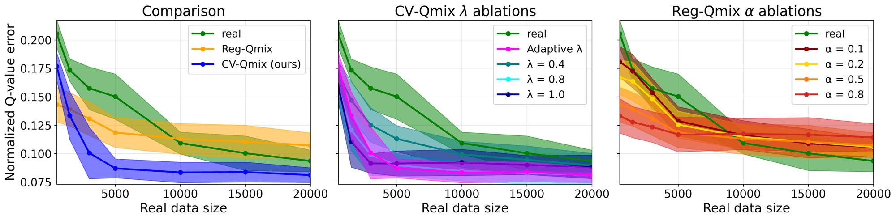
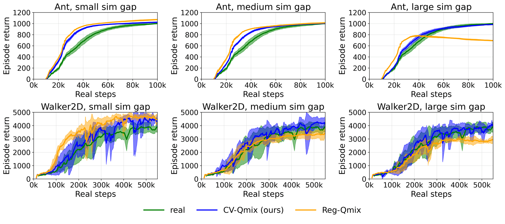

가상 환경에서 로봇을 오래 돌리는 데는 비용이 거의 들지 않지만 실제 로봇은 한 번 넘어질 때마다 시간과 장비가 소모돼요. 그래서 실제 경험은 조금만 모으고 부족한 양을 시뮬레이터 자료로 채우려는 시도가 많아요. 문제는 시뮬레이터의 마찰과 중력 설정이 실제와 조금씩 다르다는 점이에요. 틀린 물리에서 나온 자료를 실제 자료와 같은 무게로 섞으면 학습이 실제 환경의 정답 대신 시뮬레이터의 정답 쪽으로 끌려갈 수 있어요.

이스라엘 테크니온 연구진이 <abbr title="머신러닝과 인공지능 분야의 대표적인 국제 학술대회">NeurIPS</abbr> 2026 포스터로 발표한 <abbr title="시뮬레이터 자료를 학습 목표에 섞지 않고 실제 자료로 낸 추정값의 흔들림을 줄이는 데만 쓰는 가치 학습 방법">CV-Qmix</abbr>는 이 문제를 다르게 다뤄요. 시뮬레이터 자료로 정답을 정하지 않고, 실제 자료로 계산한 추정값이 덜 흔들리도록 보정하는 데만 써요. 통계에서 <abbr title="평균을 이미 아는 비슷한 값을 함께 재서, 원래 추정값이 우연히 튄 만큼을 덜어 내는 기법">제어 변량</abbr>이라고 부르는 방법이에요. 시뮬레이터가 실제와 많이 다를 때 이 차이가 학습 결과에 어떤 경로로 들어오는지가 이 연구의 핵심이에요.

## 시뮬레이터 자료를 섞을 때 생기는 두 가지 오차

<abbr title="로봇이 행동하고 받은 보상을 바탕으로 더 나은 행동 규칙을 스스로 찾아가는 학습 방법">강화학습</abbr>에서는 로봇의 행동 규칙을 정책이라고 불러요. 정책을 고치려면 먼저 지금 정책이 얼마나 좋은지 재야 하는데, 이 단계를 정책 평가라고 해요. 정책 평가의 중심에는 <abbr title="어떤 상태에서 어떤 행동을 했을 때 앞으로 받을 보상의 합이 얼마일지 예측한 값">Q값</abbr>이 있어요. 특정 자세에서 특정 관절 명령을 냈을 때 그 뒤로 얼마나 잘 걸을지를 숫자 하나로 예측한 값이에요. 많은 알고리즘이 Q값 예측기를 먼저 학습하고 그 예측을 근거로 정책을 바꾸기 때문에, 평가가 틀리면 정책도 틀린 방향으로 고쳐져요.

추정 오차는 두 갈래로 나눠 볼 수 있어요. 하나는 편향이에요. 자료를 아무리 많이 모아도 사라지지 않고 같은 방향으로 남는 어긋남이에요. 다른 하나는 분산이에요. 자료가 적어서 어떤 표본이 뽑혔느냐에 따라 결과가 들쭉날쭉한 정도예요. 실제 로봇 자료만 쓰면 편향은 없지만 양이 적어 분산이 커요. 시뮬레이터 자료를 많이 섞으면 분산은 줄지만 시뮬레이터의 물리 오차가 편향으로 들어와요.

연구진은 실제 환경과 시뮬레이터를 상태, 행동, 보상의 정의가 같고 다음 상태가 정해지는 규칙만 다른 두 문제로 놓았어요. 논문이 인용한 정리에 따르면 같은 정책의 가치가 두 환경에서 얼마나 다를 수 있는지는 두 전이 규칙의 차이에 비례하는 값을 넘지 못해요. 전이 규칙이 많이 다를수록 시뮬레이터에서 계산한 가치가 실제 가치에서 멀어질 수 있다는 뜻이에요. 논문은 이 차이가 큰 경우를 겨냥해요. 연구진이 예로 든 장면은 사족 보행 로봇이 실제 환경에서 학습하는 동안 훨씬 빠르게 돌아가는 시뮬레이터에서 추가 자료를 얻는 상황이에요. 마찰이나 접촉 힘이 실제와 달라도 같은 행동이 두 환경에서 비슷한 결과를 낸다면, 편향된 자료에도 쓸 만한 정보가 들어 있다고 봐요.

가장 흔한 대응은 두 자료를 비율을 정해 섞는 거예요. 논문은 시뮬레이터 자료의 비중을 0과 1 사이의 계수 α로 조절하는 혼합 방식을 <abbr title="실제 자료와 시뮬레이터 자료의 오차를 정해진 비율로 더해 Q값을 학습하는 기존 혼합 방식">Reg-Qmix</abbr>라고 부르고 주된 비교 대상으로 삼았어요. α가 0보다 크기만 하면 Q값 예측은 시뮬레이터 물리로 계산한 목표와도 맞춰지므로 해답이 시뮬레이터 쪽으로 옮겨 가요. 다른 길은 <abbr title="다른 조건에서 뽑힌 표본마다 가중치를 곱해 원하는 조건에서 뽑은 것처럼 평균을 맞추는 방법">중요도 가중</abbr>이에요. 시뮬레이터 표본이 실제 환경에서 나올 확률과 시뮬레이터에서 나올 확률의 비를 곱해 편향을 지워요. 그런데 다음 상태가 하나로 정해지는 결정적 물리에서 두 환경이 같은 출발점과 같은 행동으로 서로 다른 다음 상태를 내면 이 비가 0이나 무한대로 치달아요. 편향을 지운 대가로 분산이 폭발하는 셈이에요.

## 제어 변량은 평균을 그대로 두고 흔들림만 덜어 내요

알고 싶은 목표값이 있고, 목표값과 함께 움직이면서 평균은 미리 아는 보조값이 있다고 해요. 새 추정값은 목표값에서 λ 곱하기 보조값의 편차를 빼서 만들어요. 여기서 편차는 보조값에서 그 평균을 뺀 값이에요. 보조값이 평균보다 높게 나온 표본이라면 목표값도 함께 높게 나왔을 가능성이 크니 그만큼 깎고, 낮게 나왔다면 그만큼 올려 주는 거예요. 보조값의 평균을 정확히 알고 있으니 빼는 항의 평균은 0이고, 새 추정값의 평균은 목표값의 평균과 같아요.

λ를 0에서 키워 가면 새 추정값의 분산은 처음에는 줄다가 어느 값을 지나면 다시 커져요. λ를 두 값의 <abbr title="두 값이 각자의 평균에서 같은 방향으로 함께 벗어나는 정도를 나타내는 값">공분산</abbr>을 보조값의 분산으로 나눈 값으로 고르면 분산이 가장 작아지고, 그때 분산은 원래 분산에 1에서 <abbr title="두 값이 얼마나 함께 움직이는지를 마이너스 1에서 1 사이의 숫자로 나타낸 값">상관계수</abbr>의 제곱을 뺀 값을 곱한 크기가 돼요. 상관계수가 0.9라면 분산이 원래의 19%로 줄고, 0.3이라면 91%로 거의 그대로예요. 상관이 없으면 가장 좋은 λ가 0이 되어 원래 추정으로 돌아가요. 보조값이 아무리 많아도 목표값과 함께 움직이지 않으면 얻을 것이 없어요.

시뮬레이션 보조 강화학습에 대입하면 목표값은 실제 환경에서 잰 값이고 보조값은 같은 상황을 시뮬레이터에서 잰 값이에요. 보조값의 평균은 시뮬레이터를 많이 돌려 얻어요. 시뮬레이터가 실제와 다르더라도 그 차이는 보조값의 평균과 개별 표본에 똑같이 들어가 빼는 과정에서 상쇄돼요. 시뮬레이터의 품질은 상관계수의 크기, 다시 말해 분산을 얼마나 줄여 주느냐에만 영향을 줘요.

## CV-Qmix가 한 걸음 예측 오차에 보조값을 붙이는 구조

Q값 예측기는 보통 <abbr title="지금 예측한 가치와, 한 걸음 진행해 받은 보상에 다음 상태의 예측 가치를 더한 값 사이의 차이">시간차 오차</abbr>의 제곱을 줄이는 방향으로 학습해요. 실제 로봇이 어떤 자세에서 어떤 명령을 내리고 다음 자세로 넘어간 기록 한 줄이 있으면 오차 하나를 계산할 수 있어요. 목표 쪽 계산에는 <abbr title="학습 중인 가치 예측기를 조금씩 늦게 따라가도록 복사해 둔 사본으로, 목표값이 매번 크게 흔들리지 않게 해 줘요">타깃 네트워크</abbr>를 써서 목표가 매 단계 크게 바뀌지 않게 해요.

CV-Qmix는 실제 기록의 시작 상태를 시뮬레이터에 그대로 넣어요. 시뮬레이터를 그 상태로 되돌린 뒤 같은 행동을 실행해 시뮬레이터가 예측한 다음 상태를 얻고, 물리 결과가 무작위로 달라지는 시뮬레이터라면 여러 번 반복해 평균을 써요. 그러면 같은 출발점과 같은 행동에서 실제 물리로 계산한 오차와 시뮬레이터 물리로 계산한 오차가 한 쌍으로 생겨요. 두 물리가 비슷하다면 두 오차는 함께 커지고 함께 작아지므로 상관이 높아요. 이 쌍이 앞 절의 목표값과 보조값이에요.

<abbr title="학습이 줄이려고 하는 오차를 숫자 하나로 모은 값">손실</abbr>은 세 항으로 이뤄져요. 실제 기록의 오차 제곱에서, 같은 기록에 대응하는 시뮬레이터 오차 제곱에 λ를 곱해 빼요. 그리고 시뮬레이터에서 정책을 돌려 따로 대량으로 모은 자료의 오차 제곱 평균에 λ를 곱해 다시 더해요. 마지막 항이 보조값의 평균 역할을 해요. 시뮬레이터에서 모은 자료는 자주 지나가는 상태의 <abbr title="어떤 값이 얼마나 자주 나오는지를 펼쳐 놓은 모양">분포</abbr>가 실제와 다를 수 있어서, 상태와 행동의 쌍에만 중요도 가중을 곱해 분포를 맞춰요. 다음 상태까지 포함한 세 항목 대신 두 항목에만 가중치를 거는 이유는 두 분포가 훨씬 가깝기 때문이에요. 결정적 물리에서 다음 상태가 갈려 가중치가 폭발하는 문제를 이 단계에서 피해요.

논문의 정리 4.1은 이 손실의 <abbr title="예측기 안의 숫자를 어느 쪽으로 얼마나 바꿔야 손실이 줄어드는지 알려 주는 값">기울기</abbr>가 평균적으로 실제 자료만 쓴 학습의 기울기와 같다고 보여요. 시뮬레이터가 얼마나 틀렸든 평균적으로 가리키는 방향은 실제 환경의 정답이에요. 실제 자료만 쓸 때의 분산은 두 원인에서 와요. 하나는 같은 상태에서 같은 행동을 해도 실제 다음 상태가 매번 조금씩 다르게 나오는 무작위성이에요. 시뮬레이터의 다음 상태는 실제와 독립적으로 뽑히므로 이 부분은 줄일 수 없어요. 다른 하나는 어떤 상태와 행동 쌍이 하필 실제 자료에 들어왔느냐에서 생기는 흔들림이고, 시뮬레이터가 줄여 주는 것은 이쪽이에요. 시뮬레이터와 실제 사이의 가치 예측 차이는 분산이 커질 수 있는 최대 크기를 나타내는 식에만 들어가고, 그 항은 λ의 제곱에 비례하고 실제 자료 수에 반비례해요. 혼합 방식에서는 같은 차이가 해답 자체를 옮기는 편향이 된다는 점과 대비돼요.

## 이론을 알고리즘으로 옮기며 더한 장치

이론은 중요도 가중치를 정확히 안다고 가정하지만 실제로는 알 수 없어요. 연구진은 표본이 실제 자료인지 시뮬레이터 자료인지 맞히는 분류기를 학습시키고, 두 확률의 비로 가중치를 추정했어요. 실제 자료에만 주로 나타나는 상태와 행동 쌍에서는 Q값 예측기가 소수의 실제 표본에 과하게 맞춰지면서 빼는 항이 지나치게 커지고, 손실이 크게 음수로 떨어져 학습이 불안정해졌다고 해요. 그래서 추정 가중치가 기준값 3.0을 넘는 쌍은 시뮬레이터 항에서 제외해요. 이 제외 규칙은 상태와 행동만 보고 정해지므로 기울기의 평균이 바뀌지 않는다는 증명이 부록에 있고, 가중치가 정확하다면 중요도 가중 항의 분산도 기준값에 비례하는 범위 안에 묶여요. 부록에는 손실값이 음수가 되지 않도록 0에서 잘랐더니 성능에 도움이 됐다는 구현 메모도 있어요. 정리는 제외 규칙까지만 다루므로 이 자르기는 증명에 포함되지 않은 것으로 보여요.

λ도 고정하지 않아요. 실제 오차 제곱과 시뮬레이터 오차 제곱의 공분산을 시뮬레이터 오차 제곱의 분산으로 나눈 값을 계산하고, 타깃 네트워크를 갱신할 때마다 <abbr title="새로 계산한 값을 조금씩만 반영해 이전 값과 섞는 평균으로, 값이 급하게 바뀌지 않고 천천히 따라오게 해요">지수 이동 평균</abbr>으로 천천히 따라가게 해요. 시작값이 0이라서 학습 초반에는 실제 자료만 쓴 학습과 같아요. 정책 학습에는 이 Q값 학습 절차를 알고리즘의 가치 예측 부분에 끼워 넣어요. <abbr title="학습 중인 정책으로 환경에서 새 자료를 계속 모으면서 학습하는 방식">온라인 학습</abbr>은 <abbr title="행동에 일부러 무작위성을 남겨 두면서 가치 예측기와 정책을 함께 학습하는 강화학습 알고리즘">SAC</abbr>를, 미리 모은 기록만으로 학습하는 오프라인 학습은 <abbr title="기록에 없는 행동의 가치를 일부러 낮게 잡아, 고정된 자료만으로 학습할 때 생기는 과신을 막는 강화학습 알고리즘">CQL</abbr>을 바탕으로 했어요. SAC에서는 목표값에 행동의 무작위성 항이 더해진 오차를 써요. 오프라인에서는 시뮬레이터 자료가 훨씬 많아 CQL의 <abbr title="기록에 없는 행동의 가치를 낮추도록 손실에 더하는 벌점 항">보수화 항</abbr>이 시뮬레이터 표본에 끌려가지 않도록 두 자료에 따로 적용했어요.

## 실험의 실제 환경도 시뮬레이터였어요

실험은 모두 <abbr title="관절과 접촉이 있는 로봇의 움직임을 빠르게 계산하는 공개 물리 시뮬레이터">MuJoCo</abbr> 안에서 했어요. 실제 환경과 시뮬레이터가 둘 다 MuJoCo이고, 둘 사이에 중력, 바닥 마찰, <abbr title="관절이 빨리 움직일수록 더 크게 걸리는 저항으로, 움직임을 늦추는 효과를 내요">관절 감쇠</abbr>, 몸통 길이, 모터 힘 같은 물리 설정을 다르게 줘서 격차를 만들었어요. 실물 로봇 실험은 없어요.

과제는 MuJoCo의 표준 보행 과제인 <abbr title="몸통에 다리 네 개가 달린 로봇을 앞으로 걷게 하는 MuJoCo 표준 과제">Ant</abbr>, <abbr title="두 다리로 평면 위를 걷게 하는 MuJoCo 표준 과제">Walker2D</abbr>, <abbr title="한 다리로 뛰어 앞으로 나아가게 하는 MuJoCo 표준 과제">Hopper</abbr>, <abbr title="사람 모양 로봇의 균형과 보행을 다루는 MuJoCo 표준 과제">Humanoid</abbr>와 연구진이 만든 <abbr title="아이스하키에서 치는 납작한 원판 모양의 물체">퍽</abbr> 밀기 과제예요. 퍽 밀기 과제에서는 수평면에서 움직이는 두 마디 로봇 팔이 퍽을 쳐서 멀리 놓인 목표 지점에 보내야 하고, 퍽과 관절과 목표 위치가 <abbr title="과제를 처음부터 끝까지 한 번 수행하는 단위">에피소드</abbr>마다 무작위로 바뀌어요. 두 환경의 차이는 퍽의 감쇠 계수 0.2와 0.24 하나뿐이에요. Humanoid 정책 평가 실험에서는 두 환경의 <abbr title="중력이 어느 방향으로 얼마나 세게 당기는지를 세 축의 숫자로 적은 값">중력 벡터</abbr>가 (0, 0, −9.81)과 (−3, 0, −8)로 달라요. 중력의 크기와 방향이 함께 바뀐 설정이에요.

아래는 논문 표 17에 실린 Ant <abbr title="먼저 학습해 둔 정책을 새 환경의 자료로 조금 더 학습시켜 맞추는 일">미세조정</abbr> 실험의 격차 설정이에요. 단계가 올라갈수록 여러 물리값이 동시에 멀어져요.

| 설정 | 실제 | 작은 격차 | 중간 격차 | 큰 격차 |
| --- | ---: | ---: | ---: | ---: |
| 중력 방향 기울임(도) | 0 | −2.5 | −5 | −30 |
| 바닥 마찰 | 1.0 | 1.375 | 1.75 | 2.5 |
| 발목 모터 <abbr title="모터 명령을 관절 힘으로 바꿀 때 곱하는 배율로, 작을수록 같은 명령에서 힘이 약해져요">기어비</abbr> | 150 | 145 | 140 | 130 |
| 몸통 무게중심의 앞뒤 이동 | 0 | 0.1 | 0.2 | 0.4 |

Hopper에서는 중력을 −9.81에서 −8.82, −7.84, −6.86으로 약하게 하고 바닥 마찰과 몸통 길이도 함께 바꿨어요. 각 실험은 NVIDIA L40S 그래픽 카드 두 장으로 하루 정도 걸렸고, 연구진은 4GB 메모리의 일반 그래픽 카드로도 돌릴 수 있는 규모라고 적었어요. 반복 횟수는 정책 평가 실험과 Hopper, 퍽 밀기 실험이 10회이고, Ant와 Walker2D의 미세조정 실험과 견고성 실험이 5회예요.

## 정책 평가에서는 실제 자료 2천 개 부근에서 순위가 바뀌었어요

정책 평가 실험은 Humanoid에서 했어요. 시험용 상태와 행동 쌍마다 실제 환경에서 10번 실행해 받은 보상의 평균을 정답 Q값으로 삼고, 각 방법이 예측한 Q값과의 절대 오차를 정답 보상의 범위로 나눠 평균을 냈어요. 값이 작을수록 실제 환경의 가치를 정확히 맞힌 거예요.

<figure class="fig"><figcaption>왼쪽은 세 방법의 Q값 오차, 가운데는 CV-Qmix의 λ, 오른쪽은 Reg-Qmix의 시뮬레이터 비율 α를 바꾼 결과예요. 초록 선이 실제 자료만 쓴 기준선이고, 음영은 10회 반복 사이의 흔들림 폭(표준편차)이에요. <a href="https://arxiv.org/html/2611.12643v1">Hemo 연구진, 그림 1</a> · <a href="https://creativecommons.org/licenses/by/4.0/">CC BY 4.0</a> · 크기만 줄임</figcaption></figure>

CV-Qmix는 모든 실제 자료 양에서 실제 자료만 쓴 방법보다 오차가 작았어요. 자료가 가장 적을 때는 Reg-Qmix가 가장 낮았지만, 실제 자료가 2,000개 정도를 넘으면서 CV-Qmix가 앞섰고 자료가 늘수록 더 낮은 오차에서 평평해졌어요. 그래프에서 실제 자료 2만 개 지점을 읽으면 실제 자료만 쓴 방법이 약 0.094, Reg-Qmix가 약 0.107, CV-Qmix가 약 0.081이에요. Reg-Qmix는 실제 자료가 많아지는 구간에서 실제 자료만 쓴 방법보다 높은 오차에 머물렀어요.

오른쪽 그래프가 그 이유를 보여 줘요. 시뮬레이터 비율 α를 0.8로 높이면 실제 자료가 적을 때 오차가 크게 줄지만 실제 자료만 쓴 방법보다 높은 곳에서 멈춰요. α를 0.2로 낮추면 실제 자료만 쓴 방법과 거의 겹쳐요. 시뮬레이터 자료를 더 넣을수록 분산을 줄이는 대가로 편향을 떠안는 구조예요. 가운데 그래프에서 CV-Qmix는 λ가 0.8일 때 가장 좋았고, 1.0으로 올리면 0.8보다 오차가 컸어요. 분산이 λ의 중간값에서 가장 작아진다는 분석과 맞는 모습이에요. 자동으로 조절한 λ는 가장 좋은 고정값에 가까웠어요.

## 정책 학습에서는 격차가 클 때 차이가 드러났어요

온라인 미세조정 실험에서는 정책을 시뮬레이터에서 SAC로 먼저 학습한 뒤 실제 환경 자료와 시뮬레이터 자료로 미세조정했어요. 두 환경의 물리 차이를 다루는 기존 방법인 <abbr title="두 환경에서 같은 상황을 요약해 나타낸 값이 서로 다른 만큼 시뮬레이터 표본의 보상을 깎아 쓰는 기존 방법">PAR</abbr>와 <abbr title="실제 물리에서 기대되는 가치와 어긋나는 시뮬레이터 표본을 걸러 내는 기존 방법">VGDF</abbr>도 함께 비교했어요. Ant에서는 작은 격차와 중간 격차에서 방법들이 비슷했고, 큰 격차에서 CV-Qmix가 모든 비교 방법을 뚜렷하게 앞섰어요. Walker2D에서도 작은 격차와 중간 격차에서는 비슷했지만, 큰 격차에서 Reg-Qmix와 PAR의 성능이 떨어진 반면 CV-Qmix는 VGDF와 함께 가장 좋은 쪽에 남았어요.

연구진은 PAR이 Reg-Qmix와 비슷하게 움직인 이유를, 보상을 깎아도 시뮬레이터 물리로 계산한 목표값의 편향은 그대로 남기 때문이라고 설명해요. VGDF는 이 편향을 피하려고 시뮬레이터 표본을 걸러 내는데, 너무 많이 걸러 내면 시뮬레이터 자료에서 얻을 이득도 줄어 같은 양의 실제 자료로 얻는 학습 효과가 떨어져요. 실제 상호작용 한 번당 갱신 횟수를 10배로 늘린 실험에서는 Hopper와 퍽 밀기 모두 두 혼합 방식이 실제 자료만 쓴 학습보다 좋았지만, Reg-Qmix가 더 일찍 정체하고 반복 사이의 편차도 컸어요. 오프라인 실험에서는 시뮬레이터에서 학습한 정책으로 두 환경의 자료를 모으고, 20만 번의 갱신 중 마지막 5만 번의 평균 성능을 비교했어요. 오프라인에서는 학습 도중 실제 환경으로 성능을 확인할 수 없어 언제 멈출지 고르기 어려운데, CV-Qmix는 Hopper와 퍽 밀기 모두에서 두 비교 방법보다 좋았고 Hopper에서 성능의 흔들림이 특히 작았어요.

자동으로 조절된 λ 값은 시뮬레이터 격차를 진단하는 지표로도 읽혀요. 아래는 미세조정 실험의 전체 학습 동안 λ를 평균한 값을 5회 반복의 평균 ± 표준편차로 적은 표예요.

| 격차 | Ant | Walker2D |
| --- | ---: | ---: |
| 작은 격차 | 0.37 ± 0.02 | 0.45 ± 0.06 |
| 중간 격차 | 0.21 ± 0.01 | 0.32 ± 0.06 |
| 큰 격차 | 0.08 ± 0.02 | 0.25 ± 0.05 |

격차가 커질수록 λ가 작아져요. 시뮬레이터가 실제와 함께 움직이는 정도가 약해지면 시뮬레이터에 거는 무게를 스스로 줄인다는 뜻이에요. Ant의 큰 격차처럼 λ가 0.08까지 내려간 경우에는 시뮬레이터에서 얻는 분산 감소도 그만큼 작을 것으로 보여요.

## 격차가 커지면 단순 혼합은 기준선보다 낮아졌어요

부록의 견고성 실험은 실패 조건을 더 분명하게 보여 줘요. 실제 상호작용 한 번에 정책 갱신을 한 번만 하고, 시뮬레이터 자료는 많이 더하는 보수적인 설정이에요. Ant에서는 실제 환경의 모터 세기를 기본값의 30%로 낮췄어요. 연구진은 모터가 약할수록 물리 차이의 영향이 커져 격차가 성능 저하로 뚜렷하게 드러났다고 적었어요. 격차는 관절 감쇠, <abbr title="모터 안에서 도는 부품의 무게 효과를 흉내 내려고 관절 회전에 더해 주는 가상의 관성">관절 관성 보정값</abbr>, 관절 마찰을 단계적으로 바꿔 만들었어요. Walker2D를 예로 들면 실제 환경의 관절 감쇠 1과 관절 마찰 0.7에 대해, 큰 격차의 시뮬레이터는 감쇠 2와 마찰 0.4를 써요.

<figure class="fig"><figcaption>위는 Ant, 아래는 Walker2D이고 왼쪽에서 오른쪽으로 갈수록 시뮬레이터와 실제의 물리 차이가 커져요. 큰 격차에서 주황 선인 Reg-Qmix가 기준선 아래로 내려가는 지점을 보면 돼요. 음영은 5회 반복 사이의 흔들림 폭이에요. <a href="https://arxiv.org/html/2611.12643v1">Hemo 연구진, 그림 4</a> · <a href="https://creativecommons.org/licenses/by/4.0/">CC BY 4.0</a> · 크기만 줄임</figcaption></figure>

시뮬레이터가 실제와 가까울 때는 두 혼합 방식 모두 실제 자료만 쓴 학습보다 빨리 올라갔어요. 격차가 커지자 Reg-Qmix는 성능이 떨어졌고 CV-Qmix는 실제 자료만 쓴 학습과 비슷한 수준을 지켰어요. Ant의 큰 격차 그래프를 읽으면 Reg-Qmix는 초반에 가장 빨리 오르다가 실제 4만 걸음 부근에서 약 780으로 정점을 찍고 10만 걸음에서는 약 690까지 내려가요. 같은 구간에서 CV-Qmix와 기준선은 약 1,000에 도달해요. Walker2D의 큰 격차에서도 마지막 구간의 Reg-Qmix는 약 2,900으로, 약 4,000 부근의 두 방법보다 낮아요.

이 결과에서 CV-Qmix가 기준선을 이긴 것은 아니에요. 큰 격차에서 확인된 것은 성능 향상이 아니라, 시뮬레이터 자료를 넣고도 실제 자료만 쓴 학습과 비슷한 수준을 유지했다는 점이에요. 두 과제를 5회씩 반복한 관찰이라서 어떤 격차에서도 손해가 없다는 근거로까지 넓혀 읽기는 어려워요. 앞의 미세조정 실험에서는 큰 격차일 때 CV-Qmix가 가장 좋았는데, 두 실험은 설정이 달라요. 미세조정 실험은 시뮬레이터에서 먼저 학습한 정책에서 출발했고, 견고성 실험은 실제 상호작용 한 번에 정책을 한 번만 갱신해요. 이득의 크기는 이런 설정에 따라 달라지는 것으로 보여요. 연구진은 단순 혼합의 성능 저하를 시뮬레이터가 들여온 편향이 최적화를 흔든 결과로 설명해요. 초반 학습 곡선만 보고 혼합 비율을 고르면 뒤에 오는 꺾임을 놓칠 수 있어요.

## 상태를 되돌릴 수 있어야 한다는 전제와 남은 한계

가장 큰 전제는 시뮬레이터를 실제 기록의 상태로 정확히 되돌릴 수 있어야 한다는 점이에요. MuJoCo 보행 과제에서는 상태가 관절 위치와 속도이고 정책도 같은 값을 입력으로 받으므로 되돌리기가 쉬워요. 논문은 <abbr title="NVIDIA가 만든 로봇용 물리 시뮬레이터로, 사실적인 화면과 센서 신호를 함께 생성해요">Isaac Sim</abbr>과 <abbr title="파이썬에서 로봇과 물체의 물리를 계산하는 공개 시뮬레이터">PyBullet</abbr>에도 같은 기능이 있다고 적었어요. 그러나 정책이 카메라 영상을 입력으로 받거나 실제 상태를 모두 잴 수 없는 문제에서는 바로 쓸 수 없어요. 실물 조작에 옮긴다면 관절 값은 <abbr title="모터나 관절이 얼마나 돌았는지 재는 센서">엔코더</abbr>로 읽을 수 있어도 물체의 위치와 접촉 상태는 따로 추정해야 할 것으로 보여요. 연구진은 관측에서 상태를 추정하는 모델을 만들어 그 추정값으로 시뮬레이터를 되돌리는 방향을 후속 과제로 남겼어요.

두 번째는 검증 범위예요. 실제 환경도 설정만 바꾼 MuJoCo였기 때문에 두 환경의 차이는 몇 개의 물리 계수로 깔끔하게 표현돼요. 실물 로봇의 차이는 지연, 센서 잡음, 마모, 모델링하지 않은 접촉처럼 계수 몇 개로 정리되지 않는 경우가 많아요. 이런 차이에서 실제 오차와 시뮬레이터 오차의 상관이 얼마나 유지되는지는 이 논문으로 알 수 없어요.

세 번째는 구현 쪽 가정이에요. 중요도 가중치는 분류기로 추정하므로 분류기가 틀리면 분포 보정도 틀려요. 기준값 3.0으로 제외되는 표본이 많다면 두 자료의 분포가 충분히 겹치지 않는다는 뜻이고, 그만큼 시뮬레이터 자료의 쓸모가 줄어요. 오프라인 설정은 실제 자료를 모은 정책을 알고 있다고 가정해요. 실제 자료 하나마다 시뮬레이터 다음 상태를 따로 계산하고 분류기를 학습하는 추가 계산도 들어가요. 제어 변량은 가치 예측에만 적용했고 <abbr title="정책을 어느 방향으로 고쳐야 보상이 늘어나는지 계산한 값">정책 기울기</abbr> 자체에는 아직 적용하지 않았어요. 미세조정 비교는 5회 반복이고, 논문도 Walker2D의 작은 격차와 중간 격차에서는 방법들이 비슷하다고만 적어 그 구간의 순위는 갈렸다고 보기 어려워요.

## 시뮬레이터 자료를 학습에 섞기 전에 확인할 순서

논문이 따로 제시한 절차는 아니지만, 이 분석을 따른다면 실제 기록의 상태를 시뮬레이터에 그대로 넣을 수 있는지부터 확인해야 해요. 관절 위치와 속도뿐 아니라 물체의 위치, 속도, 접촉 여부처럼 다음 상태를 정하는 값이 모두 기록되는지, 기록 단위와 좌표계가 시뮬레이터와 같은지가 출발점이에요. 이 조건이 안 되면 제어 변량 방식은 쓸 수 없고, 혼합 비율을 보수적으로 잡거나 시뮬레이터를 보정하는 쪽을 먼저 봐야 해요.

다음은 같은 상태와 행동에서 실제 오차와 시뮬레이터 오차가 얼마나 함께 움직이는지를 재는 일이에요. 논문의 자동 λ가 바로 이 지표예요. 값이 0에 가깝다면 시뮬레이터 자료를 아무리 늘려도 분산이 거의 줄지 않으니, 자료를 더 생성하기보다 <abbr title="실제로 잰 움직임에 맞춰 시뮬레이터의 마찰이나 질량 같은 물리 계수를 찾아내는 일">시스템 식별</abbr>로 시뮬레이터의 물리 계수를 실제에 맞추는 일을 먼저 하는 편이 나아 보여요. 분류기가 내놓는 가중치 분포와 제외 비율도 함께 기록해요. 제외 비율이 높으면 시뮬레이터 자료를 실제와 같은 정책으로 다시 모아 두 분포의 겹침을 늘리는 방법을 생각해 볼 수 있어요.

비교 기준은 언제나 같은 실제 자료 양으로 학습한 실제 자료 전용 결과예요. 그래프의 가로축은 시뮬레이터 걸음 수가 아니라 실제 걸음 수로 두고, 여러 번 반복해 편차를 함께 봐요. 혼합 비율을 쓴다면 실제 자료가 늘어날 때 기준선보다 높은 오차에 머무르는지, 초반에 빨리 오르다가 꺾이는지를 확인해요. 논문은 이런 이른 정체를 시뮬레이터 편향 탓으로 봤어요.

시뮬레이터 보정과 이 방법은 서로를 대신하기보다 함께 쓰는 관계로 보여요. 보정은 두 환경의 차이를 줄여 상관을 높이고, 상관이 높을수록 제어 변량으로 줄일 수 있는 분산이 커져요. 제어 변량은 보정이 덜 된 시뮬레이터가 학습 목표를 끌고 가지 못하게 막아요. 실제 자료가 귀하다면 시뮬레이터 자료를 정답으로 쓸지 흔들림을 줄이는 보조값으로만 쓸지를 먼저 정하고, 그 선택에 맞는 점검 지표를 함께 남겨 두는 편이 좋아요.

<!-- src-block -->
출처 — https://arxiv.org/abs/2611.12643
