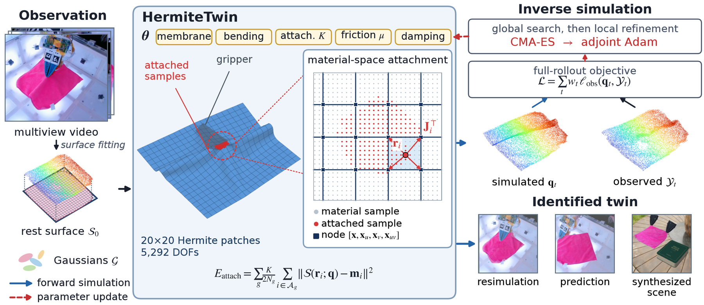
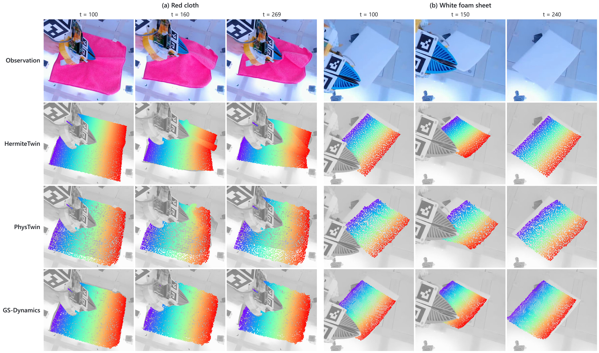
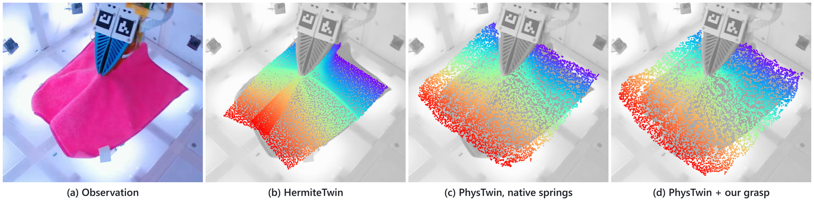

로봇이 수건 모서리를 집어 접어 넘기는 장면을 시뮬레이터에서 다시 돌리려면 수건이 어느 선을 따라 얼마나 휘는지와 로봇 손이 수건의 어느 부분을 물고 있는지를 함께 맞혀야 해요. 얇은 천은 잘 늘어나지 않으면서 쉽게 휘어서 모양 대부분이 굽힘으로 정해지고, 로봇 손 끝의 <abbr title="로봇 팔 끝에 달려 물체를 집고 놓는 집게">그리퍼</abbr>는 좁은 면을 물었다가 놓아요.

난카이대학교, 푸단대학교, 상하이 인공지능 연구소 등의 연구진이 2026년 11월 20일 <abbr title="연구자들이 논문을 심사 전에 올려 공개하는 온라인 저장소">arXiv</abbr>에 공개한 <abbr title="얇은 천이나 스펀지 판을 매끄러운 곡면 모델로 계산하고, 그리퍼가 무는 부분은 촘촘한 점으로 따로 계산하는 가상 복제 방법">HermiteTwin</abbr>은 이 두 가지를 서로 다른 해상도로 나눠 표현하는 <abbr title="실제 물체의 모양과 움직임을 컴퓨터 안에 그대로 옮겨, 같은 조작을 가상으로 다시 해 볼 수 있게 만든 복제 모델">디지털 트윈</abbr>이에요. 물체는 칸 수가 적은 매끄러운 곡면으로 시뮬레이션하고, 그리퍼가 무는 자리는 곡면 위에 촘촘히 찍어 둔 점으로 따로 계산해요. 실제 로봇이 천과 <abbr title="스펀지처럼 속에 공기 구멍이 많은 푹신한 소재">폼</abbr>을 다루는 기록 열 건에서 이 구조는 기존 방법보다 관측된 움직임을 더 가깝게 재현했고, 기록 한 건에서 접촉 모델만 기존 방법에 옮겨 붙여 본 실험에서는 같은 접힘이 나오지 않았어요.

## 영상에서 복원한 디지털 트윈과 점 집합 하나가 맡은 두 역할

이 논문이 다루는 디지털 트윈은 로봇이 물체를 다루는 영상에서 그 물체의 형상과 움직이는 성질, 겉모습을 복원해 만든 시뮬레이터예요. 한번 만들어 두면 기록된 조작을 다시 돌려 보는 재시뮬레이션을 하거나, 기록이 끝난 뒤의 움직임을 예측하거나, 기록에 없던 조작의 결과를 그려 볼 수 있어요. 논문은 이런 시뮬레이션이 실물 시험 없이 로봇의 행동 규칙을 평가하는 데 이미 쓰이고 있다고 소개해요. 트윈이 실제와 얼마나 가까울지는 두 가지 모델링 선택에 달려 있어요. 물체를 어떤 물리 표현으로 나타내는지와 로봇과의 접촉이 그 표현에 어떻게 들어오는지예요.

비교 기준이 된 <abbr title="영상에서 물체를 스프링으로 이어진 점들의 모델로 복원하는 기존 디지털 트윈 방법">PhysTwin</abbr>은 물체를 <abbr title="물체를 무게를 가진 점들로 나누고 점 사이를 스프링으로 이어 움직임을 계산하는 모델">스프링과 질점 모델</abbr> 하나로 나타내요. 물체를 이루는 점들이 물체의 변형도 나타내고 그리퍼와 물체를 잇는 연결점 노릇도 해요. 연구진은 점 집합 하나가 굽힘을 표현하는 일과 접촉을 계산하는 일을 한꺼번에 맡는다는 점을 문제로 봤어요. 그리퍼가 무는 좁은 자리를 세밀하게 계산하려면 그 자리의 점이 촘촘해야 하는데, 그 점들이 곧 물체의 물리 상태라서 접촉 해상도와 상태의 크기가 한데 묶여요.

얇은 물체에서는 이 묶임이 더 불리해요. 천은 당기는 힘에는 잘 버티지만 쉽게 휘어서 모양이 휜 정도, 곧 곡률로 정해져요. 그리퍼는 좁은 면을 잡아 물고 있다가 나중에 놓아요. HermiteTwin은 대상을 사각형 한 장으로 펼칠 수 있는 얇은 시트로 좁혀요. 시트의 변형은 <abbr title="두께가 길이와 폭에 견줘 아주 얇아서 곡면 한 장으로 다루는 구조물 모델">셸</abbr>이라는 곡면 모델에 맡기고 접촉은 곡면 위의 표본 점에 맡겨서, 각각에 맞는 해상도를 따로 정해요.

## 셸은 적은 칸으로 매끄러운 곡면을 만들어요

셸을 만들려면 먼저 물체 표면의 각 지점에 <abbr title="물체가 어떻게 움직이고 접혀도 바뀌지 않도록 물체 표면의 각 지점에 붙여 둔 주소">재질 좌표</abbr>를 붙여요. 첫 프레임에서 관측한 물체의 점들을 그 점들에 맞춘 평면에 내려놓고 점들을 감싸는 가장 작은 사각형을 구한 뒤, 사각형의 가로와 세로를 0에서 1 사이의 좌표 두 개로 삼아요. 시트가 이 사각형 위에 평평하게 놓인 모양이 힘을 받지 않을 때의 기준 형상이에요.

이 사각형을 격자로 나눈 칸 하나하나가 <abbr title="칸의 네 모서리에 위치와 방향 값을 함께 저장하고, 그 값들로 칸 안의 곡면을 삼차 곡선으로 채우는 방식">쌍삼차 에르미트 요소</abbr>예요. 격자점에는 위치 하나만 두지 않아요. 그 점에서 곡면이 가로 방향과 세로 방향으로 뻗어 나가는 방향, 두 방향이 함께 비틀린 정도까지 <abbr title="크기와 방향을 함께 가진 값으로, 3차원에서는 숫자 세 개로 적어요">벡터</abbr> 네 개를 저장해요. 3차원 벡터가 네 개이니 격자점 하나가 숫자 12개를 가져요. 칸 안의 곡면은 네 모서리가 가진 벡터 16개를 삼차 곡선 모양의 가중치로 섞어서 정해요.

이웃한 칸은 모서리의 방향 값을 공유하므로 칸이 만나는 선에서 곡면이 꺾이지 않아요. 수학에서는 이 성질을 <abbr title="조각들이 만나는 자리에서 위치뿐 아니라 뻗어 나가는 방향까지 끊기지 않고 이어지는 성질">C1 연속</abbr>이라고 불러요. 곡면이 매끄러우면 곡률을 칸 안 어디서나 계산할 수 있고, 그 곡률로 굽힘 에너지를 정의할 수 있어요.

논문은 <abbr title="얇은 판이 휠 때 두께 방향으로 밀리는 변형은 없다고 보고, 곡면이 휜 정도만으로 굽힘 저항을 계산하는 고전 이론">키르히호프-러브 굽힘</abbr> 이론을 써서, 늘어남에 저항하는 막 에너지와 휨에 저항하는 굽힘 에너지를 더한 값을 탄성 에너지로 삼았어요. 두 항에는 배율이 하나씩 붙어 있고, 이 배율은 나중에 영상에 맞춰 조정하는 <abbr title="시뮬레이터의 동작을 정하는 설정값으로, 여기서는 뻣뻣한 정도나 마찰 같은 물리 값이에요">파라미터</abbr>예요. 이 곡면에서는 굽힘이 곡률로 바로 정의되고 늘어남과 별개인 <abbr title="물체가 변형에 얼마나 세게 버티는지를 나타내는 값으로, 클수록 뻣뻣해요">강성</abbr> 값을 가져요.

실험에 쓴 격자는 가로세로 20칸이에요. 격자점은 21×21로 441개이고 점마다 숫자 12개를 가지니 물체의 물리 상태는 숫자 5,292개로 표현돼요. 논문이 적은 <abbr title="모델의 상태를 정하려면 따로따로 값을 줘야 하는 숫자의 개수">자유도</abbr> 수와 같아요.

시간은 <abbr title="다음 순간의 상태를 방정식을 풀어 구하는 계산 방식으로, 뻣뻣한 물체도 큰 시간 간격에서 안정적으로 계산돼요">암시적 적분</abbr>으로 넘겨요. 매 단계에서 관성, 탄성, 그리퍼 부착, 접촉, 마찰 에너지를 더한 값이 가장 작아지는 상태를 찾고, 영상 한 프레임을 다섯 단계로 나눠 계산해요. 셸이 그리퍼와 탁자를 파고들지 않게 막는 일은 <abbr title="물체끼리 가까워질수록 급격히 커지는 밀어내는 에너지를 넣어 서로 파고들지 않게 하는 접촉 계산 방법">IPC</abbr>가 맡아요.

## 그리퍼가 무는 자리는 재질 좌표 위의 촘촘한 표본이 맡아요

그리퍼로 물체를 잡는 동작인 <abbr title="로봇이 그리퍼로 물체를 잡는 동작">파지</abbr>는 격자점에 맡기지 않고 재질 좌표 위에 일정한 간격으로 찍어 둔 표본 점에 맡겨요. 표본마다 변하지 않는 재질 좌표가 있고, 3차원 위치는 그 좌표에서 곡면 식을 계산해 얻어요. 붉은 천 실험에서는 표본 간격이 2mm여서 후보가 약 21,000개였어요. 칸이 400개이니 칸 하나에 50개 남짓 들어가는 셈이에요.

표본의 위치는 그 표본이 속한 칸의 벡터 16개로 계산되므로, 표본을 늘려도 물체의 자유도는 5,292개 그대로예요. 접힌 자리가 칸 몇 개에 걸쳐 있을 뿐이어도 표본은 그 자리를 촘촘하게 덮어요.

표본은 자유, 포획, 고정 세 상태 가운데 하나에 있어요. 그리퍼 패드를 둘러싼 얇은 상자가 계산 단계 사이에 자유 상태의 표본 위를 지나가면 그 표본이 포획돼요. 이때 표본의 재질 좌표, 어느 쪽 패드에 잡혔는지, 그리퍼 기준 좌표로 나타낸 목표 위치가 기록돼요. 그리퍼가 완전히 물기 전에는 목표 위치가 패드 면을 따라 표본 쪽으로 조금 움직일 수 있고, 무는 순간 그리퍼 기준 좌표에 고정되어 그리퍼와 한 덩어리로 움직여요.

그리퍼가 놓으면, 또는 물기 전에 표본이 패드 영역을 벗어나면 표본은 자유 상태로 돌아가고 다시 포획될 수 있어요. 잡는 대상이 정해진 격자점 묶음이 아니고 그 순간 그리퍼 아래에 있는 재질이라서, 천을 새로 잡을 때마다 그 자리의 표본이 포획돼요.

포획된 표본은 목표 위치에서 벗어난 거리의 제곱에 비례하는 부착 에너지를 받아요. 스프링으로 끌어당기는 것과 같은 형태예요. 이 에너지는 그리퍼마다 활성 표본 수로 나눠서, 표본을 더 촘촘히 찍어도 한 번 잡는 힘의 전체 세기가 달라지지 않게 했어요. 표본 하나가 받는 당김은 에르미트 가중치를 거쳐 그 칸의 벡터 16개로 나뉘어 전달돼요. 활성 표본 집합이 정해져 있는 동안 부착 에너지는 식의 꼴이 단순해서, 매 단계에 푸는 방정식에 일정한 항 하나를 더할 뿐이에요.

<figure class="fig"><figcaption>가운데 파란 곡면이 20×20칸 에르미트 셸이에요. 오른쪽 확대 그림에서 굵은 격자선이 칸의 경계, 회색 점이 재질 좌표 표본, 붉은 점이 그리퍼에 포획된 표본이고, 붉은 화살표는 표본 하나의 당김이 칸의 네 모서리로 나뉘는 모습이에요. <a href="https://arxiv.org/html/2611.27282v1">Zhang 연구진, 그림 1</a> · <a href="https://creativecommons.org/licenses/by/4.0/">CC BY 4.0</a> · 논문 소스에 들어 있는 벡터 그림을 이미지로 변환하고 크기를 조정함</figcaption></figure>

## 영상만으로 유효 파라미터를 거꾸로 찾아요

입력은 위치와 방향을 보정한 카메라 여러 대의 영상, 그리퍼의 이동 궤적, 그리퍼가 닿고 물고 놓는 시점이에요. 기준 형상과 겉모습은 첫 프레임에서 만들고, 재료와 접촉의 파라미터는 <abbr title="시뮬레이션 결과가 관측과 같아지도록 시뮬레이터의 설정값을 거꾸로 찾아내는 일">역시뮬레이션</abbr>으로 찾아요. 파라미터를 하나 정해 기록된 그리퍼 궤적대로 시뮬레이션을 처음부터 끝까지 돌리고, 시뮬레이션한 표면의 점들과 영상에서 추적한 물체 점들이 얼마나 떨어져 있는지를 재서, 그 값이 줄어드는 쪽으로 파라미터를 고쳐요. 거리는 <abbr title="두 점 무리에서 각 점이 상대 무리의 가장 가까운 점과 떨어진 거리의 제곱을 양쪽 방향으로 평균한 값">챔퍼 거리</abbr>로 재요.

찾는 파라미터는 다섯 개예요. 막 강성 배율, 굽힘 강성 배율, 부착 강성, 탁자 마찰, 그리고 움직임이 잦아드는 정도를 정하는 감쇠예요. 기준 재료값은 천과 폼에 똑같이 <abbr title="재료가 얼마나 뻣뻣한지를 나타내는 값으로, 클수록 같은 힘에 덜 늘어나요">탄성 계수</abbr> 100kPa를 주고 두께만 천 1mm, 폼 5mm로 달리했어요.

재료값을 하나하나 찾지 않고 이 다섯 값만 찾아요. 영상에는 힘 측정값이 없어서 논문은 이렇게 얻은 값을 유효값으로 다루고, 강성과 기준 형상, 마찰, 부착이 서로의 오차를 일부 메워 줄 수 있다고 적었어요. 실제 천의 물성을 잰 값으로 읽으면 안 된다는 뜻이에요.

최적화는 두 단계예요. 그리퍼가 표본을 포획하고 무는 사건이 끼어 있어서 오차는 파라미터에 따라 구간별로만 매끄럽게 변하고, 가장 낮은 곳이 하나로 모이는 모양도 아니에요. 그래서 먼저 <abbr title="후보 값을 여러 개 뿌려 시뮬레이션해 보고, 결과가 좋았던 쪽으로 다음 후보를 뽑는 범위를 옮겨 가는 탐색 방법으로, 오차가 매끄럽게 변하지 않아도 쓸 수 있어요">CMA-ES</abbr>로 넓게 탐색하고, 모든 후보를 같은 물기와 놓기 일정으로 돌려요.

가장 좋은 후보를 출발점으로 삼아 오차의 <abbr title="파라미터를 어느 쪽으로 얼마나 바꾸면 오차가 줄어드는지 알려 주는 값">기울기</abbr>를 구하고 <abbr title="기울기의 최근 흐름을 반영해 한 번에 고치는 폭을 스스로 조절하는 최적화 방법">Adam</abbr>으로 다듬어요. 기울기는 <abbr title="시뮬레이션을 끝에서 처음으로 거슬러 올라가며 각 파라미터가 최종 오차에 준 영향을 한 번에 계산하는 방법">수반법</abbr>으로 계산하고, 그동안 접촉 구성은 고정해 둬요. 계산량은 기본값 평가 한 번, CMA-ES 후보 5개씩 4세대, Adam 반복 10번이에요.

겉모습은 물리와 떼어 놓았어요. 첫 프레임에서 물체를 <abbr title="수많은 반투명 타원형 점으로 장면을 나타내, 어느 각도에서 본 모습이든 빠르게 그려 내는 기법">가우시안 스플래팅</abbr>으로 복원하고, 가우시안 하나하나를 가까운 표면 점 16개에 묶어 그 점들의 움직임을 따라가게 해요. 색과 불투명도는 고정이고, 이미지 오차는 파라미터를 찾는 데 쓰지 않아요. 같은 겉모습 모델을 서로 다른 시뮬레이터에 얹을 수 있어서, 그려 낸 그림의 차이는 시뮬레이션한 움직임의 차이만 반영해요.

## 실험 조건은 붉은 천 여덟 건과 폼 시트 두 건이에요

자료는 <abbr title="로봇이 변형되는 물체를 다루는 장면을 카메라 여러 대와 촉각 센서로 함께 기록한 데이터셋">Deform360</abbr>에서 고른 상호작용 열 건이에요. 약 29×29cm 붉은 천이 여덟 건, 약 10.5×15.7cm 흰 폼 시트가 두 건이고, 로봇은 그리퍼 한 개나 두 개로 시트를 잡아요. 각 기록에는 카메라 여러 대로 찍은 초당 30프레임 영상과 로봇의 움직임, 손가락 끝의 촉각 신호가 들어 있어요. 닿는 시점과 무는 시점, 놓는 시점은 촉각 신호가 기준값을 넘는지로 찾아서 파라미터를 맞추기 전에 고정했어요. 붉은 천은 1번부터 300번 프레임, 폼 시트는 1번부터 267번 프레임으로 파라미터를 맞췄고, 붉은 천 기록의 나머지 프레임은 예측 평가용으로 남겨 뒀어요.

비교 대상은 둘이에요. PhysTwin은 원래의 스프링과 질점 모델, 시간 적분 방식, 최적화 방식을 그대로 쓰되 맞출 때의 목표를 HermiteTwin과 같은 챔퍼 거리로 바꿨어요. 이 기록들에서는 그리퍼가 멀리서 다가오기 때문에, 그리퍼와 물체를 잇는 스프링은 닿는 시점에 그리퍼 근처의 점들에 한 번 연결되고 놓을 때까지만 작용해요. <abbr title="점들의 다음 움직임을 물리 방정식 없이 신경망으로 예측하도록 학습한 시뮬레이터">GS-Dynamics</abbr>는 그리퍼의 움직임에서 물체 점들의 움직임을 <abbr title="점과 점 사이의 연결 관계를 따라 정보를 주고받으며 계산하는 신경망">그래프 신경망</abbr>으로 예측하는 학습형 시뮬레이터이고, 같은 프레임으로 학습했어요. 세 방법은 같은 관측을 쓰고 같은 겉모습 모델을 움직여요.

지표는 3차원 오차와 이미지 정확도 두 갈래예요. 3차원 오차는 챔퍼 거리를 제곱밀리미터로 적어요. 이미지 쪽은 고정 카메라 세 대에서 본 윤곽이 실제와 겹치는 비율인 <abbr title="두 영역이 겹친 넓이를 둘을 합친 넓이로 나눈 값으로, 100%에 가까울수록 윤곽이 잘 맞아요">IoU</abbr>와 화소 값의 차이를 나타내는 <abbr title="그려 낸 그림과 실제 사진의 화소 값 차이를 로그 눈금으로 나타낸 값으로, 클수록 두 그림이 비슷해요">PSNR</abbr>을 쓰고, 예측 평가에는 <abbr title="밝기와 대비, 무늬 구조가 얼마나 닮았는지를 0에서 1 사이로 나타낸 값으로, 1에 가까울수록 비슷해요">SSIM</abbr>과 <abbr title="학습된 신경망이 두 그림을 얼마나 다르게 느끼는지를 잰 값으로, 작을수록 사람 눈에 비슷해 보여요">LPIPS</abbr>를 더했어요. 그리퍼가 차지한 화소는 비교에서 빼요. 계산에는 NVIDIA RTX 5090 그래픽 카드를 썼고, 열 건을 모두 맞추는 데 HermiteTwin이 약 6.5시간, PhysTwin이 약 5시간 걸렸어요.

## 재시뮬레이션과 미래 예측에서 모두 오차가 줄었어요

아래는 파라미터를 맞추는 데 쓴 프레임을 다시 시뮬레이션한 결과예요. 열 건을 같은 비중으로 평균했어요.

| 방법 | 챔퍼 거리(mm²) | 윤곽 IoU(%) | PSNR(dB) |
| --- | ---: | ---: | ---: |
| GS-Dynamics | 116.95 | 83.24 | 22.160 |
| PhysTwin | 61.89 | 85.22 | 22.745 |
| HermiteTwin | 42.05 | 88.89 | 24.242 |

HermiteTwin의 챔퍼 거리는 PhysTwin보다 약 32% 작아요. 숫자보다 눈에 띄는 차이는 접힘이에요. 붉은 천 기록에서 그리퍼는 모서리를 집어 들어 올린 뒤 시트 위로 접어 넘겨요.

<figure class="fig"><figcaption>왼쪽 세 칸이 붉은 천, 오른쪽 세 칸이 폼 시트예요. 맨 윗줄이 실제 영상이고 아래 세 줄이 각 방법의 재시뮬레이션이며, 점의 색은 기준 형상에서의 재질 좌표를 나타내요. 붉은 천의 160번과 269번 프레임에서 접혀 넘어간 모서리는 HermiteTwin 줄에 재현돼 있고 아래 두 줄에서는 시트가 거의 평평해요. <a href="https://arxiv.org/html/2611.27282v1">Zhang 연구진, 그림 2</a> · <a href="https://creativecommons.org/licenses/by/4.0/">CC BY 4.0</a> · 원문 배치대로 타일을 한 장으로 합치고 크기를 조정함</figcaption></figure>

HermiteTwin은 160번과 269번 프레임에서 접힌 모서리를 재현했고 두 비교 방법은 시트를 거의 평평하게 뒀어요. PhysTwin에는 촉각 신호에서 얻은 접촉 시점을 줘서 그리퍼가 천에 닿은 뒤에야 스프링이 연결되게 했는데도 접힘이 생기지 않았어요. 폼 시트는 천보다 훨씬 뻣뻣해요. PhysTwin의 시트는 잡힌 자리 주변에서 휘어 버렸고 HermiteTwin의 시트는 평평한 모양을 지켰어요.

예측 평가는 붉은 천 여덟 건에서 했어요. 앞 300프레임으로 맞춘 모델을 파라미터를 고정한 채 기록 끝까지 이어 돌렸고, 시뮬레이션 상태를 관측에 맞춰 되돌려 놓지 않았어요.

| 방법 | 챔퍼 거리(mm²) | 윤곽 IoU(%) | PSNR(dB) | SSIM | LPIPS |
| --- | ---: | ---: | ---: | ---: | ---: |
| GS-Dynamics | 552.40 | 71.40 | 17.696 | 0.9132 | 0.1291 |
| PhysTwin | 120.40 | 81.08 | 20.022 | 0.9316 | 0.0994 |
| HermiteTwin | 67.75 | 84.78 | 21.417 | 0.9396 | 0.0850 |

다섯 지표 모두 HermiteTwin이 가장 좋았고, 챔퍼 거리는 PhysTwin보다 약 44% 작아요. 이 실험에서 그리퍼의 미래 움직임과 접촉 시점은 기록에서 가져와요. 로봇이 무엇을 할지는 알고 있는 상태에서 천이 어떻게 따라올지를 맞히는 평가이고, 로봇의 행동까지 예측하는 평가는 아니에요. 두 표는 평균한 기록의 구성이 달라요. 앞 표는 폼을 포함한 열 건이고 뒤 표는 붉은 천 여덟 건이라서 두 표의 숫자를 그대로 견주기는 어려워요.

## 파지 모델만 옮겨서는 접힘이 나오지 않았어요

앞의 비교는 물리 표현과 파지 모델을 한꺼번에 바꾼 것이라 어느 쪽이 차이를 만들었는지 가려지지 않아요. 연구진은 붉은 천 기록 한 건에서 HermiteTwin의 파지 모델을 PhysTwin에 옮겨 붙였어요. 천을 이루는 모든 점을 파지 후보로 두고, 패드 둘레의 얇은 상자가 지나가면 포획하고, 무는 순간 목표를 고정하고, 놓으면 풀어 주는 같은 규칙이에요. 파지 강성을 활성 점의 수로 나누는 것도 같고, 이 변형판은 파지 강성까지 함께 최적화했어요.

<figure class="fig"><figcaption>왼쪽부터 실제 관측, HermiteTwin, 원래의 연결 스프링을 쓴 PhysTwin, HermiteTwin의 파지 모델을 옮겨 붙인 PhysTwin이에요. 맨 오른쪽에서 그리퍼 끝 근처의 천은 들렸지만 관측된 접힘은 생기지 않았어요. <a href="https://arxiv.org/html/2611.27282v1">Zhang 연구진, 그림 4</a> · <a href="https://creativecommons.org/licenses/by/4.0/">CC BY 4.0</a> · 원문 배치대로 타일을 한 장으로 합치고 크기를 조정함</figcaption></figure>

옮겨 붙인 파지는 작동해서 포획된 점들이 그리퍼를 따라갔어요. 그런데 시트는 옆으로 펼쳐진 채 남았고 HermiteTwin이 재현한 접힘은 생기지 않았어요. 연구진은 이 결과를 근거로, 파지 모델만으로는 차이가 설명되지 않고 셸 표현도 차이에 기여한다고 해석해요. 논문은 이 결과를 기록 한 건의 한 프레임 그림으로 제시했고, 기여의 크기를 잰 수치는 싣지 않았어요.

연구진은 부착 에너지 없이 마찰 접촉만으로 시트를 잡게 하는 길도 시도했는데 두 군데서 막혔다고 해요. 첫째로 파지가 잘 성립하지 않았어요. 가장자리나 모서리는 그리퍼 사이로 바로 들어가지만, 평평한 시트에서 주름을 집어 올려야 하는 파지는 그리퍼 벌림과 자세, 높이, 굽힘 강성을 바꿔 봐도 시트가 미끄러지거나 계산이 멈췄어요. 그리퍼를 미리 벌렸다가 손으로 조정한 경로를 따라 단계적으로 닫아야만 잡혔고, 계산 시간도 부착 방식의 세 배 이상이었어요.

둘째로 기울기가 맞지 않았어요. 수반법으로 구한 기울기를 <abbr title="파라미터를 아주 조금 바꿔 시뮬레이션을 다시 돌리고, 결과가 달라진 만큼으로 기울기를 어림하는 방법">유한 차분</abbr>으로 구한 값과 대조하니 손가락이 닫히는 동안에는 맞았지만 시트가 들린 뒤에는 맞지 않았어요. 연구진은 손가락을 변형되지 않는 단단한 물체로 두고 셸과 묶어 계산하는 방식이 수반법이 다시 풀어야 하는 방정식을 풀기 어렵게 만드는 것, 그리고 마찰로만 들린 시트에서 접촉 위치가 단계마다 급하게 바뀌는 것을 원인으로 추정해요. 부착 방식은 물 때부터 놓을 때까지 매끄러운 에너지로 표본을 붙잡고 있어요. 시트가 그리퍼에 남아 있는지가 마찰 계수에 좌우되지 않고, 파지 상태는 포획과 놓기 시점에만 바뀌어요.

## 유효 파라미터와 기록 한 건짜리 트윈이라는 한계

트윈은 기록된 상호작용 한 건마다 하나씩 만들어져요. 파라미터는 그 한 건의 영상에 맞춘 유효값이라 다른 조작에서도 같은 값이 맞는다는 보장이 없어요. 숫자로 확인한 예측은 기록된 조작의 뒷부분을 이어 돌린 경우뿐이에요. 논문에는 천을 책 위에 걸치거나 상자 안에 내려놓는 동작, 천 위에 세워 둔 병이 천이 들리면서 넘어지는 장면처럼 기록에 없던 조작을 넣은 결과도 실려 있지만, 대응하는 실제 영상이 없어서 그림으로만 보여 줘요. 연구진은 같은 물체의 상호작용 여러 건에서 공통 모델을 찾는 일을 다음 과제로 적었어요.

입력으로는 보정된 카메라 여러 대의 영상에서 추적한 물체 점이 있어야 하고, 정확도는 그 추적의 품질을 넘지 못해요. 닿고 물고 놓는 시점은 추정하지 않고 촉각 신호에서 가져와 고정해요. 대상은 사각형 한 장으로 펼칠 수 있고 평평하게 놓인 상태가 기준 형상인 얇은 시트예요. 소매가 달린 옷처럼 사각형 한 장으로 펼쳐지지 않는 물체는 이 논문에서 다루지 않았어요.

검증에 쓴 물체는 천 한 종류와 폼 한 종류이고 기록은 열 건이에요. PhysTwin은 목표를 챔퍼 거리로 바꾸고 그리퍼 연결 스프링을 접촉 구간에만 작용하게 한 상태로 돌렸고, 두 방법 모두 CMA-ES 후보 20개와 Adam 10회라는 같은 예산을 썼어요. 예산을 늘렸을 때 격차가 어떻게 달라지는지는 이 논문으로 알 수 없어요.

겉모습에는 별도의 한계가 있어요. 가우시안은 셸을 따라 옮겨지기만 해서 주름에서 보는 각도에 따라 달라지는 음영이나 접히면서 새로 드러난 면을 그리지 못해요. 이 때문에 이미지 지표는 물리 계산의 정확도와 별개로 제한돼요.

## 얇은 물체의 디지털 트윈을 만들 때 확인할 순서

이 결과를 디지털 트윈 작업에 옮긴다면 먼저 볼 것은 물체가 사각형 한 장으로 펼쳐지는 얇은 시트인지예요. 수건이나 얇은 폼처럼 굽힘이 모양을 정하는 물체라면 굽힘 강성을 따로 가진 셸 표현을 검토할 이유가 있어요. 이 논문의 진단 실험은 기록 한 건뿐이지만, 거기서는 점 모델에 파지 규칙만 더해서는 접힘이 나오지 않았어요.

다음은 상태 해상도와 접촉 해상도를 따로 정할 수 있는지예요. 약 29cm인 붉은 천을 20칸으로 나누면 칸 하나의 한 변은 약 1.45cm이고, 표본 간격은 2mm였어요. 그리퍼가 무는 면이 칸보다 작다면, 물체의 점을 늘려 접촉을 표현하는 방식은 상태 크기를 접촉 해상도에 맞춰 키워야 해요. 접촉 표본을 상태와 분리해 두면 표본 밀도를 바꿔도 자유도와 파지의 전체 세기가 그대로라서, 밀도를 그리퍼 패드의 크기에 맞춰 고를 여지가 생기는 것으로 보여요.

접촉 시점을 어디서 얻을지도 미리 정해야 해요. 이 방법은 닿는 시점과 무는 시점, 놓는 시점을 촉각 신호에서 받아 고정하고, 모든 후보 시뮬레이션이 같은 일정을 재생해요. 촉각 센서가 없는 장비라면 그리퍼를 여닫은 명령 기록처럼 접촉 시점을 대신 알려 줄 신호가 있는지부터 확인해야 할 것으로 보여요.

기울기로 파라미터를 찾는다면 기울기를 계산하는 동안 접촉 구성을 고정해 두는 설계를 참고할 만해요. 마찰만으로 잡는 모델에서는 시트가 들린 뒤 수반법 기울기가 유한 차분과 어긋났어요. 미분 가능한 시뮬레이터를 쓰더라도 접촉이 있는 구간에서는 기울기를 유한 차분과 대조해 본 뒤에 믿는 편이 안전해요.

마지막은 평가예요. 맞춘 구간을 다시 돌린 오차만으로는 파라미터들이 서로의 오차를 메우고 있는지 알 수 없어요. 뒤쪽 프레임을 남겨 두고 상태를 되돌리지 않은 채 이어 돌린 오차를 따로 보면, 맞춘 구간 밖에서도 값이 통하는지를 가늠할 수 있을 것으로 보여요. 겉모습 모델을 공유해 시뮬레이터 차이만 그림에 남게 한 설계도 비교에 쓸 만해요. 얻은 값은 그 기록에 맞춘 유효값이므로, 다른 조작에 쓰기 전에는 그 조작의 실제 영상으로 한 번 더 확인해야 해요.

<!-- src-block -->
출처 — https://arxiv.org/abs/2611.27282
