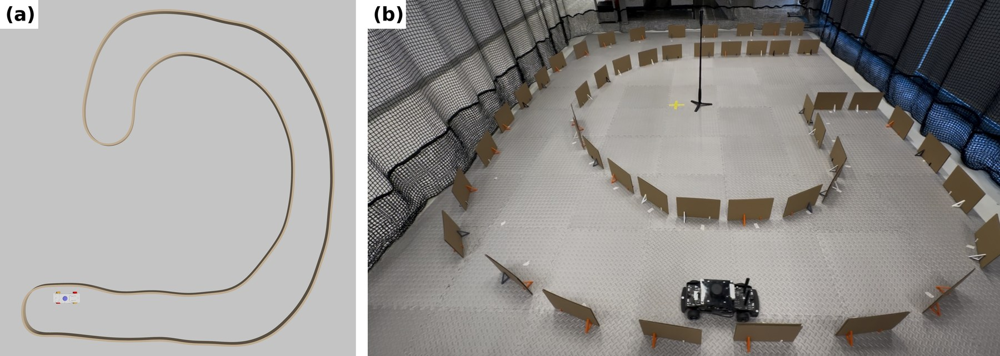
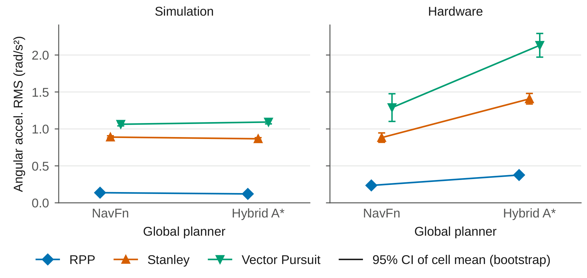

로봇 주행 소프트웨어의 구성을 고를 때는 시뮬레이터에서 후보 조합을 여럿 돌려 보고 결과가 좋은 것을 실물에 올리는 순서가 흔해요. 이 순서는 시뮬레이션에서 나온 우열이 실물에서도 유지된다는 가정에 기대요.

헤리엇와트대학교 두바이 캠퍼스 연구진이 2026년 11월 18일 <abbr title="연구자들이 논문을 심사 전에 올려 공개하는 온라인 저장소">arXiv</abbr>에 공개한 논문은 이 가정을 조합 단위로 시험했어요. <abbr title="자동차처럼 앞바퀴를 꺾어 방향을 바꾸는 방식으로, 제자리에서는 돌 수 없어요">Ackermann 조향</abbr> 방식의 10분의 1 크기 차량과 그 차량을 본뜬 <abbr title="로봇과 주변 환경을 물리 법칙에 따라 컴퓨터 안에서 움직여 보는 공개 시뮬레이터">Gazebo</abbr> 시뮬레이션에서 <abbr title="지도 위에서 출발점부터 목표까지 갈 길 전체를 미리 그리는 프로그램">전역 플래너</abbr> 두 개와 <abbr title="계획된 길을 따라가도록 매 순간 속도와 조향 명령을 만드는 프로그램">경로 추종 제어기</abbr> 세 개를 짝지은 여섯 조합을 같은 코드로 모두 60번 달렸어요. 제어기끼리의 순위는 두 환경에서 거의 같았어요. 반면 플래너를 바꿨을 때 주행 명령이 얼마나 거칠어지는지는 시뮬레이션이 크기도 방향도 맞히지 못했어요.

## 플래너와 제어기를 따로 고르는 구조와 Ackermann 차량의 제약

자율 주행 소프트웨어는 보통 두 층으로 나뉘어요. 전역 플래너가 지도 위에서 목표까지의 경로를 정하고, 경로 추종 제어기가 그 경로를 따라가도록 속도와 조향 명령을 만들어요. <abbr title="로봇 프로그램들이 서로 데이터를 주고받게 해 주는 공개 소프트웨어 기반">ROS 2</abbr>의 주행 소프트웨어 묶음인 <abbr title="지도에서 길을 찾고 그 길을 따라 로봇을 움직이는 기능을 모아 둔 공개 소프트웨어">Nav2</abbr>는 두 층을 독립된 부품으로 두어서, 플래너와 제어기를 각각 골라 끼울 수 있어요.

Ackermann 조향 차량에서는 두 층의 관계가 특히 중요해요. 앞바퀴를 꺾어 도는 차는 제자리에서 돌 수 없고, 그보다 작게는 돌 수 없는 최소 회전 반지름이 있어요. 격자 지도 위에서 길만 찾는 플래너는 차가 따라갈 수 없을 만큼 급한 굽이를 경로에 넣을 수 있고, 차의 회전 한계를 계획 단계에서 반영하는 플래너는 그런 굽이를 만들지 않아요. 플래너는 어디로 갈지와 함께 제어기가 얼마나 어려운 경로를 따라가야 하는지도 정해요.

논문에 따르면 기존 비교 연구는 대부분 경로를 고정해 두고 제어기만 견주거나, 제어기를 고정해 두고 플래너만 견줬어요. 그래서 두 가지가 확인되지 않은 채 남아 있었어요. 플래너를 바꾼 효과가 제어기에 따라 달라지는지, 그리고 그런 조합별 효과가 시뮬레이션에서 실물로 옮겨지는지예요.

## 같은 코드와 같은 트랙으로 맞춘 실물과 Gazebo 환경

실물 차량은 <abbr title="연구용으로 만든 10분의 1 크기 자율주행 실험 차량">Quanser QCar</abbr>예요. 앞뒤 바퀴 축 사이 거리가 0.256m이고 앞바퀴는 좌우 30도까지 꺾여서, 최소 회전 반지름이 약 0.44m예요. 조향 <abbr title="명령받은 각도로 움직여 주는 소형 모터 장치">서보</abbr>는 명령을 받은 뒤 따라가는 데 시간이 걸리고, 그 지연의 크기를 나타내는 <abbr title="명령이 바뀐 뒤 실제 값이 바뀔 양의 약 63%까지 따라가는 데 걸리는 시간">시정수</abbr>가 0.16초예요. 주행 소프트웨어 전체는 차에 실린 소형 컴퓨터 <abbr title="로봇에 싣는 NVIDIA의 소형 컴퓨터로, 계산 자원이 넉넉하지 않은 기종">Jetson TX2</abbr>에서 돌았어요.

트랙은 가로 5.2m, 세로 5.35m 실험 공간에 판지 벽을 세워 만든 갈고리 모양 통로예요. 통로 폭의 중앙값은 0.67m예요. 차는 직선 구간을 지나 중심선 반지름이 약 1.9m인 200도 왼쪽 굽이를 돌고, 되돌아오는 구간 끝에서 반지름 0.5m의 좁은 왼쪽 굽이를 돌아 막다른 곳에 도착해요. 출발점과 목표는 2.7m 떨어져 있지만 계획된 경로는 약 10.6m이고, 마지막 굽이는 차의 최소 회전 반지름에 가까워서 가장 까다로운 구간이에요.

차의 위치는 <abbr title="여러 대의 카메라로 물체에 붙인 표식을 추적해 위치와 방향을 정밀하게 재는 장치">모션 캡처</abbr> 카메라 여섯 대가 차에 붙인 표식 여섯 개를 추적해서 얻었고, 바퀴 회전 센서나 관성 센서의 값은 섞지 않았어요. 지도는 <abbr title="레이저를 쏘아 주변 물체까지의 거리를 재는 센서">라이다</abbr> 측정값을 지도 작성 프로그램 <abbr title="라이다 측정값을 이어 붙여 주변 지도를 만드는 공개 프로그램">Cartographer</abbr>에 넣어 만든 한 칸 0.05m짜리 <abbr title="공간을 작은 칸으로 나누고 칸마다 장애물이 있는지 적어 둔 지도">점유 격자</abbr>이고 실험 내내 바꾸지 않았어요. 로봇이 자기 위치를 추정하면서 생기는 오차가 결과에 섞이지 않게 한 설계예요.

시뮬레이션은 이 구성을 Gazebo Harmonic 판에 옮겼어요. 트랙 형상과 주행용 지도는 실물에서 만든 점유 격자에서 다시 만들었고, 차량 모델에는 같은 치수와 조향 지연 0.16초를 넣었어요. 두 환경의 목표 위치 차이는 1cm 미만이고, 실물의 평균 출발 위치는 시뮬레이션 출발점에서 0.08m 안쪽이었어요.

<figure class="fig"><figcaption>왼쪽이 Gazebo에 다시 만든 트랙과 차량 모델이고, 오른쪽이 판지 벽으로 만든 실물 트랙과 QCar예요. 시뮬레이션 트랙의 형상은 실물에서 만든 점유 격자에서 가져왔어요. <a href="https://arxiv.org/html/2611.24800v1">Saeed 연구진, 그림 4</a> · <a href="https://creativecommons.org/licenses/by/4.0/">CC BY 4.0</a> · 크기를 줄이고 이미지 형식을 바꿈</figcaption></figure>

소프트웨어는 가능한 한 같게 맞췄어요. <abbr title="차가 실제로 꺾을 수 있는 정도를 지키면서 길을 찾는 경로 탐색 방법">Hybrid A\*</abbr> 플래너와 제어기 세 개는 두 환경에서 바이트 단위로 같은 소스 파일과 설정값을 썼고, ROS 2에 연결하는 겉 부분만 달랐어요. 실물은 Jetson TX2의 제약 때문에 ROS 2의 Dashing <abbr title="같은 소프트웨어를 시기별로 묶어 내놓은 판으로, 판이 다르면 들어 있는 기능과 구현이 달라요">배포판</abbr>을, 시뮬레이션은 Jazzy 배포판을 썼어요. <abbr title="지도를 격자 칸으로 보고 목표에서 퍼져 나가는 거리 값을 따라 길을 찾는 Nav2의 기본 플래너">NavFn</abbr> 플래너는 배포판마다 들어 있는 기본 구현에 같은 설정값을 줬어요.

주행 절차도 같아요. 목표 하나에 전역 경로를 한 번만 계획하고, 주행 중에 경로를 다시 짜는 기능과 막혔을 때의 복구 동작은 껐어요. 주행 한 번이 제어기 하나가 경로 하나를 따라간 결과가 되게 한 거예요. 코드와 처리한 지표 결과는 [실물용 저장소](https://github.com/HWUD-AIMBeyonD/qcar)와 [시뮬레이션용 저장소](https://github.com/HWUD-AIMBeyonD/QCarSim)에 공개돼 있어요.

| 항목 | 실물 | 시뮬레이션 | 대응 |
| --- | --- | --- | --- |
| Hybrid A\*와 제어기 세 개 | 독립 실행 프로그램 | 같은 알고리즘과 설정값 | 동일 |
| NavFn | Dashing 기본 구현 | Jazzy 기본 구현, 같은 설정값 | 설정값 일치 |
| 차의 위치 기준 | 모션 캡처, 초당 50회 | 시뮬레이터가 아는 참값, 초당 약 48회 | 비슷함 |
| 주행용 지도 | Cartographer 점유 격자 | 같은 격자에서 생성 | 일치 |
| 조향 명령 한계와 지연 | ±0.5rad(약 28.6도), 0.16초 | 같음 | 동일 |
| 앞뒤 방향 속도 응답 | 속도를 재지 않는 스로틀 | 명령 속도를 그대로 따름 | 다름 |
| 명령 속도 | 0.35m/s | 0.30m/s | 다름 |

두 환경이 갈린 곳은 차가 앞뒤로 나아가는 방향의 응답이에요. 시뮬레이션은 이 방향의 움직임을 이상화해서, 차가 명령받은 속도를 정확히 따라갔어요. 실물 차는 실제 속도를 재서 고치지 않는 <abbr title="결과를 재서 되먹이지 않고 정해 둔 세기로만 모터를 돌리는 방식">개루프 스로틀</abbr>로 움직여서 명령보다 빠르게 달렸어요. 연구진은 이 차이 때문에 지표의 절대값을 두 환경 사이에서 견주지 않았어요. 환경마다 따로 구한 순위와 효과의 방향이 서로 같은지만 봤어요.

## 전역 플래너 두 개와 경로 추종 제어기 세 개의 차이

플래너 두 개는 차의 회전 한계를 계획에 넣는지로 갈려요. NavFn은 지도를 격자로 보고 목표에서부터 거리 값을 퍼뜨린 뒤 그 값이 줄어드는 쪽을 따라 길을 뽑아요. 차를 원 하나로 다루고 굽이의 급한 정도나 차의 방향에는 제한을 두지 않아요. Hybrid A\*는 위치와 방향을 함께 탐색하면서 차가 실제로 그릴 수 있는 0.15m 길이의 짧은 이동 조각만 이어 붙여요. 이 실험에서는 최소 회전 반지름을 차의 한계 0.44m보다 큰 0.5m로 줘서, 계획된 경로가 차의 회전 한계를 넘지 않게 했어요.

제어기 세 개는 모두 계산이 가벼운 기하 방식이고, 경로의 어느 지점을 보고 조향하는지가 달라요. <abbr title="경로 위의 조금 앞 지점을 겨냥해 조향하고, 급한 굽이에서는 속도를 줄이는 제어기">Regulated Pure Pursuit(RPP)</abbr>은 차에서 0.6m 이상 떨어진 경로 위 첫 지점을 겨냥해 조향해요. 겨냥할 지점까지의 이 거리를 전방 주시 거리라고 불러요. 경로에서 옆으로 벗어난 거리나 방향이 틀어진 각도를 직접 되먹이지 않아서, 전방 주시 거리보다 짧은 경로의 잔굴곡은 명령에 덜 드러나요.

<abbr title="가장 가까운 경로 지점에서 방향이 틀어진 각도와 옆으로 벗어난 거리를 함께 줄이도록 조향하는 제어기">Stanley</abbr>는 가장 가까운 경로 지점에서 방향이 틀어진 각도와 옆으로 벗어난 거리를 함께 고쳐요. 먼 지점을 겨냥하지 않으므로 경로의 국소적인 굴곡에 더 민감해요. 이 구현에서는 제어기에 현재 속도가 늘 0으로 전달돼서, 속도에 따라 달라져야 할 보정 세기가 차의 실제 속도와 무관하게 고정됐다고 논문은 밝혀요.

<abbr title="앞 지점을 겨냥하는 조향에 경로의 방향을 맞추는 항을 더한 제어기">Vector Pursuit</abbr>은 전방 지점을 겨냥하는 조향 항과 경로의 방향에 맞추는 항을 1.5와 2.0의 가중치로 더해요. 가중치를 정규화하지 않아서 일정한 굽이에서 필요한 조향의 약 2.5배를 명령하게 되고, 차가 굽이 안쪽으로 치우쳐야 균형이 맞아요.

세 제어기는 굽이가 급하면 속도를 명령값의 75%나 50%로 낮추는 2단계 감속을 같이 써요. 설정값은 평가 트랙이 아닌 별도의 급한 유턴 트랙에서 미리 조정한 뒤 두 플래너와 두 환경에 똑같이 고정했어요. 플래너마다 제어기를 다시 조정하지 않은 것은 플래너와 제어기 사이의 상호작용을 그대로 남겨 두기 위해서예요. 명령 속도도 한 환경 안에서는 모든 조합이 같았어요.

## 60회 주행에서 잰 지표와 일치 판정 방법

실험은 제어기 셋, 플래너 둘, 환경 둘의 모든 조합을 다섯 번씩 달린 60회 주행이에요. 60회 모두 목표에 도착했어요. 실물 주행은 한 번에 15–27초 걸렸고, 매번 손으로 차를 출발점에 놓아서 출발 위치는 0.03m, 방향은 1.7도의 <abbr title="값들이 평균에서 얼마나 흩어져 있는지를 나타내는 값">표준편차</abbr>로 흩어졌어요.

지표는 세 갈래예요. 추종 정확도는 차의 위치에서 계획된 경로까지의 가장 짧은 거리인 횡방향 오차로 재고, 주행 전체를 <abbr title="오차를 제곱해 평균한 뒤 제곱근을 구한 값으로, 큰 오차일수록 더 크게 반영돼요">RMSE</abbr>와 최댓값으로 요약해요. 명령의 매끄러움은 제어기가 내보낸 속도 명령이 얼마나 급하게 바뀌는지로 재요. 직진 속도 명령과 회전 속도 명령을 초당 20번 간격으로 다시 뽑아 이웃한 명령의 차이를 구하고, 그 <abbr title="값을 제곱해 평균한 뒤 제곱근을 구한 값으로, 값의 크기가 평균적으로 얼마나 되는지 나타내요">RMS</abbr>를 각각 선가속도 RMS와 각가속도 RMS라고 불러요. 차가 실제로 낸 가속도가 아니고 명령의 변화량이라서, 구동 응답이 다른 두 환경에서도 같은 식으로 계산할 수 있어요. 나머지는 주행 시간, 평균 속도, 계획 거리에 대한 실제 주행 거리의 비율인 경로 효율, 최종 목표 오차 같은 효율 지표예요.

효과의 크기는 환경마다 따로 추정했어요. 플래너 효과는 같은 제어기에서 Hybrid A\* 조합의 평균에서 NavFn 조합의 평균을 뺀 값이에요. 불확실성은 주행 기록을 1만 번 다시 뽑아 구한 95% <abbr title="측정한 주행들을 중복을 허용해 여러 번 다시 뽑아 보면서, 평균 차이가 흔들리는 범위를 어림한 구간">부트스트랩 신뢰구간</abbr>으로 나타내고, 구간이 0을 포함하지 않을 때만 효과가 확인됐다고 봐요. 통상의 <abbr title="관측한 차이가 우연으로도 나올 만한 크기인지 따지는 통계 절차">유의성 검정</abbr>은 쓰지 않았어요. 시뮬레이션은 거의 같은 결과가 반복돼서 조합 안의 편차가 1mm에 못 미치는 경우가 있고, 실물은 조합마다 다섯 번뿐이라 검정이 차이를 가려낼 힘이 약하다는 이유예요.

시뮬레이션과 실물의 일치는 세 가지로 봤어요. 여섯 조합의 평균값 순위가 두 환경에서 얼마나 같은지를 지표마다 <abbr title="두 목록에서 순위가 얼마나 같은지를 −1에서 1 사이로 나타낸 값으로, 1이면 순위가 완전히 같아요">스피어만 순위 상관</abbr>으로 구했어요. 같은 플래너 안에서 제어기 세 개의 순서가 같은지도 봤어요. 마지막으로 제어기별 플래너 효과의 부호가 같은지를 확인했어요.

## 제어기 순위는 두 환경에서 같았어요

제어기끼리의 우열은 시뮬레이션이 실물을 잘 따라갔어요. 각가속도 RMS는 두 플래너와 두 환경의 모든 경우에서 RPP가 가장 작고 Stanley, Vector Pursuit 순으로 커졌어요. 시뮬레이션에서 세 제어기의 값은 차례로 0.121–0.137, 0.867–0.890, 1.06–1.09<abbr title="회전 속도가 1초마다 얼마나 바뀌는지를 나타내는 단위">rad/s²</abbr>였고, 실물에서는 0.236–0.377, 0.882–1.41, 1.29–2.13rad/s²였어요. 선가속도 RMS도 모든 조합에서 RPP, Vector Pursuit, Stanley 순이었어요.

추종 정확도에서는 Vector Pursuit의 횡방향 오차가 모든 조합에서 가장 컸어요. RMSE가 시뮬레이션에서 0.124–0.184m, 실물에서 0.0939–0.144m였고, RPP와 Stanley는 모든 조합에서 0.070m 아래였어요. 논문은 이 오차가 굽이 안쪽으로 치우치는 조향 법칙의 성질과 맞는다고 해석해요. 다만 실물에서 NavFn과 짝지었을 때 직선 구간에서 크게 흔들린 것은 그 성질만으로 설명되지 않는다고 덧붙였어요. 이 조합의 최대 횡방향 오차는 평균 0.327m였고 한 번은 0.55m까지 벗어났어요.

| 지표 | 순위 상관 | 같은 플래너 안의 제어기 순서 |
| --- | ---: | --- |
| 횡방향 오차 RMSE | 0.886 | NavFn에서 일치, Hybrid A\*에서 불일치 |
| 횡방향 오차 최댓값 | 0.886 | 두 플래너 모두 일치 |
| 선가속도 RMS | 0.943 | 두 플래너 모두 일치 |
| 각가속도 RMS | 0.771 | 두 플래너 모두 일치 |
| 주행 시간 | 0.600 | 두 플래너 모두 불일치 |
| 평균 속도 | 0.600 | 두 플래너 모두 불일치 |
| 방향 오차 RMS | 0.371 | NavFn에서만 일치 |
| 최종 목표 오차 | 0.029 | 두 플래너 모두 불일치 |
| 경로 효율 | −0.714 | 두 플래너 모두 불일치 |

추종 정확도와 명령 매끄러움의 네 지표는 순위 상관이 0.77–0.94였어요. 이 네 지표에서 제어기 순서가 어긋난 곳은 Hybrid A\*에서의 횡방향 오차 RMSE 하나인데, 자리가 바뀐 RPP와 Stanley는 시뮬레이션에서 0.8mm 차이였어요. 논문이 인용한 선행 연구에는 최적화 계산이 무거운 제어기가 실물에서 계산 지연 때문에 순위가 뒤집힌 사례가 있어요. 이번 기하 제어기들은 Jetson TX2에서 명령 하나를 계산하는 데 평균 0.5ms가 안 걸렸고, 50ms인 제어 주기의 1%에 못 미쳐요.

## 플래너를 바꾼 효과는 실물에서만 커졌어요

같은 제어기에서 플래너만 NavFn에서 Hybrid A\*로 바꿨을 때 각가속도 RMS가 변한 양은 아래와 같아요. 단위는 rad/s²예요.

| 제어기 | 시뮬레이션 | 실물 |
| --- | ---: | ---: |
| RPP | −0.016 | +0.141 |
| Stanley | −0.023 | +0.524 |
| Vector Pursuit | +0.030 | +0.843 |

<figure class="fig"><figcaption>왼쪽 칸이 시뮬레이션, 오른쪽 칸이 실물이에요. 가로축은 전역 플래너, 세로축은 각가속도 RMS이고, 파란 마름모가 RPP, 주황 세모가 Stanley, 초록 역삼각형이 Vector Pursuit이에요. 점은 다섯 번 주행의 평균이고 세로 막대는 그 평균의 95% 부트스트랩 신뢰구간이에요. <a href="https://arxiv.org/html/2611.24800v1">Saeed 연구진, 그림 7</a> · <a href="https://creativecommons.org/licenses/by/4.0/">CC BY 4.0</a> · 논문 소스에 들어 있는 벡터 그림을 이미지로 변환함</figcaption></figure>

시뮬레이션에서는 플래너를 바꿔도 각가속도 RMS가 0.030rad/s² 넘게 달라지지 않았어요. 실물에서는 Hybrid A\*가 세 제어기 모두에서 값을 키웠고, 그 폭이 제어기에 따라 0.141에서 0.843rad/s²까지 벌어졌어요. 변화의 방향까지 두 환경에서 같았던 제어기는 Vector Pursuit 하나였어요. 플래너 효과가 제어기마다 얼마나 다른지를 보여 주는 제어기 사이의 차이도 실물에서는 0.32–0.70rad/s²였고, 시뮬레이션에서는 0.053rad/s²를 넘지 않았어요.

선가속도 RMS에서도 방향이 엇갈렸어요. 시뮬레이션의 플래너 효과는 RPP −0.080, Stanley +0.179, Vector Pursuit +0.101m/s²였어요. 실물에서는 +0.133, +0.200, +0.276m/s²로 셋 다 커졌고 신뢰구간이 모두 0을 벗어났어요. RPP는 시뮬레이션에서 Hybrid A\*가 명령을 더 매끄럽게 만든다고 나왔는데 실물에서는 반대였어요.

추종 정확도에 대한 플래너 효과는 실물에서 확인되지 않았어요. 시뮬레이션에서는 Hybrid A\*가 횡방향 오차 RMSE를 RPP에서 7.0mm 줄이고 Stanley에서 1.2mm, Vector Pursuit에서 60.4mm 늘렸어요. 실물에서는 세 제어기 모두 신뢰구간이 0을 포함했고, Vector Pursuit은 평균이 −49.6mm로 뒤집혔지만 구간이 −107.4mm에서 3.1mm까지 걸쳐 있어요. 시뮬레이션은 편차가 작아 1.2mm짜리 효과도 구간이 0을 벗어나는데, 실물 다섯 번으로는 수십 mm의 차이도 가려내지 못한 것으로 보여요.

## 명령 속도를 그대로 따르는 시뮬레이션 차량과 함께 나타난 차이

실물에서 플래너 효과가 커진 자리에는 속도 차이가 함께 있었어요. 명령 속도가 0.35m/s로 같았는데도 Hybrid A\* 조합은 NavFn 조합보다 평균 0.05–0.17m/s 빠르게 달렸고 주행 시간이 2.6–6.0초 짧았어요. 시뮬레이션에서 플래너에 따른 평균 속도 차이는 0.03m/s 아래였어요. 부록 표의 평균 속도를 보면 실물은 0.398–0.674m/s로 모든 조합이 명령 속도를 넘었고, 시뮬레이션은 0.161–0.222m/s였어요.

연구진은 속도가 각가속도에 얼마나 기여했는지를 간단한 관계로 가늠했어요. 같은 굽이를 일정한 속도로 지나면 각가속도는 속도의 제곱에 비례해요. 실물의 평균 속도를 이 관계에 넣으면 Hybrid A\*와 NavFn 사이 각가속도 RMS의 비가 RPP 1.75, Stanley 1.25, Vector Pursuit 1.64로 예측되고, 실제로 잰 비는 1.60, 1.60, 1.65였어요. RPP와 Vector Pursuit은 예측과 가깝고 Stanley는 속도로 예측한 것보다 더 커졌어요. 다만 두 플래너는 경로 자체가 다르고 주행 중 속도도 변했으므로, 논문은 이 비교가 속도를 원인으로 분리해 낸 것은 아니라고 적었어요.

속도 응답에 걸린 지표들은 순위부터 맞지 않았어요. 주행 시간과 평균 속도의 순위 상관은 0.60이고, 시뮬레이션에서는 Vector Pursuit이, 실물에서는 RPP가 가장 빨리 도착했어요. 경로 효율은 상관이 −0.71로 순위가 거꾸로에 가까웠고, 최종 목표 오차는 0.03으로 사실상 관계가 없었어요. 논문은 실물의 최종 오차에 목표 도착 판정 뒤에도 남은 차의 움직임이 반영됐다고 설명해요.

플래너와 제어기의 상호작용은 시뮬레이션 안에서도 드러났어요. Stanley에서 횡방향 오차에 곱해 보정 세기를 정하는 <abbr title="오차에 곱해 보정의 세기를 정하는 값으로, 클수록 작은 오차에도 크게 반응해요">이득</abbr>을 0.80에서 0.40으로 낮추자 Hybrid A\*에서는 각가속도 RMS가 0.867에서 0.622rad/s²로 줄었는데, NavFn에서는 0.890에서 1.08rad/s²로 오히려 늘었어요. 횡방향 오차 RMSE는 Hybrid A\*에서 48.4mm가 61.7mm로, NavFn에서 47.2mm가 51.2mm로 둘 다 늘었어요. NavFn에서는 이득 0.40과 0.54에서 Stanley가 Vector Pursuit만큼 또는 그보다 거칠어져서, 제어기의 매끄러움 순위가 이득 값에 따라 바뀌었어요. 연구진은 횡방향 보정이 약해질수록 NavFn의 격자 경로에 있는 국소적인 방향 변화가 조향에 더 크게 드러났을 가능성을 들어요.

## 차량 한 대와 트랙 하나, 단순화한 구현이라는 한계

이 결과는 차량 한 대, 트랙 하나, 환경마다 명령 속도 하나에서 나왔고 조합당 주행은 다섯 번이에요. 속도나 경로 형상, 운용 조건이 달라지면 플래너와 제어기의 상호작용이 어떻게 변하는지는 이 논문으로 알 수 없어요. 실물에서 플래너에 따라 속도가 달라진 원리도 따로 분리해 확인하지 못했다고 연구진은 적었어요.

두 환경의 대응에도 빈 곳이 있어요. 앞뒤 방향 응답과 명령 속도가 달라서 비교는 순위와 방향에 한정돼요. ROS 2 배포판이 다르고 NavFn은 배포판별 기본 구현이라, NavFn이 만든 경로 길이는 시뮬레이션 11.04m, 실물 10.64m로 0.40m 차이가 났어요. Hybrid A\*는 10.72m와 10.61m로 0.11m 차이였어요. 실물의 모션 캡처 값에는 보정하지 않은 전송 지연도 있었어요. 측정된 평균 8.3–8.9ms는 장치 안의 처리 시간을 뺀 하한이고, 주행 속도로 환산하면 약 3–12mm의 위치 지연이에요.

위치를 외부 기준으로 준 것도 해석의 범위를 좁혀요. 두 환경 모두 모션 캡처나 시뮬레이터 참값을 썼기 때문에, 로봇이 자기 센서로 위치를 추정할 때 생기는 오차의 영향은 실험에서 빠져 있어요.

제어기 세 개는 원래 방법을 단순화한 구현이에요. RPP에는 장애물 근접 감속과 충돌 검사가 없고, Stanley는 속도가 0으로 전달돼 보정 세기가 고정됐으며, Vector Pursuit은 원 논문의 수식 체계를 따르지 않은 기하 구현이에요. 논문도 Vector Pursuit의 결과가 평가한 구현의 특성이라고 선을 그어요. 같은 이름을 쓰는 다른 구현에 이 순위를 그대로 옮겨 읽기는 어려워요. 계산 부하도 Hybrid A\*를 쓴 실물 주행 가운데 제어기별 3–5회에서만 쟀어요.

## 주행 구성을 시뮬레이션으로 고를 때 확인할 순서

이 실험에서 시뮬레이션이 옮긴 것과 옮기지 못한 것은 지표가 차의 어느 응답에 걸려 있는지로 나뉘는 것으로 보여요. 조향 지연까지 맞춘 옆 방향 거동에 걸린 제어기끼리의 추종 오차와 명령 매끄러움 순위는 옮겨졌어요. 시뮬레이터가 이상화한 앞뒤 방향 응답에 걸린 주행 시간과 평균 속도, 플래너를 바꿨을 때의 매끄러움 변화는 옮겨지지 않았어요. 시뮬레이션에 던지는 질문이 어느 쪽에 속하는지부터 가르는 것이 첫 순서예요.

그다음은 두 환경의 대응표를 실험 전에 적는 일이에요. 이 논문은 같은 것과 다른 것을 항목별로 나열했고, 다르다고 적은 앞뒤 방향 응답이 결과가 갈린 자리와 겹쳤어요. Gazebo의 이번 설정처럼 차가 명령 속도를 그대로 내는 모델을 쓴다면, 속도에 따라 달라지는 지표는 실물의 구동 응답을 재서 모델에 넣거나 실물에서 따로 확인해야 해요.

비교 방법도 그대로 쓸 수 있어요. 절대값이 맞지 않는 두 환경에서는 조합별 평균의 순위 상관과 효과의 부호 일치를 지표마다 따로 구하면, 어느 지표까지 시뮬레이션에 맡길 수 있는지가 숫자로 나와요. **순위 상관이 높다고 조합별 효과까지 맞는 것은 아니에요.** 각가속도 RMS는 순위 상관이 0.77이었지만 플래너 효과의 부호가 맞은 제어기는 셋 중 하나였어요.

제어기를 고른 뒤 플래너를 바꾸거나 이득을 조정할 계획이라면 그 조합을 다시 확인해야 해요. Stanley의 이득 실험에서는 같은 조정이 플래너에 따라 매끄러움을 반대 방향으로 바꿨어요. 제어기 순위는 플래너와 이득을 고정한 조건에서 얻은 값이에요.

매끄러움 지표가 명령의 변화량이라는 점도 함께 봐야 해요. 구동 응답이 다른 두 환경을 같은 식으로 견줄 수 있지만, 차가 실제로 얼마나 흔들렸는지를 말해 주지는 않아요. 실물 다섯 번으로는 횡방향 오차의 플래너 효과를 가려내지 못했으므로, 반복 횟수는 실물에서 확인하려는 효과의 크기에 맞춰 정해야 해요.

<!-- src-block -->
출처 — https://arxiv.org/abs/2611.24800
