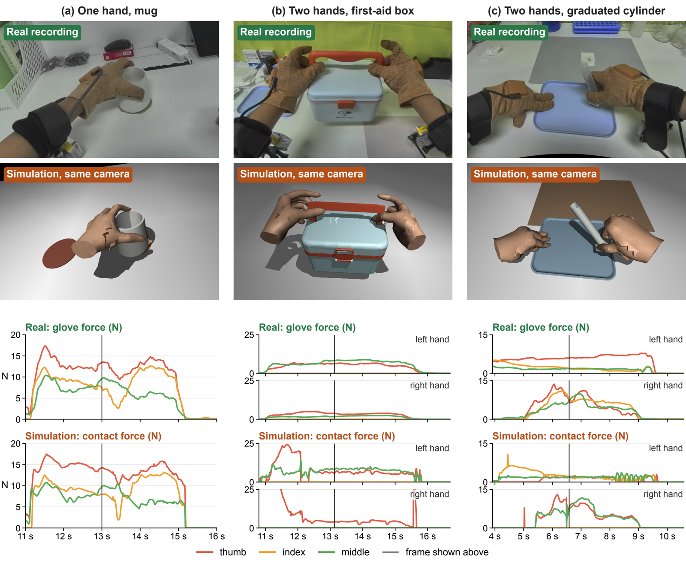
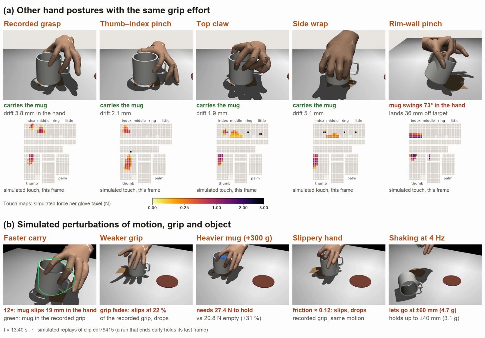

사람이 손으로 물건을 다루는 시연은 손재주가 필요한 로봇 조작을 가르칠 때 대규모로 모으기 쉬운 데이터예요. 그래서 시연 한 건을 시뮬레이션 안에 다시 세운 뒤 조건을 바꿔 여러 건으로 늘리는 <abbr title="실제 기록을 시뮬레이션으로 옮겨 늘린 다음, 그 결과를 다시 실제 쪽 학습과 평가에 쓰는 흐름">real-to-sim-to-real</abbr> 방식을 여러 연구가 써요. 이런 방식은 영상에서 손과 물체의 움직임을 복원하는데, 영상에는 손가락이 물체를 얼마나 세게 눌렀는지가 찍히지 않아요.

스탠퍼드대학교와 텍사스 A&M 대학교, 예일대학교 등의 연구진이 2026년 11월 13일 <abbr title="연구자들이 논문을 심사 전에 올려 공개하는 온라인 저장소">arXiv</abbr>에 공개한 <abbr title="촉각 장갑으로 잰 사람 손의 접촉을 써서 시연을 시뮬레이션에 다시 세우는 방법의 이름">TouchTwin</abbr>은 이 빈자리를 촉각 장갑의 측정값으로 채워, 시연을 물리 시뮬레이터 <abbr title="관절로 이어진 물체의 움직임과 접촉을 계산하는 물리 시뮬레이터로, 로봇 연구에서 널리 쓰여요">MuJoCo</abbr> 안에 다시 세워요. 학습에 쓰지 않은 기록으로 시험했을 때, 영상에 보이는 손 자세를 따라 하도록 학습한 <abbr title="관측을 받아 다음 행동을 정하는 규칙으로, 로봇 학습에서는 주로 학습된 신경망을 가리켜요">정책</abbr>은 기록된 힘의 0.31배로 쥐었어요. 영상으로 만든 재현, 곧 시연을 시뮬레이션에서 다시 실행한 데이터로 학습한 정책은 1.55배로 쥐었고, 촉각으로 맞춘 재현으로 학습한 정책은 0.99배였어요. 이 수치는 모두 시뮬레이션 안에서 머그잔 과제 하나로 잰 값이에요.

## 영상으로 다시 세운 시연에서 빠지는 접촉력

real-to-sim-to-real 흐름에서 시뮬레이션은 기록을 불리는 장치예요. 실제 시연 한 건을 물리 시뮬레이터 안에서 다시 실행할 수 있게 만들어 두면, 물체의 위치나 무게를 바꾼 시연을 추가 촬영 없이 얻을 수 있어요. 논문이 인용한 기존 방법들은 카메라 한 대의 영상이나 머리에 쓴 카메라의 영상에서 손과 물체를 복원하고, 그 상호작용이 물리적으로 실행되게 다듬은 뒤 로봇 정책을 학습하거나 시험하는 데 써요.

영상이 알려 주는 것은 손이 어떻게 움직였는지와 물체가 어떻게 움직였는지까지예요. 손 자세는 각 손가락이 물체 표면의 어디에서 멈췄는지를 보여 주고, 손가락을 얼마나 더 오므리려 했는지는 보여 주지 않아요. 단단한 물체를 살짝 쥘 때와 꽉 쥘 때 손가락은 거의 같은 자리에 있고, 달라지는 것은 표면을 누르는 힘이에요. 손가락이 닿은 자리도 손과 물체에 가려지는 일이 많아요. 어느 손가락이 언제, 얼마나 세게 닿았는지는 영상만으로 정해지지 않아요.

논문은 영상의 대표적인 두 쓰임새가 서로 반대쪽으로 틀린다고 보고해요. 관측한 손 자세를 그대로 따라 하게 하면 쥐는 힘이 기록의 0.31배로 모자라고, 영상에서 추적한 자세를 물리 시뮬레이션으로 재현해 학습하면 1.55배로 넘쳐요.

물리 계산으로 힘을 채워 넣어도 사람의 힘은 나오지 않아요. 머그잔을 드는 과제의 재현에서, 사람이 실제로 쥔 힘은 머그잔을 놓치지 않는 데 필요한 최소 힘의 1.6배에서 3.7배였어요. 최소 힘은 무게와 마찰로 계산할 수 있어도, 사람이 그 위에 얹은 여유는 계산으로 나오지 않아요. 이 값을 재는 수단이 촉각이에요.

촉각 장갑을 비롯한 착용형 측정 장치는 이미 여러 용도로 쓰였어요. 로봇 정책을 가르치는 신호로 쓰거나, [[2026-11-15_forcetwin-measured-dynamics|디지털 트윈 ForceTwin이 힘 측정으로 문 저항을 복원한 방법]]에서처럼 사람이 물체를 움직이며 잰 힘으로 물체의 <abbr title="힘이 가해질 때 물체가 어떻게 움직이는지를 정하는 성질">동역학</abbr>을 식별하는 데 썼어요. 영상에서 촉각을 예측하는 모델도 있지만, 같은 화소에서 장갑 신호를 재현하도록 학습하므로 화소에 보이지 않는 힘을 되찾거나 기록의 조건을 바꾸지는 못한다고 논문은 지적해요. 연구진은 손과 물체의 상호작용을 측정한 촉각으로 움직이는 물리 시뮬레이션으로 다시 세운 사례가 없었다는 점을 차이로 내세워요.

## 기록 한 건을 MuJoCo 재현으로 만드는 네 단계

TouchTwin의 입력은 <abbr title="사람의 손 조작을 영상과 촉각으로 함께 기록한 500시간 규모의 데이터">TouchScale</abbr> 데이터에서 고른 기록이에요. 기록 한 건에는 머리와 손목에 단 <abbr title="색 영상과 함께 화소마다 카메라에서 물체까지의 거리를 재는 카메라">RGB-D 카메라</abbr>의 영상과 손에 낀 촉각 장갑의 신호가 들어 있어요. 장갑에는 누르는 힘을 재는 감지점이 880개 있고, 패드 15개에 나뉘어 있어요. [프로젝트 페이지](https://touchtwin.github.io)에 따르면 엄지에 296개, 검지와 중지와 약지에 128개씩, 새끼손가락에 96개, 손바닥에 104개예요.

연구진은 이 기록을 MuJoCo 안에 네 단계로 다시 세워요. 논문의 개요 그림에서 첫 단계와 넷째 단계에는 <abbr title="사람 대신 코드를 쓰고 실행 결과를 보며 고쳐 나가는 언어 모델 기반 프로그램">에이전트</abbr> 표시가, 가운데 두 단계에는 정해진 코드 표시가 붙어 있어요.

첫 단계에서는 코드를 쓰는 에이전트가 물체를 MuJoCo 프로그램으로 작성해요. 논문은 이 프로그램이 물리 시험을 거쳤다고 적고, 예시로 열두 개를 실었어요. 도자기 머그잔이나 바구니처럼 통짜인 물체도 있고, 방아쇠와 노즐이 있는 분무기, 걸쇠와 뚜껑과 손잡이와 속 쟁반이 움직이는 구급상자, 누름대와 팁 분리 장치가 있는 1mL 피펫처럼 움직이는 부품을 가진 물체도 있어요.

손은 기록에 참여한 사람마다 따로 만들어요. 두 카메라의 영상에서 손을 추적해 그 사람의 기록에 맞는 손 모델을 맞추고, 관절이 이어진 뼈대를 세운 다음, 장갑의 감지점을 시뮬레이션 손의 피부 위에 올려요. 이렇게 하면 시뮬레이션 손이 내는 촉각을 실제 장갑이 낸 880칸짜리 힘 지도와 대조할 수 있어요.

둘째와 셋째 단계에 촉각이 들어가요. 손과 물체의 상호작용을 정하는 둘째 단계에서는 촉각이 손가락이 어디에 닿는지를 정하고, 물리 재현을 돌리는 셋째 단계에서는 언제 얼마나 세게 누르는지를 정해요. 논문의 표현으로는 기록된 촉각이 각 손가락을 영상에 보이는 자세보다 더 오므리게 해요. 손가락을 보이는 자리에 두는 데서 끝내지 않고, 닫는 방향으로 더 몰아서 접촉과 닫는 힘을 장갑 기록에 맞추는 거예요.

넷째 단계에서는 검사 절차와 검토 에이전트가 재현을 기록과 비교해요. 개요 그림에는 넷째 단계에서 둘째 단계로 돌아가 고치는 되돌림 화살표가 그려져 있어요.

이 재현에서 물체는 미리 정한 경로를 따라 움직이지 않아요. 논문은 물체가 오직 접촉으로만 움직인다고 적었어요. 물체의 움직임을 기록에 맞춰 강제하면 손이 내는 힘이 틀려도 화면은 맞아 보이지만, 접촉으로만 움직이게 두면 힘이 모자랄 때 물체가 미끄러지거나 떨어져요. 이 조건에서는 재현이 기록대로 끝까지 실행됐다는 사실이 힘을 점검하는 구실도 하는 것으로 보여요.

<figure class="fig"><figcaption>초록 표지가 실제 기록이고 주황 표지가 같은 카메라 시점에서 그린 시뮬레이션이에요. 아래 그래프는 엄지(빨강), 검지(주황), 중지(초록)가 누르는 힘을 장갑 측정값과 시뮬레이션 접촉력으로 같은 축에 그렸고, 세로선은 위 장면의 시점이에요. 왼쪽부터 한 손 머그잔, 두 손 구급상자, 두 손 눈금실린더 기록이에요. <a href="https://arxiv.org/html/2611.17619v1">Han 연구진, 그림 4</a> · <a href="https://creativecommons.org/licenses/by/4.0/">CC BY 4.0</a> · 논문 소스에 들어 있는 벡터 그림을 이미지로 변환하고 크기를 줄임</figcaption></figure>

## 장갑이 잰 힘과 시뮬레이션 접촉력의 대조

논문의 그림 4는 세 기록에서 엄지와 검지, 중지가 물체 표면을 수직으로 누르는 힘을 장갑 측정값과 시뮬레이션 접촉력으로 나란히 그려요. 첫째는 왼손으로 머그잔을 표시된 자리로 옮기는 기록이에요. 둘째는 두 손으로 구급상자 손잡이를 집어 들고 옮겨 내려놓는 기록이고, 셋째는 오른손이 눈금실린더를 쟁반에서 꺼내 깔개 위에 세우는 동안 왼손이 쟁반을 잡고 있는 기록이에요.

한 손으로 머그잔을 옮기는 기록에서는 힘이 오르내리는 시점과 크기가 두 그래프에서 비슷하게 나타나요. 두 손 기록에서는 차이가 드러나요. 논문 설명에 따르면 구급상자 기록에서 쥐기 시작할 때와 놓을 때 시뮬레이션의 엄지 힘이 장갑 값보다 크게 솟고, 25<abbr title="힘의 단위인 뉴턴으로, 1뉴턴은 약 100g짜리 물체를 손에 올렸을 때 느끼는 무게만큼의 힘이에요">N</abbr>을 넘는 봉우리는 그래프에서 잘려 있어요. 논문은 이 그림에서 두 곡선의 차이를 수치로 요약하지 않았어요. 재현이 얼마나 맞는지는 그 재현으로 학습한 모델의 성적으로 간접 평가돼요.

## 세 가지 학습 데이터로 견준 손 정책과 접촉 예측기

손 정책 실험에서는 영상과 촉각, 언어를 함께 받아 손의 움직임을 내는 모델 N0-VTLA를 세 가지 데이터로 각각 학습했어요. 관측한 손가락 자세는 기록에서 손이 도달한 관절 각도를 목표로 삼는 데이터예요. 영상 기반 재현은 영상에서 추적한 자세를 물리 시뮬레이션으로 재현한 데이터이고, 촉각 기반 재현은 TouchTwin이 만든 데이터예요.

| 학습 데이터 | 남겨 둔 기록 성공 | 기록 대비 쥐는 힘 | 시뮬레이션 시험 성공 |
| --- | ---: | ---: | ---: |
| 관측한 손가락 자세 | 17/20 | 0.31배 | 26/36 |
| 영상 기반 재현 | 15/20 | 1.55배 | 33/36 |
| 촉각 기반 재현 | 20/20 | 0.99배 | 35/36 |

성공은 물체가 손안에서 5mm 넘게 미끄러지지 않고, 내려놓은 자리가 목표에서 30mm 넘게 벗어나지 않은 경우예요. 남겨 둔 기록은 학습에 쓰지 않은 기록이고, 시뮬레이션 시험 36건은 논문 초록이 처음 보는 섭동이라고 부른 조건이에요.

표에서 성공 횟수와 힘의 비율은 따로 움직여요. 영상 기반 재현으로 학습한 정책은 힘이 1.55배로 넘치는데도 시뮬레이션 시험 36건 가운데 33건을 성공했어요. 성공 판정이 미끄러짐과 내려놓은 위치만 보기 때문에, 필요 이상으로 세게 쥐는 것은 실패로 잡히지 않아요. 쥐는 힘이 사람과 같은지는 성공률과 별도로 재야 드러나요.

프로젝트 페이지에는 손가락에 흔들림을 넣은 시뮬레이션 시험 한 건이 실려 있어요. 촉각 기반 재현으로 학습한 정책에서는 머그잔이 손안에서 1.0mm 미끄러지는 데 그쳤고, 나머지 두 정책에서는 107mm와 108mm 미끄러져 손에서 빠져 떨어졌어요.

접촉 예측기 실험에서는 손가락이 물체에 닿아 있는지를 예측하는 모델을 두 가지 재현으로 각각 학습한 뒤, 학습에 쓰지 않은 사람의 1인칭 기록으로 시험했어요. 영상 기반 재현으로 학습한 예측기는 실제로 접촉이 있던 프레임의 32.2%를 놓쳤고, 촉각 기반 재현으로 학습한 예측기는 13.1%를 놓쳤어요. <abbr title="맞다고 한 것 가운데 실제로 맞은 비율과, 실제로 맞는 것 가운데 찾아낸 비율을 함께 반영한 점수로, 1에 가까울수록 좋아요">F1 점수</abbr>는 0.778에서 0.890으로 올랐고, 손가락별로 누르고 있던 시간을 예측한 오차는 1.01초에서 0.61초로 줄었어요.

재현을 사실적인 영상으로 바꾸는 실험도 있어요. 영상 생성 모델 <abbr title="글이나 첫 장면을 받아 영상을 만들어 내는 영상 생성 모델의 이름">Wan2.2</abbr>에 첫 프레임과 설명 글만 줬을 때보다, 시뮬레이션으로 계산한 손과 물체를 조건으로 함께 줬을 때 생성 영상이 실제 영상에 더 가까웠어요. 두 영상의 화소 값이 얼마나 비슷한지 나타내는 <abbr title="두 영상의 화소 값 차이를 바탕으로 계산하는 유사도로, 클수록 두 영상이 비슷해요">PSNR</abbr>이 15.36에서 18.89로 올랐어요. 깊이 정보만 조건으로 준 경우는 18.55였고, 논문의 나머지 세 지표도 같은 순서였어요. 시뮬레이션 조건 없이 생성한 영상에서는 머그잔이 실제와 다른 경로로 움직였어요.

## 한 가지 조건만 바꿔 다시 계산하는 섭동

재현이 물리 시뮬레이션이라서, 조건 하나를 바꾸고 물리를 다시 계산하면 새 시연이 나와요. 논문은 이를 <abbr title="원래 조건에서 한 가지를 일부러 바꿔 결과가 어떻게 달라지는지 보는 것">섭동</abbr>이라고 부르고 네 갈래로 나눠요. 쥐는 노력은 그대로 두고 손 모양을 바꾸는 것, 더 빨리 옮기거나 흔들림을 더하는 것, 각 손가락의 힘 목표를 줄이는 것, 물체를 더 무겁거나 미끄럽게 만드는 것이에요. 아무것도 바꾸지 않으면 원래 재현이 그대로 다시 나와요.

<figure class="fig"><figcaption>머그잔 기록 하나를 섭동한 결과예요. 위 줄은 쥐는 노력을 그대로 두고 손 모양만 바꾼 다섯 경우이고, 장면 아래 격자는 그 순간 시뮬레이션 손의 감지점별 힘이에요. 아래 줄은 왼쪽부터 12배 빠른 운반, 약한 쥐기, 물 300g 추가, 미끄러운 손, 초당 네 번 좌우로 흔들기예요. <a href="https://arxiv.org/html/2611.17619v1">Han 연구진, 그림 6</a> · <a href="https://creativecommons.org/licenses/by/4.0/">CC BY 4.0</a> · 논문 소스에 들어 있는 벡터 그림을 이미지로 변환하고 크기를 줄임</figcaption></figure>

결과를 물리가 정하므로 실패도 나와요. 머그잔 기록 하나에서 기록된 잡기, 엄지와 검지로 집기, 위에서 움켜쥐기, 옆에서 감싸기는 머그잔을 옮겼고 손안에서 밀린 거리가 1.9mm에서 5.1mm였어요. 테두리와 벽을 집는 손 모양에서는 머그잔이 손안에서 73도 돌았고 목표에서 36mm 벗어난 곳에 놓였어요.

움직임과 힘, 물체를 바꾼 경우의 결과는 아래와 같아요.

| 바꾼 조건 | 결과 |
| --- | --- |
| 옮기는 속도를 12배로 올림 | 머그잔이 손안에서 19mm 미끄러짐 |
| 쥐는 힘을 점점 줄임 | 기록된 힘의 22%에서 미끄러져 떨어짐 |
| 물 300g을 담음 | 쥐고 있는 데 필요한 힘이 20.8N에서 27.4N으로 31% 늘어남 |
| 손과 머그잔 사이 마찰을 0.12배로 낮춤 | 기록된 힘과 같은 동작에서 미끄러져 떨어짐 |
| 4<abbr title="1초에 몇 번 되풀이되는지 나타내는 단위">Hz</abbr>로 좌우로 흔듦 | 진폭 ±40mm까지 버티고 ±60mm에서 놓침 |

논문은 한 요인을 물체가 떨어질 때까지 조금씩 밀어 보는 실험도 실었어요. 손가락의 힘 목표를 1배에서 0까지 낮추고, 손과 머그잔의 마찰을 낮추고, 질량을 최대 7.5kg까지 더하고, 4Hz 흔들림의 진폭을 키워요. 떨어지는 지점까지의 거리가 기록된 잡기에 남아 있던 여유예요.

섭동한 재현에는 장갑과 같은 형식의 감지점별 촉각과 접촉, 힘이 시뮬레이션 값으로 붙어요. 성공한 시연과 실패한 시연이 모두 이 표지를 갖고 나와요. Wan2.2로 영상을 만들 때 카메라 위치나 손 모양, 배경 장면을 바꿔도 생성된 영상은 원래 재현의 표지를 물려받아요. 논문이 촉각 데이터를 추가 수집 없이 늘린다고 말하는 근거가 이 구조예요.

장갑이 재지 못하는 곳의 접촉도 시뮬레이션에서 읽을 수 있어요. 장갑은 손바닥 가운데와 손가락 밑동 일부에 감지점이 없는데, 시뮬레이션 손은 피부 전체에서 접촉을 계산해요. 머그잔 재현에서 손바닥이 머그잔에 처음 닿는 위치보다 손목을 손바닥 면에 수직인 방향으로 8mm 더 밀자, 장갑의 손바닥 감지점 자리는 0을 유지했고 감지점이 없는 손바닥 피부에는 최대 22N이 실렸어요.

## 시뮬레이션 안에서만 확인된 결과와 남은 한계

논문 제목은 시뮬레이션에서 다시 실제로 돌아가는 데까지를 내세우지만, 실제 쪽으로 돌아간 범위는 좁아요. 모든 정책은 시뮬레이션 자산 위에서 행동했고, 시뮬레이션 안에서 <abbr title="행동의 결과를 다시 관측해 고쳐 나가지 않고, 주어진 입력에 낸 출력만 확인하는 시험 방식">개루프</abbr>로 시험됐어요. 로봇 손으로 옮기는 일, 실물 로봇 실험, 과제를 넓히는 일은 연구진이 남은 과제로 적었어요. 이 논문에서 실제 쪽에 닿은 것은 사실적인 영상 생성과 실제 사람 기록에 대한 접촉 예측까지예요.

시험 규모도 작아요. 남겨 둔 기록으로 한 시험은 20회, 시뮬레이션 시험은 36회이고, 정책 실험과 접촉 예측 실험은 머그잔 과제만 썼어요. 17회와 20회의 차이는 세 번이라, 이 표만으로 방법 사이의 성공률 차이를 다른 과제까지 넓혀 말하기는 어려워요. 힘의 비율도 값 하나로만 실려 있어서 기록마다 얼마나 흩어졌는지는 알 수 없어요.

남겨 둔 기록은 손이 이미 물체에 닿은 상태에서 시작해요. 손가락이 처음 닿는 순간을 정책이 맞히는지는 시험되지 않았어요. 접촉이 시작되는 시점이 결과를 가르는 작업에는 이 결과를 옮겨 읽을 수 없어요.

재현의 오차도 남아 있어요. 두 손 재현에서는 물체가 손안에서 12mm에서 23mm 미끄러져요. 정책 평가의 성공 기준이 미끄러짐 5mm 이하였으니, 두 손 재현의 오차는 그 기준보다 커요. 앞에서 본 구급상자 기록의 엄지 힘 차이도 두 손 재현에서 나왔어요.

생성 영상은 시뮬레이션의 오류를 물려받고, 영상 모델은 시뮬레이션이 정하지 않은 세부를 바꿀 수 있어요. 영상에 붙는 접촉과 힘 표지는 시뮬레이션에서 온 값이어서, 영상 모델이 바꿔 그린 부분까지 표지와 맞는다는 근거는 논문에 없어요.

기준값이 장갑이라는 점도 함께 봐야 해요. 0.99배는 장갑이 잰 힘에 대한 비율이므로, 장갑 측정에 오차가 있다면 재현과 정책은 그 오차까지 따라가게 돼요. 논문에는 장갑 측정의 정확도, 물체 프로그램이 거친 물리 시험의 항목, 촉각 신호를 손가락의 힘 목표로 바꾸는 식이 실려 있지 않아요.

## 시연을 시뮬레이션으로 늘릴 때 확인할 순서

시연을 시뮬레이션에 옮겨 늘리는 작업이라면 먼저 재현이 물체를 무엇으로 움직이는지 확인해요. 물체의 경로를 기록에 맞춰 강제하는 재현은 힘이 틀려도 그럴듯하게 재생돼요. TouchTwin처럼 물체가 접촉으로만 움직이게 두면 힘이 모자란 재현이 미끄러짐과 낙하로 드러나요.

다음으로 성공률과 힘을 따로 기록해요. 이 논문에서 힘이 1.55배인 정책은 36건 중 33건을 성공했어요. **성공 판정이 위치와 미끄러짐만 본다면 힘이 틀린 데이터는 걸러지지 않아요.** 쥐는 세기가 결과에 영향을 주는 작업을 겨냥한다면 기록 대비 힘의 비율 같은 지표를 성공률 옆에 둬야 해요.

힘 측정이 없는 시연을 쓸 때는 힘 표지의 출처를 구분해요. 물체를 놓치지 않는 최소 힘을 계산해 채운 값은 사람이 실제로 쥔 힘보다 작아요. 이 논문의 머그잔 재현에서는 그 차이가 1.6배에서 3.7배였어요. 계산으로 채운 힘과 측정한 힘을 같은 열에 섞어 두면 나중에 무엇을 학습시켰는지 가릴 수 없어요.

섭동은 한 번에 한 요인만 바꾸는 편이 표지로 쓰기 좋아요. 속도와 마찰을 함께 바꾼 시연이 실패하면 어느 쪽 때문인지 남지 않아요. 한 요인을 떨어질 때까지 밀어 보는 실험은 그 잡기가 어디서 실패로 넘어가는지를 숫자로 주므로, 마찰이나 질량을 얼마나 넓게 흔들지 정할 때 근거로 쓸 수 있어요.

마지막으로 결과가 닿는 범위를 넘겨 쓰지 않아요. 로봇 손으로의 전이와 접촉이 시작되는 구간은 시험되지 않았고, 과제는 머그잔 하나였어요. 촉각 기반 재현이 로봇 학습 성능을 올린다는 주장은 이 논문의 근거로는 아직 할 수 없어요. 영상만으로 만든 재현에 힘 정보가 빠져 있다는 사실과 그 크기를 잰 방법까지가 지금 가져다 쓸 수 있는 부분이에요.

<!-- src-block -->
출처 — https://arxiv.org/abs/2611.17619
