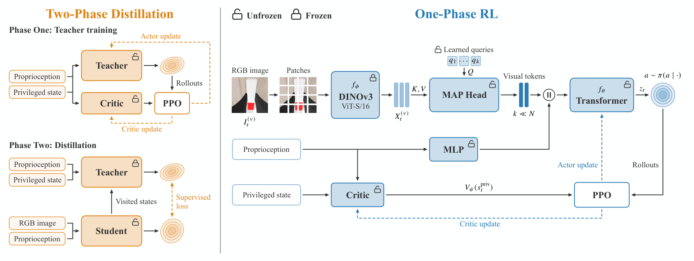
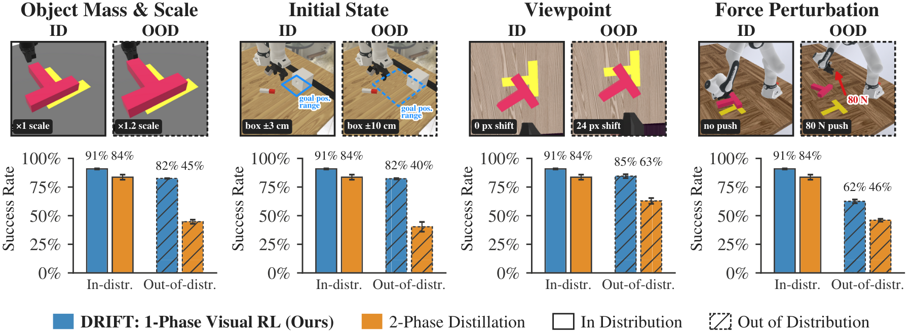

시뮬레이션에서 로봇 조작을 <abbr title="행동의 결과로 받은 보상을 늘리는 쪽으로 시행착오를 되풀이하며 배우는 학습 방법">강화학습</abbr>으로 가르친 뒤 카메라만 단 실물 로봇에 올릴 때는 보통 두 단계를 거쳐요. 시뮬레이터만 아는 물체의 정확한 위치와 속도를 받는 교사를 먼저 학습하고, 카메라 영상을 받는 학생이 그 교사의 행동을 따라 하도록 학습해요. 이 방식을 <abbr title="먼저 학습한 교사 모델의 행동을, 다른 입력을 받는 학생 모델이 따라 하도록 학습해 능력을 옮기는 방법">교사-학생 증류</abbr>라고 부르는데, 학생이 시뮬레이션에서 높은 성공률을 내도 <abbr title="시뮬레이션에서 학습한 것을 실물 로봇에 옮겨 쓰는 일">실물 전이</abbr>에서 성공률이 크게 떨어지는 일이 있어요.

매사추세츠공과대학교 연구진이 2026년 11월 23일 <abbr title="연구자들이 논문을 심사 전에 올려 공개하는 온라인 저장소">arXiv</abbr>에 공개한 <abbr title="교사 없이, 카메라 영상을 받는 제어기를 보상만으로 처음부터 학습하는 방법의 이름">DRIFT</abbr>는 교사 단계를 두지 않아요. 대량의 자연 사진으로 <abbr title="쓰려는 과제와 별개로, 대량의 자료로 미리 해 둔 학습">사전학습</abbr>된 시각 <abbr title="영상을 받아 뒤 단계가 쓰기 좋은 숫자 묶음으로 바꿔 주는 신경망 부분">인코더</abbr>를 고정해 두고, 실물에서 쓸 카메라 영상을 받는 <abbr title="관측을 받아 다음 행동을 정하는 규칙으로, 로봇 학습에서는 주로 학습된 신경망을 가리켜요">정책</abbr>을 처음부터 보상으로 학습해요. 신경망 구조와 관측, 연산 예산을 같게 맞춘 비교에서 핀 끼우기 과제의 시뮬레이션 성공률은 82.3%와 78.5%로 비슷했지만 실물 성공률은 66.7%와 23.3%로 갈렸어요. 이 수치는 로봇팔 한 대와 탁상 과제 세 개에서, 방법마다 실물 성적이 가장 좋은 학습 결과를 골라 잰 값이에요.

## 교사-학생 증류가 실물에서 성적을 잃는 두 경로

시뮬레이션 강화학습은 수많은 환경을 동시에 돌려 시행착오를 대량으로 쌓을 수 있어서, 보행과 손 조작에서 로봇 하드웨어의 성능 한계에 가까운 동작을 만들어 왔어요. 다만 논문은 이런 성과의 대부분이 물체의 자세처럼 간추린 상태값을 관측으로 썼고, 그 값은 공들여 만든 인식 장치로 추정한 것이라고 짚어요. 카메라 영상만으로 움직이는 정책을 얻으려면 다른 길이 필요해요.

널리 쓰이는 길이 교사-학생 증류예요. 첫 단계에서는 교사 정책이 <abbr title="시뮬레이터 안에서는 정확히 알 수 있지만 실물 로봇의 센서로는 얻기 어려운 값">특권 정보</abbr>, 곧 물체의 자세와 속도 같은 시뮬레이터 내부 값을 받아 강화학습으로 과제를 익혀요. 둘째 단계에서는 카메라 영상과 관절 상태값만 받는 학생이 교사의 행동을 흉내 내요. [[2026-07-20_걸음을_먼저_배우고_지형은_나중에|걸음을 사전학습하고 지형 적응만 강화학습에 맡긴 사족보행 APT-RL]]의 지각 증류 단계도 같은 계열이에요. 그 글에서 교사는 시뮬레이터가 주는 높이 지도를 썼고, 학생은 깊이 카메라와 <abbr title="레이저를 쏘아 주변 물체까지의 거리를 재는 센서">라이다</abbr> 값으로 교사의 출력을 따라 했어요.

이 논문이 비교 대상으로 삼은 증류는 <abbr title="학생이 스스로 움직여 도달한 상태마다 교사가 정답 행동을 알려 주고, 학생이 그 정답을 따라 하도록 되풀이해 학습하는 모방 학습 방법">DAgger</abbr> 방식이에요. 학생이 스스로 움직여 궤적을 만들면, 고정된 교사가 학생이 지나간 상태마다 자기라면 냈을 행동을 표지로 붙여요. 학생은 그 표지를 재현하도록 갱신돼요. 자료는 학생의 행동에서 나오지만, 학생이 맞추려는 목표는 과제 보상이 아니고 교사의 행동이에요.

논문은 이 구조에서 성능이 깎이는 경로를 둘로 정리해요. 첫째는 <abbr title="교사가 쓰는 정보를 학생의 관측으로는 알아낼 수 없어서, 학생이 교사의 행동을 끝까지 따라 할 수 없는 상태">실현 가능성 격차</abbr>예요. 교사가 학생에게는 없는 정보에 기대어 행동을 정하면, 학생은 자기 관측만으로 그 행동을 끝까지 따라 할 수 없어요. 둘째는 <abbr title="학습 때 보지 못한 조건에서도 배운 것이 통하는 성질">일반화</abbr>예요. 모방으로 학습한 학생은 시뮬레이션 성공률이 높아도 시뮬레이션과 실물의 차이를 넘을 때 약할 수 있다는 선행 연구를 논문은 인용해요.

교사를 없애고 영상에서 곧바로 강화학습을 하는 방법에 대해 논문은 비용 문제를 짚어요. 과제에 쓸모 있는 시각 표현을 배우는 일과 제어를 배우는 일이 한 학습에 묶이고, 시각 인코더를 처음부터 학습하는 쪽이 보통 연산 비용의 대부분을 차지해요.

## 고정한 시각 인코더로 한 단계 학습을 감당하는 구조

논문이 말하는 한 단계는 학습 과정에 특권 정보를 받는 교사 정책도, 전문가 시연도 쓰지 않는다는 뜻이에요. DRIFT는 세 부분으로 이뤄져요. 학습 중에 값이 바뀌지 않도록 <abbr title="학습하는 동안 신경망의 값이 바뀌지 않게 고정해 두는 일">동결</abbr>한 시각 인코더, 학습되는 <abbr title="입력 조각마다 얼마나 눈여겨볼지 가중치를 매긴 뒤 더 적은 수의 대표 값으로 간추리는 연산">주의 기반 풀링</abbr>, 그리고 행동을 내는 작은 <abbr title="입력 조각들이 서로를 참고해 가며 정보를 섞는 신경망 구조">트랜스포머</abbr>예요.

시각 인코더는 <abbr title="대량의 자연 사진으로 미리 학습해 둔 공개 시각 모델 계열의 이름">DINOv3</abbr>의 <abbr title="영상을 가로세로 16화소 조각으로 잘라 처리하는 신경망 구조의 소형 모델">ViT-S/16</abbr> 모델로, <abbr title="학습으로 값이 정해지는 신경망 안의 숫자">매개변수</abbr>가 2,200만 개예요. 224×224 화소 영상을 받아 조각 196개마다 384차원 특징을 내요. 연구진은 영상 전체를 요약한 특징 하나만으로는 정밀 조작에 부족하다는 것을 확인했고, 그렇다고 조각 특징을 모두 정책에 넣으면 계산이 무거워져요. 그래서 학습되는 질의 몇 개가 조각 특징 전체를 살펴 소수의 시각 <abbr title="신경망이 한 단위로 다루는 입력 조각">토큰</abbr>으로 줄이는 풀링을 사이에 뒀어요. 행동을 내는 트랜스포머는 3층에 폭 64인 작은 구조이고, 시각 토큰과 관절 상태값 토큰을 함께 받아요.

학습 알고리즘은 <abbr title="한 번의 갱신에서 정책이 너무 크게 바뀌지 않도록 제한을 두는 강화학습 알고리즘">PPO</abbr>예요. 행동이 얼마나 좋았는지 값을 매기는 비평자는 학습 중에만 쓰이므로 특권 정보를 받게 했고, 실물에 올라가는 정책 쪽에는 카메라 영상과 관절 상태값만 들어가요. 특권 정보를 버린 구조가 아니고, 실물에 올리지 않는 쪽으로 옮긴 구조예요.

<figure class="fig"><figcaption>왼쪽 주황색 절반이 두 단계 증류이고 오른쪽 파란색 절반이 DRIFT예요. 왼쪽 위 칸은 관절 상태값과 특권 정보를 받는 교사를 PPO로 학습하는 첫 단계, 왼쪽 아래 칸은 카메라 영상을 받는 학생이 자기가 지나간 상태에서 교사의 행동을 따라 하는 둘째 단계예요. 오른쪽에서 자물쇠가 잠긴 상자는 고정된 DINOv3 인코더 하나이고, 특권 정보는 아래쪽 비평자에만 들어가요. <a href="https://arxiv.org/html/2611.31588v1">Marangola 연구진, 그림 2</a> · <a href="https://creativecommons.org/licenses/by/4.0/">CC BY 4.0</a> · 논문 소스에 들어 있는 벡터 그림을 이미지로 변환함</figcaption></figure>

인코더를 동결하는 선택에는 이유가 셋 있어요. 먼저 큰 시각 신경망으로 <abbr title="출력의 오차를 신경망의 뒤에서 앞으로 전달하며 각 가중치를 얼마나 고칠지 계산하는 과정">역전파</abbr>를 하지 않아도 돼요. 다음으로 PPO는 모은 경험 한 묶음으로 갱신을 여러 번 되풀이하는데, 인코더가 고정이면 조각 특징을 한 번만 계산해 되풀이마다 다시 쓸 수 있어요. 이 논문은 최대 네 번 되풀이하는 설정이라, 되풀이마다 인코더를 다시 돌릴 때와 견줘 인코더 계산이 최대 4분의 1까지 줄어요. 마지막으로 자연 사진으로 익힌 표현이 시뮬레이션 영상의 겉모습에 맞춰 바뀌는 일을 막아요.

연구진은 이 표현 덕분에 <abbr title="물체의 면을 화면의 화소로 빠르게 옮겨 그리는 방식으로, 빛의 반사와 그림자는 근사로 처리해요">래스터화</abbr>로 빠르게 그린 영상으로 학습해도 실물로 옮겨 갔다고 보고해요. 빛의 경로를 따라가며 계산하는 <abbr title="빛이 지나는 길을 따라가며 계산해 반사와 그림자를 사실적으로 그리는 방식으로, 계산이 무거워요">레이 트레이싱</abbr>을 쓰지 않았다는 뜻이에요. 논문의 그림 3은 핀 끼우기 과제에서 학습 한 시간 동안 모은 <abbr title="시뮬레이터가 시간을 한 칸 앞으로 보내며 물리를 한 번 계산하는 단위">물리 스텝</abbr> 수와, 그 시간이 어디에 쓰였는지를 세 구성으로 나눠 보여 줘요.

| 구성 | 한 시간에 모은 물리 스텝 | 가장 큰 시간 비중 |
| --- | ---: | --- |
| 인코더 동결, 래스터화 | 530만 | 시뮬레이션 59% |
| 인코더 동결, 레이 트레이싱 | 120만 | 시뮬레이션 93% |
| 인코더 학습, 래스터화 | 190만 | 역전파 68% |

여기서 시뮬레이션 시간에는 <abbr title="가상 장면을 카메라 영상으로 그려 내는 계산">렌더링</abbr>이 들어 있어요. 레이 트레이싱을 쓰면 그리는 시간이 학습 시간의 대부분이 되고, 인코더를 함께 학습하면 역전파가 대부분이 돼요. 표의 값으로 계산하면 두 병목을 함께 걷어 낸 구성은 같은 시간에 레이 트레이싱 구성의 약 4.4배, 인코더를 함께 학습하는 구성의 약 2.8배를 모아요.

## 시뮬레이터와 실물을 맞춘 학습 조건과 평가 절차

학습은 <abbr title="많은 계산을 동시에 처리하는 그래픽 처리 장치로, 신경망 학습과 병렬 시뮬레이션에 쓰여요">GPU</abbr>에서 환경 1,024개를 동시에 돌리는 <abbr title="수많은 환경을 동시에 돌리고 카메라 영상까지 그려 주는 공개 로봇 조작 시뮬레이터">ManiSkill</abbr> 시뮬레이터에서 했어요. 과제는 셋이에요. 정육면체 집기(Pick-Cube)는 정육면체를 쥐어 들어 올리고, T자 블록 밀기(Push-T)는 쥐지 않고 밀어서 T자 블록을 화면에 보이는 목표 자세에 맞추고, 핀 끼우기(Peg-Insertion)는 사각 핀을 틈이 2mm인 구멍에 넣어요. 물체와 목표의 처음 자세는 매번 무작위로 정해요. 정책은 카메라의 컬러 영상과 관절 위치, 관절 속도, <abbr title="로봇팔 끝에서 물체를 집는 집게">그리퍼</abbr> 위치를 받아 팔 관절의 상대 목표 위치와 그리퍼 목표 위치를 내요.

실물과 맞추는 작업은 두 가지예요. 카메라는 실물에서 보정한 내부 값과 로봇에 대한 카메라 자세를 시뮬레이션 카메라에 옮기고, 실물 영상을 가운데로 잘라 크기를 줄이는 처리까지 내부 값에 반영했어요. <abbr title="명령을 받아 관절을 실제로 움직이는 모터와 그 제어 장치">구동기</abbr>는 <abbr title="실제 장치를 움직여 얻은 기록에 모델의 출력이 맞도록 모델의 값을 찾는 일">시스템 식별</abbr>로 맞췄어요. 실물 로봇에 주파수가 변하는 사인파 명령을 주고 관절 위치와 속도를 기록한 뒤, 같은 명령을 시뮬레이션에서 재생해 두 궤적의 차이가 줄어들도록 일곱 관절의 <abbr title="목표 위치와의 차이와 속도에 각각 곱해 모터 힘을 정하는 제어기의 두 계수">PD 이득</abbr>과 회전부 관성, <abbr title="속도와 관계없이 움직임을 거스르는 일정한 크기의 마찰">쿨롱 마찰</abbr>을 <abbr title="여러 후보 값을 만들어 시험하고 좋은 쪽으로 후보를 옮겨 가며 최적값을 찾는 탐색 방법">CMA-ES</abbr>로 찾았어요. 로봇팔의 회전력이 바뀌는 속도에 걸린 제한도 시뮬레이션에 넣었어요.

맞춘 값 주변은 <abbr title="시뮬레이션의 겉모습과 물리 값을 일부러 넓게 바꿔 가며 학습해, 실물과의 차이를 견디게 하는 방법">도메인 무작위화</abbr>로 흔들었어요. 물체의 마찰과 겉모습, 탁자 무늬, 환경 조명 이미지를 뽑아 바꾸는 조명, 보정값 주변의 카메라 자세가 대상이에요. 배경 화소는 시뮬레이터가 주는 물체와 배경의 구분 정보로 가려내 자연 사진 약 2만 7천 장으로 바꿔 넣었어요.

실물 시험은 <abbr title="연구용으로 널리 쓰이는 일곱 관절 로봇팔 제품">Franka Research 3</abbr> 로봇팔에서 손목 카메라 영상과 관절 상태값으로 정책을 20<abbr title="1초에 몇 번 되풀이되는지 나타내는 단위">Hz</abbr>로 돌렸고, 실물 자료로 추가 학습을 하지 않았어요. 시뮬레이션 비교에서 두 방법은 같은 동결 인코더를 쓰고 <abbr title="엔비디아가 만든 서버용 그래픽 처리 장치 제품의 이름">NVIDIA L40S</abbr> GPU로 환산한 150시간을 똑같이 썼어요.

평가에 쓸 모델은 두 번 걸러 골랐어요. 방법과 과제마다 <abbr title="학습을 시작할 때 정하는 난수의 출발값으로, 값이 다르면 같은 설정에서도 결과가 조금씩 달라져요">시드</abbr> 셋으로 학습하고, 학습 도중 저장한 <abbr title="학습 도중 저장해 둔 그 시점의 모델">체크포인트</abbr>를 시뮬레이션 <abbr title="과제를 처음부터 끝까지 한 번 수행하는 시도 하나">에피소드</abbr> 1,024개로 평가해 시드마다 가장 좋은 것을 남겨요. 남은 것을 실물에서 다섯 번씩 돌려 하나를 고르고, 그 하나를 20번 또는 30번 돌린 성적을 보고해요.

## 학습 범위 안에서는 비슷하고 밖에서 벌어진 성공률

시뮬레이션 비교는 핀 끼우기와 T자 블록 밀기 두 과제에서 했어요. 학습 때와 같은 조건에서는 DRIFT가 91%, 두 단계 증류가 84%였어요. 논문은 이 차이를 상대적으로 8.6% 높은 값이라고 적고, 특권 정보를 쓰는 교사를 흉내 낼 때 생기는 실현 가능성 격차를 피한 결과와 들어맞는다고 해석해요.

차이는 학습 때 보지 못한 조건에서 벌어졌어요. 연구진은 네 가지를 바꿨어요.

| 바꾼 조건 | DRIFT | 두 단계 증류 |
| --- | ---: | ---: |
| 학습 때와 같은 조건 | 91% | 84% |
| 물체 질량과 크기 | 82% | 45% |
| 목표와 물체의 처음 위치 범위 | 82% | 40% |
| 카메라 시점 | 85% | 63% |
| 밖에서 미는 힘 | 62% | 46% |

질량은 두 과제 모두 4배로 올렸고, T자 블록 밀기에서는 블록과 목표의 크기도 1.2배로 키웠어요. 처음 위치는 목표 위치 범위를 T자 블록 밀기에서 ±1cm에서 ±2cm로, 핀 끼우기에서 ±5cm에서 ±10cm로 넓혔고, 핀의 출발 위치도 학습 범위의 1.25배까지 옮겼어요. 시점은 T자 블록 밀기에서 영상을 24화소 옮기고 핀 끼우기에서 카메라 시야각을 0.85배로 좁혔어요. 미는 힘은 T자 블록 밀기에서만 시험했고, 0.2초 동안 그리퍼를 80<abbr title="힘의 단위인 뉴턴으로, 1뉴턴은 약 100g짜리 물체를 손에 올렸을 때 느끼는 무게만큼의 힘이에요">N</abbr>으로 밀거나 블록을 3N으로 밀었어요.

<figure class="fig"><figcaption>네 가지 조건 변화에서 잰 시뮬레이션 성공률이에요. 파란 막대가 DRIFT, 주황 막대가 두 단계 증류이고, 민무늬는 학습 때와 같은 조건, 빗금은 학습 때 보지 못한 조건이에요. 왼쪽부터 물체 질량과 크기, 처음 위치, 카메라 시점, 미는 힘이고 위쪽 장면은 각 조건의 예시예요. 둘째 칸의 학습 조건 장면에는 ±3cm라고 적혀 있지만, 논문의 그림 설명이 밝힌 핀 끼우기 학습 범위는 ±5cm예요. 막대는 시드 셋의 평균이고 오차 막대는 그 <abbr title="같은 실험을 되풀이할 때 평균값이 얼마나 흔들릴지를 나타내는 값">표준 오차</abbr>예요. <a href="https://arxiv.org/html/2611.31588v1">Marangola 연구진, 그림 5</a> · <a href="https://creativecommons.org/licenses/by/4.0/">CC BY 4.0</a> · 논문 소스에 들어 있는 벡터 그림을 이미지로 변환함</figcaption></figure>

네 조건을 묶으면 두 단계 증류는 학습 조건 성공률의 약 42%를 잃었고 DRIFT는 14%를 잃었어요. 그 결과 DRIFT의 상대 우위는 8.6%에서 61%로 커졌어요.

목표 위치를 더 넓게 옮긴 그림 6의 격자 시험에서도 같은 모양이 나와요. T자 블록 밀기에서 학습 범위 안의 칸은 DRIFT가 100%, 두 단계 증류가 85%였어요. 목표를 가로로 4cm 옮긴 두 칸에서는 DRIFT가 96%와 94%를 지킨 반면 두 단계 증류는 6%와 27%로 내려갔어요. 핀 끼우기에서 구멍 상자를 가로로 12cm 옮긴 칸들은 한쪽 다섯 칸에서 DRIFT가 5%에서 59%, 두 단계 증류가 0%에서 1%였고, 반대쪽 다섯 칸에서 20%에서 57%와 4%에서 8%였어요. 칸마다 시드 셋에서 100번씩 시험한 평균이에요.

## 실물 세 과제에서 잰 전이 하락

아래 표의 하락 폭은 시뮬레이션 성공률에서 실물 성공률을 뺀 값이고, 단위는 <abbr title="두 백분율의 차이를 나타내는 단위로, 80%에서 60%로 떨어지면 20퍼센트포인트 하락이에요">퍼센트포인트</abbr>예요. 값은 논문의 표에 적힌 그대로예요.

| 과제 | 방법 | 시뮬레이션 성공률 | 실물 성공률 | 하락 폭 | 실물 시도 |
| --- | --- | ---: | ---: | ---: | ---: |
| 핀 끼우기 | DRIFT | 82.3% | 66.7% | 15.7 | 30 |
| 핀 끼우기 | 증류, 인코더 동결 | 78.5% | 23.3% | 55.2 | 30 |
| 핀 끼우기 | 증류, 인코더 학습 | 74.6% | 6.7% | 67.9 | 30 |
| 정육면체 집기 | DRIFT | 99.7% | 100.0% | -0.3 | 20 |
| 정육면체 집기 | 증류, 인코더 동결 | 96.4% | 100.0% | -3.6 | 20 |
| T자 블록 밀기 | DRIFT | 99.3% | 76.7% | 22.6 | 30 |
| T자 블록 밀기 | 증류, 인코더 동결 | 93.6% | 30.0% | 63.6 | 30 |
| T자 블록 밀기 | 증류, 인코더 학습 | 92.1% | 16.7% | 75.4 | 30 |

핀 끼우기에서 DRIFT는 30번 가운데 20번에 해당하는 66.7%를 성공했고, 인코더를 동결한 증류는 7번에 해당하는 23.3%였어요. 시뮬레이션 성공률은 3.8퍼센트포인트 차이였는데, 실물로 가며 떨어진 폭은 15.7과 55.2퍼센트포인트로 벌어졌어요. T자 블록 밀기도 76.7%와 30.0%로 갈렸어요. 증류에서 인코더까지 학습하게 풀면 실물 성적은 더 내려갔어요. 표의 세 과제 값을 평균하면 DRIFT가 81.1%, 인코더를 동결한 증류가 51.1%이고, 논문은 이 차이를 상대적으로 58.8% 높은 값이라고 적어요.

정육면체 집기에서는 두 방법 모두 실물 20번을 전부 성공했어요. 차이는 물체를 바꾸자 나타났어요. 두 정책은 시뮬레이션에서 한 변 4cm인 검은 정육면체 하나로만 학습했는데, 처음 보는 물체 네 가지를 20번씩 집게 하자 평균 성공률이 DRIFT 88.8%, 증류 50.0%였어요.

실물 차이를 들여다보려고 연구진은 정책 안쪽의 <abbr title="신경망이 입력을 처리하는 도중에 안쪽에서 만들어 내는 숫자 묶음">잠재 표현</abbr>을 비교했어요. 정책마다 시뮬레이션 실행에서 모은 잠재 표현에 <abbr title="자료가 어떤 값 근처에 얼마나 몰려 있는지를 종 모양 분포 여러 개의 합으로 나타내는 통계 모델">가우시안 혼합 모델</abbr>을 맞추고, 실물 실행에서 나온 잠재 표현이 그 분포에서 얼마나 흔한 값인지 점수를 매겼어요. 실물 에피소드 30개씩에서 DRIFT의 점수가 덜 떨어졌어요. 실물에서 DRIFT 정책의 안쪽 상태가 시뮬레이션에서 겪은 범위에 더 가깝게 머물렀다는 뜻이에요.

인코더를 바꾼 실험은 시뮬레이션 성적과 실물 성적이 따로 움직일 수 있음을 보여 줘요. 핀 끼우기에서 동결 인코더 일곱 가지를 시뮬레이션 에피소드 512개로 견주고, 성적이 좋은 셋을 실물에서 30번씩 시험했어요. 2위와 3위는 DINOv3로 사전학습한 합성곱 구조 모델 <abbr title="영상의 이웃한 화소를 묶어 가며 처리하는 합성곱 방식 신경망의 중간 크기 모델">ConvNeXt-B</abbr>와, 영상과 글을 짝지어 학습한 <abbr title="영상과 그 설명 글이 서로 맞는지를 배우는 방식으로 사전학습한 공개 시각 모델 계열의 이름">SigLIP2</abbr> 계열의 더 큰 모델 ViT-B/16이었어요.

| 동결 인코더 | 매개변수 | 시뮬레이션 성공률 | 실물 성공률 |
| --- | ---: | ---: | ---: |
| DINOv3 ViT-S/16 | 2,200만 | 82.2% | 66.7% |
| DINOv3 ConvNeXt-B | 8,900만 | 73.4% | 3.3% |
| SigLIP2 ViT-B/16 | 8,600만 | 73.2% | 10.0% |

매개변수가 네 배 안팎 많은 두 인코더는 시뮬레이션에서 73%대를 냈지만, 실물에서는 30번 가운데 한 번과 세 번에 해당하는 3.3%와 10.0%에 그쳤어요.

## 과제 세 개와 가장 좋은 시드로 잰 결과의 한계

실험 범위는 로봇팔 한 종과 손목 카메라, 탁상 과제 셋이에요. 실물 시도는 조건마다 20번 또는 30번이에요. 30번 가운데 20번과 7번의 차이는 작지 않지만, 다른 로봇이나 카메라 배치, 더 긴 과제로 넓혀 말할 근거는 이 논문에 없어요.

실물 표는 방법마다 실물 성공률이 가장 높은 시드를 실었고, 그 모델을 고르는 데에도 실물 시도 다섯 번씩을 썼어요. 두 방법에 같은 절차를 적용했지만, 시드에 따라 실물 성적이 얼마나 흩어지는지는 표에서 알 수 없어요.

비교 대상은 DAgger 방식 증류 하나예요. 논문이 관련 연구로 든 방법 가운데에는 교사가 학생이 따라 할 수 있는 행동을 하도록 둘을 함께 학습하는 방법과, 깊이 영상을 받는 교사를 거쳐 컬러 영상 학생으로 옮기는 방법이 있는데, 이들은 실험 표에 들어 있지 않아요. 이 결과를 증류 방식 전체에 대한 판정으로 읽을 수는 없어요.

원인에 대한 설명은 추정 단계예요. 학습 범위 밖 시험의 상대 우위와 실물의 상대 우위가 둘 다 60% 안팎이라는 관찰과 잠재 표현 분석이 근거이고, 논문도 일반화 차이가 실물 전이 차이의 일부를 설명하는 것으로 보인다고 적어요. 특권 정보를 쓰는 교사를 흉내 낸 탓인지, 흉내 내기라는 학습 목표 자체의 탓인지를 가르는 실험은 실려 있지 않아요.

DRIFT도 조건이 멀어지면 떨어져요. 밖에서 미는 힘을 준 시험의 성공률은 62%였고, T자 블록 밀기에서 목표를 8cm 옮긴 칸은 0%에서 57%였어요. 실물에서도 핀 끼우기 15.7퍼센트포인트, T자 블록 밀기 22.6퍼센트포인트의 하락이 남아 있어요.

실물 전이가 확인된 인코더는 하나예요. 같은 틀에 다른 동결 인코더를 넣은 두 경우는 실물 성공률이 3.3%와 10.0%였으므로, 동결 인코더와 래스터화 영상을 쓰면 전이된다는 일반 규칙으로 읽을 수 없어요. 레이 트레이싱 영상으로 학습한 정책의 실물 성적도 실려 있지 않아요. 논문이 비교한 것은 한 시간에 모으는 경험의 양이고, 렌더링 방식이 전이에 주는 영향은 이 논문으로 알 수 없어요.

한 단계라는 이름이 준비 작업까지 줄여 주지는 않아요. 카메라 보정과 구동기 식별, 도메인 무작위화, 배경 교체가 그대로 필요했고, 비교에 쓴 연산은 방법마다 GPU 150시간이었어요. 쉬운 과제인 정육면체 집기에서는 학습한 물체를 쓰는 한 두 방법의 실물 성적이 같았어요.

## 시뮬레이션 학습 방법을 고를 때 확인할 순서

먼저 학습 범위 밖 시험을 방법 선택의 기준에 넣어요. **학습 조건에서 잰 시뮬레이션 성공률이 비슷하다는 사실만으로는 실물 전이가 비슷하다고 볼 수 없어요.** 핀 끼우기의 시뮬레이션 성공률이 82.3%와 78.5%였던 두 방법은 실물에서 66.7%와 23.3%가 됐어요. 질량, 크기, 처음 위치 범위, 카메라 시점, 미는 힘처럼 실물에서 어긋날 만한 축을 하나씩 학습 범위 밖으로 밀어 본 성공률을 함께 적어 두면, 실물에 올리기 전에 이 차이를 볼 수 있어요.

다음으로 성공률 옆에 시뮬레이션에서 실물로 가며 떨어진 폭을 따로 기록해요. 핀 끼우기에서 두 방법의 시뮬레이션 성공률 차이는 3.8퍼센트포인트였지만 하락 폭의 차이는 39.5퍼센트포인트였어요. 성공률만 적은 표에서는 이 차이가 보이지 않아요.

특권 정보를 어디에 넣는지도 구분해요. 실물에 올릴 정책이 흉내 낼 교사에 넣으면 학생이 관측으로 알아낼 수 없는 행동이 목표에 섞일 수 있어요. 학습 중에만 쓰는 비평자에 넣으면 실물에 올릴 정책의 입력은 실물과 같게 유지돼요.

렌더링 품질에 연산을 쓰기 전에 학습 시간이 어디에 쓰이는지 재요. 이 논문의 구성에서는 레이 트레이싱을 쓰자 시뮬레이션과 렌더링이 학습 시간의 93%를 차지했고, 한 시간에 모으는 경험이 530만 스텝에서 120만 스텝으로 줄었어요. 다만 렌더링 방식이 실물 전이에 주는 영향은 이 논문으로 알 수 없으니, 빠른 렌더링으로 경험을 늘리는 구성은 실물 확인과 함께 시험해야 해요.

인코더는 시뮬레이션 성적만으로 고르지 않아요. 시뮬레이션 73%대 인코더가 실물에서 3.3%였으니, 후보를 줄인 뒤에는 적은 횟수라도 실물에서 확인해야 해요.

교사-학생 증류를 이미 쓰고 있다면 학생의 시뮬레이션 성공률이 교사에 가깝다는 사실과 별도로, 학습 범위 밖 조건에서 학생이 얼마나 버티는지를 재 보는 일이 이 논문에서 바로 가져올 수 있는 점검이에요. 로봇팔 한 종과 과제 셋, 증류 방식 하나에서 나온 결과라는 범위는 그대로 붙여서 읽어야 해요.

<!-- src-block -->
출처 — https://arxiv.org/abs/2611.31588
